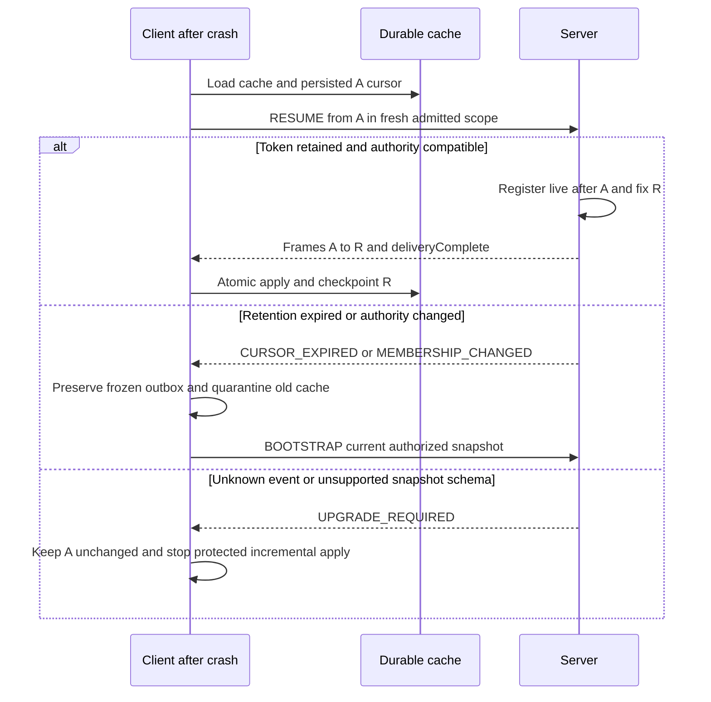

# Messaging API Contract V1 Draft FIX3

> **Local publication candidate — identified public-safe derivative; owner clearance and final publication authorization pending.**
> Source F is a historical snapshot. Source measurements identify the internal original, not these derivative bytes. See [README](README.md) and [artifact manifest](artifact-manifest.md). Historical findings/status statements below remain dated evidence; later status is separately described in README.


**DRAFT — FOR TV1 / TV2 / TV3 REVIEW — NOT APPROVED FOR PRODUCTION IMPLEMENTATION.**

## 1. Scope status and source inventory

**Full contract status: PENDING.** TV2-CONTRACT-01C-FIX3, 2026-11-25. Direct baseline: FIX2 Draft SHA256 9E361198B1DDFCCC4B31D703D241438C44A931B3FFB7075AB4A49E83DCDCBD0C. Read with [Decision Register FIX3](MESSAGING_API_V1_DECISION_REGISTER_FIX3.md) and [Resolution Report FIX3](MESSAGING_API_V1_FIX3_RESOLUTION_REPORT.md). Original01C, R2 and R3 verdicts remain historical input evidence. All MUST/SHALL language is normative **within the proposed design only**; no team policy or production implementation is approved.

This complete candidate preserves FIX2 except R3-01 (paired old-period retry concealment), R3-02 (schema-trace table continuity) and R3-03 (D27 control count in the register), plus necessary revision metadata/references. Independent R3 verdict C REQUEST TARGETED CONTRACT REVISIONS, SHA256 70F7F5A30BE92B34E8015E501CA31E62E29DB2B6292C215B6AF0DA1EC009DDBF, is input evidence, not approval. All three corrections have status **REVISION PROPOSED — AWAITING TARGETED INDEPENDENT VERIFICATION**. All eleven immutable input hashes are inventoried in the FIX3 report. No implementation, API expansion, migration, Foundation Sync, Coordinator/PR review or automatic independent review is authorized.

Target repository [target repository], feature/messaging @ ea239b9f66a153ac9f848fd089e5d4dd8b8874e4; clean working tree/index verified before writing. IDE review worktree is not baseline. Inputs read completely and hashed:
- Original Draft: 070442D06C21958F8E50F2EF0CE7BDB75866AF034C2DC66078DDBCED47A2A8CE.
- Original Register: B05D676D06B93FA42375A5FE2F6E2DDCB2CEAB8CEED556ACAFE44AE32F7E3F83.
- Independent Review: B9D7960DA78FEC56D7F172FC3D3EFC6E9D8A6D78677D633A814756E6AE40A4F5.

| Source | Exact inventory and evidence | Limitation |
| --- | --- | --- |
| S1 MASTER | [private source S1 MASTER; location and private-document fingerprint withheld]; v2.0; §3/5/7/8, CHAT/GROUP/MEDIA/ROT and B.2–B.10 | Same hash as01C; selected OOXML body evidence from01C, no new visual/track-changes audit |
| S2 Technical02 | [private source S2 Technical02; location and private-document fingerprint withheld]; §4–7/10 | Proposal and blank agreement fields; no scoped wire approval |
| S3 Foundation ledger | [internal foundation ledger] §6–7, inspected01C | Historical HEAD/dirty/counts stale; relayed foundation approval only |
| S4 Messaging and Session V2 | Pinned target app/src/main/java/com/nexa/chat/feature/messaging/{DAY1_DECISIONS.md,model,repository,ui}; feature/auth/session/{SessionRepository,SessionSnapshot,CredentialProvider}.java | Local foundation/provisional ports; no production REST/WS/Room proof |
| S4T FIX4 | app/src/test/java/com/nexa/chat/feature/messaging/ui/MessagingFix4Test.java at target pin; reservation, observer and startup tests | Source inspection only, no test run in FIX1 |
| S5 GROUP-01 | Git d2141e2560d8d6ba198942c944a69a963c133923; docs/group-01/{README,backend-baseline-proposal,session-v2-integration}.md; backend/.../groups/{GroupMapper,GroupService,GroupContracts,GroupController,GroupConfiguration,GroupDirectory}.java; conversation/{Conversation,ConversationMember}.java; V1__shared_conversations_and_group_invitations.sql | Snapshot/proposal, not deployment/approval. Mapper/member/migration rechecked; broader inventory from01C, not exhaustive new audit |
| S6 Coordinator | Git1c459c517cbfea06d1c071554a05c894157e157e app/src/main/java/com/nexa/chat/core/session/SessionCoordinator.java | Read immutable object; not TV2-approved hook failure/suspension contract |
| S7 Current instruction | TV2-CONTRACT-01C-FIX1 and FIX1-ADDENDUM documentation-only tasks | CORE-04A FIX1 and TV2-R13-01 unresolved until verified new revision; no Foundation Sync |
| S9 TV3 architecture communication | User-provided Phase 1 Foundation Architecture Audit communication: TV3 D-01,D-02,D-03,D-04,D-05,D-07,D-10 | TV3-confirmed architecture direction only; full audit artifact/decision ledger not supplied or read; no TV1 approval inferred |
| S8 Historical artifacts | [unavailable original source audit] and [unavailable previous contract draft] under contract folder | Both exact paths return File not found; MISSING EVIDENCE |

SPECIFIED means source requirement, IMPLEMENTED means inspected behavior, PROPOSED means unapproved design, and APPROVED requires scoped explicit evidence. No source code, fake, test result, unrelated PR or general architecture approval closes a wire decision.

Full project P0 includes real DIRECT/GROUP realtime, IMAGE/FILE/basic VIDEO, Auth/Contacts, i18n, rotation and durable state/recovery. Initial TEXT REST remains a limited executable slice; it does not reduce P0. Reply/edit/revoke and translation activation remain later gates; baseline version/redaction compatibility is designed now.

### 1.1 TV3 architecture alignment addendum

Evidence S9 is exactly the user-provided TV3 Phase 1 Architecture Audit communication received for this Addendum. It confirms the following TV3 architecture directions, not the full Architecture Audit artifact or Architecture Decision Ledger. No date/signature/URL for an unseen artifact is invented; no TV1 concurrence inferred. Architecture identifiers **D-01** etc use a hyphen and are distinct from Messaging decision identifiers **D01** etc without a hyphen.

| TV3 architecture ID | Attributed architecture direction (summary) | Affected Draft sections | Messaging decision IDs | Related findings | Acceptance cases | Remaining wire/schema/policy decisions | Approval scope and evidence limit |
| --- | --- | --- | --- | --- | --- | --- | --- |
| D-01 | Modular Monolith with one deployable backend. | §1, §11, §17 | D08 | IR-14, CR-09 | AT07, IT09, IT14 | Deployment/migration registry, domain boundaries, physical lock strategy and atomic account fanout remain OPEN. | TV3-confirmed direction via S9; no full artifact/ledger or TV1 sign-off verified; Messaging records stay OPEN/CONFLICT. |
| D-02 | DIRECT and GROUP share Conversation UUID identity and the Message pipeline. | §3, §4, §11, §12 | D02 D08 D25 D26 | CR-04, CR-10, IR-15 | AT01, AT18, IT04, IT10, IT15 | GROUP projection/version adapter, invitation integration and DIRECT period semantics remain OPEN. | TV3-confirmed direction via S9; no full artifact/ledger or TV1 sign-off verified; Messaging records stay OPEN/CONFLICT. |
| D-03 | Membership history is period-scoped; the default begins with the latest join. | §3, §10, §12 | D09 D10 D17 D25 | CR-04, IR-11 | AT18, AT24, IT04, IT11 | Exact transactional history boundary, previous-period exceptions, DIRECT period semantics, period lifetime and authority publication remain OPEN. | TV3-confirmed direction via S9; no full artifact/ledger or TV1 sign-off verified; Messaging records stay OPEN/CONFLICT. |
| D-04 | Historical TV3 architecture direction: for GROUP conversations, least-privilege access requires current ACTIVE membership and applicable membership-period authorization. This GROUP-specific requirement does not define DIRECT or Message Request authorization; their applicable Auth/Consent, current authorization and disclosure boundaries remain unchanged. | §2, §8, §9, §10, §12, §13 | D03 D05 D06 D09 D10 D12 D17 D18 D24 D29 | CR-01, CR-04, CR-05, IR-11, IR-16 | AT03, AT19, AT20, AT27, IT01, IT04, IT05, IT11, IT14, IT16 | Revocation admission/fence protocol, receipt visibility after LEFT/REMOVED, exceptions and signed-URL residual policy remain owner decisions. | TV3-confirmed direction via S9; no full artifact/ledger or TV1 sign-off verified; Messaging records stay OPEN/CONFLICT. |
| D-05 | Historical TV3 architecture material records server-authoritative sequence allocation with a transactional per-conversation message counter as a technical design direction. This is not approval of a shared physical transaction strategy or shared implementation; Physical Transaction remains DEFER. | §6, §11 | D08 D12 D13 | IR-14, CR-02 | AT09, IT02, IT14 | Counter schema, event-domain allocation, watermark proof, global lock order and deployed migration version remain OPEN. | TV3-confirmed direction via S9; no full artifact/ledger or TV1 sign-off verified; Messaging records stay OPEN/CONFLICT. |
| D-07 | Standardized REST/WS separates history cursors from replay cursors. | §4, §7, §8, §9, §14 | D01 D02 D11 D12 D15 D22 D27 | CR-02, CR-06, CR-10, IR-12, IR-13 | AT10, AT11, IT02, IT06, IT10, IT12, IT13 | Exact token/frame/endpoint types, schema version, expiry/crypto/account cursor and error mappings remain OPEN. | TV3-confirmed direction via S9; no full artifact/ledger or TV1 sign-off verified; Messaging records stay OPEN/CONFLICT. |
| D-10 | Messaging owns its runtime/router and supplies the TV1 integration adapter. | §2, §15, §17 | D07 D20 D21 D29 | IR-15, CR-09 | AT14, AT16, AT17, AT23, AT29, IT09, IT15 | Shared interface package/signatures, assembly, suspension/resource failure/cancellation contract need TV1/TV3 review; CORE-04A FIX1 and TV2-R13-01 unresolved. | TV3-confirmed direction via S9; no full artifact/ledger or TV1 sign-off verified; Messaging records stay OPEN/CONFLICT. |

S9 narrows architecture uncertainty only. The full project P0 and prior FIX1 normative proposals remain intact. Latest-join is now the TV3-confirmed default direction rather than merely an illustrative option; exact boundary/exception/receipt contracts still need owner decisions. This does not close any of the16 findings or approve wire fields, endpoint prefixes, schema, migrations or global lock order. Historical01A/previous draft remain MISSING EVIDENCE.

## 2. Authentication authorization and admission

PROPOSED D03–D07/D09/D11/D29. HTTPS/WSS bearer JWT validated by TV1 (signature, issuer, audience, expiry/revocation). JWT subject is authoritative UUID; local sessionEpoch is never sent as identity/credential. Actor/sender/role/status never accepted from client claims in messaging bodies. Missing authority fails closed.

| Operation | Current authorization | History and policy boundary |
| --- | --- | --- |
| DIRECT create/get | Existing distinct actor/peer plus relationship/block authority D05 | Canonical pair; authorization rechecked on retry |
| List/history/replay | Current ACTIVE membership; DIRECT participation semantics still D09 review | TV3 D-03 latest-join default and D-04 ACTIVE-only direction; exact bounds/exceptions OPEN, no LEFT/REMOVED new access admission |
| Send | ACTIVE eligible sender plus relationship/group send rules | Current action authority even for committed retries; new-send-only checks §5 |
| Read/delivered | Actor's eligible current period | Period/history revision match and eligible evidence prefix §10 |
| Typing | Current send eligibility and local genuine input | Never generated by restoration/render |
| Download | Current visibility of owning message and attachment | No public URL ownership shortcut; recall/removal policy §13 |
| Edit/revoke | Sender plus approved time/version rules for new mutation | No implicit group moderation |
| Account sync | Current authenticated actor and per-item visibility | Previously visible IDs only for removal; no unauthorized summary |

TV1 CredentialProvider.acquire(expectedEpoch,executor,callback) and afterAuthenticationRejected(rejectedCredential) remain transport-only interfaces. At actual dispatch and result mutation the adapter SHALL recheck the latest atomic SessionSnapshot state/user/epoch, not an observer payload. Same-user new epoch fences old callbacks. Same-epoch CHECKING/UNAVAILABLE suspends protected admission/render/read/typing while retaining isolated draft/outbox per proposed D29; resource recovery remains CORE-04A FIX1/D07 dependency.

Credential revision is distinct from scope epoch: late401 for R1 may use already-issued R2 without a second refresh; one bounded auth replay preserves frozen request/key.403 never triggers refresh. No shared Session lock may be held while calling feature cleanup, transport or callbacks. Physical cancellation and logical invalidation are separate; termination must remain charged until actually observed. Hidden Messages tab can continue authorized sync, but never emits READ/TYPING solely from sync.

### 2.1 TV1 architecture communication scope — affected R2-03 consistency

S10 is the external TV1 direction relayed in the FIX2 task, not independent source/ADR approval: JWT RS256; sub=User UUID; sid=server session ID; local sessionEpoch separate; shared CredentialProvider and SecurityFilterChain/JwtDecoder/TrustedPrincipal; single-flight refresh, bounded credential replay, server-side session revocation and HTTPS/WSS. Same-epoch CHECKING/UNAVAILABLE suspends protected presentation. TV1 owns Composition Root/cross-module navigation; TV2 owns Messaging runtime/router. Production fake isolation remains a gate before PR #9 integration, not implemented or independently verified here.

Token lifetimes, issuer, audience, OTP policy and endpoint details remain PROPOSED. The nexa-api versus nexa-chat-api audience conflict remains unresolved; this revision selects neither. No TV1 R01–R25 or F01–F09 contents, missing ADR D-08, full audit/ledger or historical approval are invented. Architecture D-01–D-10 identifiers are distinct from Messaging D01–D30. TV2-R13-01 and CORE-04A FIX1 remain unresolved pending exact new revision and independent evidence; no new Coordinator review is authorized.

## 3. DTO and wire schema

D02/D09/D10/D14/D15/D17/D18/D22/D27/D28 remain unapproved. JSON UTF-8; UUID canonical lowercase RFC version/variant shape; UTC ISO8601 Z instants. Sequence type decimal is an unsigned decimal string without leading zeros (except0), range0..9223372036854775807; positiveDecimal excludes0. Version/positiveInt is JSON integer1..2147483647 unless sizeBytes explicitly safe-integer cap; nonnegativeInt includes0. Revision fields are generation counters, not checkpoints. token is opaque nonempty string with server-enforced kind/binding, never decoded by clients.

All field tables are normative proposed required/nullable rules. Literal-null convention (R2-04): Type `literal null`, Presence R, Nullable Yes means the key MUST exist and its ONLY permitted value is JSON null; missing, number (including 0), string and boolean reject. This does not make the key optional. R means key required even when nullable; O means optional. Arrays contain no null elements. enum alternatives use commas to avoid Markdown column ambiguity. Request unknown fields reject400 INVALID_REQUEST; compatible response additive fields may be ignored, unknown event/snapshot schema follows §9. No body trim/Unicode normalization of frozen sends.

Server supplies all fields except explicit request fields. Immutable IDs/order/createdAt/ACK are never client-writable. Current body/version/receipt/metadata are server projections; changing them requires authorized mutation. Snapshot/token fields are issued only by server. Table naming is deliberate PROPOSED, not approval of alternatives.

### ConversationMemberDTO

| Field | Type | Presence | Nullable | Validation and semantics |
| --- | --- | --- | --- | --- |
| id | UUID | R | No | Stable current membership identity |
| conversationId | UUID | R | No | Existing conversation |
| userId | UUID | R | No | Server authoritative user |
| role | enum(OWNER, ADMIN, MEMBER) | R | No | DIRECT MEMBER proposal |
| status | enum(ACTIVE, LEFT, REMOVED) | R | No | Invitation is separate |
| joinedAt | UTC | R | No | Current period start |
| leftAt | UTC | R | Yes | Null ACTIVE |
| membershipPeriodId | UUID | R | No | Stable per join; never reused |
| roleRevision | positiveDecimal | R | No | Role-only revision; not period identity |
| authorityRevision | positiveDecimal | R | No | Current actor access generation |
| historyRevision | positiveDecimal | R | No | Visible interval generation |
| visibleIntervals | VisibleInterval[] | R | No | Ordered disjoint intervals; S9 latest-join default; exact bounds/exceptions OPEN D09 |

### VisibleInterval

| Field | Type | Presence | Nullable | Validation and semantics |
| --- | --- | --- | --- | --- |
| from | positiveDecimal | R | No | Inclusive authorized message-sequence lower bound |
| through | decimal | R | Yes | Inclusive upper; null is open |

### ConversationDTO

| Field | Type | Presence | Nullable | Validation and semantics |
| --- | --- | --- | --- | --- |
| id | UUID | R | No | Server identity |
| type | enum(DIRECT, GROUP) | R | No | Shared identity system |
| title | string | R | No | 1..120 code points candidate |
| avatarUrl | https | R | Yes | Private attachment bypass forbidden |
| createdAt | UTC | R | No | Server time |
| updatedAt | UTC | R | No | >=createdAt |
| lastServerSequence | decimal | R | No | Authorized committed message watermark |
| myMembership | ConversationMemberDTO | R | No | Actor projection |

### MessageDTO

| Field | Type | Presence | Nullable | Validation and semantics |
| --- | --- | --- | --- | --- |
| messageId | UUID | R | No | Immutable server ID |
| clientMessageId | UUID | R | No | Original logical send ID |
| conversationId | UUID | R | No | Path identity |
| senderId | UUID | R | No | JWT-derived actor |
| type | enum(TEXT, IMAGE, FILE, VIDEO, VOICE) | R | No | VOICE disabled pending approval |
| body | string | R | Yes | TEXT nonblank <=16000 UTF8 bytes unless tombstone; media caption nullable |
| attachmentIds | UUID[] | R | No | Ordered distinct original refs; [] TEXT and revoked |
| replyToMessageId | UUID | R | Yes | Same conversation authorized target; no excerpt |
| serverSequence | positiveDecimal | R | No | Message domain; positive committed order |
| version | positiveInt | R | No | Current resource version |
| createdAt | UTC | R | No | Immutable original server time |
| editedAt | UTC | R | Yes | >=createdAt |
| revokedAt | UTC | R | Yes | >=createdAt; body null and refs empty |

### SendMessageRequest

| Field | Type | Presence | Nullable | Validation and semantics |
| --- | --- | --- | --- | --- |
| clientMessageId | UUID | R | No | Generated once at confirmed send |
| type | enum(TEXT, IMAGE, FILE, VIDEO, VOICE) | R | No | Initial slice TEXT |
| body | string | R | Yes | Frozen exact code points; TEXT nonblank |
| attachmentIds | UUID[] | R | No | Frozen order; [] initial TEXT |
| replyToMessageId | UUID | R | Yes | Null initial slice |

### MessageAcknowledgement

| Field | Type | Presence | Nullable | Validation and semantics |
| --- | --- | --- | --- | --- |
| messageId | UUID | R | No | Original server identity |
| clientMessageId | UUID | R | No | Original request ID |
| conversationId | UUID | R | No | Original path |
| senderId | UUID | R | No | Authenticated origin actor |
| serverSequence | positiveDecimal | R | No | Original committed message sequence |
| createdAt | UTC | R | No | Original creation time |
| persisted | boolean | R | No | Always true; after commit |

### ReceiptDTO

| Field | Type | Presence | Nullable | Validation and semantics |
| --- | --- | --- | --- | --- |
| receiptId | UUID | R | No | Stable receipt resource per user/period |
| conversationId | UUID | R | No | Conversation scope |
| userId | UUID | R | No | Receipt subject |
| membershipPeriodId | UUID | R | No | Evidence period; never infer from current membership |
| historyRevision | positiveDecimal | R | No | Eligible intervals generation |
| receiptVersion | positiveInt | R | No | Increases on evidence mutation |
| lastDeliveredSequence | decimal | R | No | 0 sentinel or eligible target in this period |
| lastReadSequence | decimal | R | No | 0 sentinel or eligible target; read<=delivered |
| evidence | enum(KNOWN, NONE, UNKNOWN) | R | No | KNOWN has authoritative row; NONE explicitly no evidence; UNKNOWN cursor0 is placeholder |
| updatedAt | UTC | R | No | Evidence boundary server time |

### ConversationSummaryDTO

| Field | Type | Presence | Nullable | Validation and semantics |
| --- | --- | --- | --- | --- |
| conversation | ConversationDTO | R | No | Current authorized actor view |
| summaryRevision | positiveDecimal | R | No | Per-actor conversation summary revision |
| lastMessage | MessageDTO | R | Yes | Last visible current version only |
| unreadCount | nonnegativeInt | R | No | Eligible incoming unread, no absence inference |
| myReceipt | ReceiptDTO | R | No | Actor/current period; explicit evidence state |

### AttachmentDTO

| Field | Type | Presence | Nullable | Validation and semantics |
| --- | --- | --- | --- | --- |
| id | UUID | R | No | Finalized identity |
| ownerId | UUID | R | No | Uploader actor |
| conversationId | UUID | R | No | Bound at init |
| mimeType | string | R | No | Verified bytes/MIME allowlist |
| sizeBytes | positiveInt | R | No | Approved cap; safe JSON integer |
| fileName | string | R | No | Sanitized display; no path |
| uploadStatus | enum(READY, ATTACHED, REVOKED) | R | No | Finalized lifecycle |
| createdAt | UTC | R | No | Server time |

### ReadCursorRequest

| Field | Type | Presence | Nullable | Validation and semantics |
| --- | --- | --- | --- | --- |
| membershipPeriodId | UUID | R | No | Current eligible period |
| historyRevision | positiveDecimal | R | No | Current interval generation |
| lastReadSequence | decimal | R | No | 0 no-op; eligible viewed prefix |

### DeliveredCursorRequest

| Field | Type | Presence | Nullable | Validation and semantics |
| --- | --- | --- | --- | --- |
| membershipPeriodId | UUID | R | No | Current eligible period |
| historyRevision | positiveDecimal | R | No | Current interval generation |
| lastDeliveredSequence | decimal | R | No | Durable received eligible prefix only |

### CreateDirectRequest

| Field | Type | Presence | Nullable | Validation and semantics |
| --- | --- | --- | --- | --- |
| peerUserId | UUID | R | No | Existing authoritative distinct peer |

### SendResult

| Field | Type | Presence | Nullable | Validation and semantics |
| --- | --- | --- | --- | --- |
| acknowledgement | MessageAcknowledgement | R | No | Immutable creation evidence |
| message | MessageDTO | R | No | Current authorized representation; §5.2 full-disclosure gate |

### ErrorResponse

| Field | Type | Presence | Nullable | Validation and semantics |
| --- | --- | --- | --- | --- |
| code | string | R | No | Canonical registry; unknown future response safe fallback |
| message | string | R | No | Safe generic text |
| requestId | UUID | R | No | Correlation ID |
| details | object | O | Yes | Public field/code only |
| retryAfterSeconds | nonnegativeInt | O | Yes | Advisory; no new automatic scheduler |

Examples span one fixture timeline: original send01:00:00Z, edit01:00:01Z and recall01:00:02Z; post-recall replay/page/list/account examples use tombstone v3, original Message/SendResult examples show the pre-recall send. Period sentinel0 is no evidence, not authorization to read all earlier sequence numbers.

Example schema: ConversationDTO; VALID.

```json
{
  "id": "33333333-3333-4333-8333-333333333333",
  "type": "DIRECT",
  "title": "Hội thoại mẫu",
  "avatarUrl": null,
  "createdAt": "2026-11-25T01:00:00Z",
  "updatedAt": "2026-11-25T01:00:00Z",
  "lastServerSequence": "1",
  "myMembership": {
    "id": "77777777-7777-4777-8777-777777777777",
    "conversationId": "33333333-3333-4333-8333-333333333333",
    "userId": "11111111-1111-4111-8111-111111111111",
    "role": "MEMBER",
    "status": "ACTIVE",
    "joinedAt": "2026-11-25T01:00:00Z",
    "leftAt": null,
    "membershipPeriodId": "99999999-9999-4999-8999-999999999999",
    "roleRevision": "1",
    "authorityRevision": "1",
    "historyRevision": "1",
    "visibleIntervals": [
      {
        "from": "1",
        "through": null
      }
    ]
  }
}
```
Example schema: MessageDTO; VALID.

```json
{
  "messageId": "55555555-5555-4555-8555-555555555555",
  "clientMessageId": "44444444-4444-4444-8444-444444444444",
  "conversationId": "33333333-3333-4333-8333-333333333333",
  "senderId": "11111111-1111-4111-8111-111111111111",
  "type": "TEXT",
  "body": "Xin chào",
  "attachmentIds": [],
  "replyToMessageId": null,
  "serverSequence": "1",
  "version": 1,
  "createdAt": "2026-11-25T01:00:00Z",
  "editedAt": null,
  "revokedAt": null
}
```
Example schema: SendMessageRequest; VALID.

```json
{
  "clientMessageId": "44444444-4444-4444-8444-444444444444",
  "type": "TEXT",
  "body": "Xin chào",
  "attachmentIds": [],
  "replyToMessageId": null
}
```
Example schema: MessageAcknowledgement; VALID.

```json
{
  "messageId": "55555555-5555-4555-8555-555555555555",
  "clientMessageId": "44444444-4444-4444-8444-444444444444",
  "conversationId": "33333333-3333-4333-8333-333333333333",
  "senderId": "11111111-1111-4111-8111-111111111111",
  "serverSequence": "1",
  "createdAt": "2026-11-25T01:00:00Z",
  "persisted": true
}
```
Example schema: ReceiptDTO; VALID.

```json
{
  "receiptId": "aaaaaaaa-aaaa-4aaa-8aaa-aaaaaaaaaaaa",
  "conversationId": "33333333-3333-4333-8333-333333333333",
  "userId": "11111111-1111-4111-8111-111111111111",
  "membershipPeriodId": "99999999-9999-4999-8999-999999999999",
  "historyRevision": "1",
  "receiptVersion": 1,
  "lastDeliveredSequence": "0",
  "lastReadSequence": "0",
  "evidence": "NONE",
  "updatedAt": "2026-11-25T01:00:00Z"
}
```
Example schema: ReadCursorRequest; VALID.

```json
{
  "membershipPeriodId": "99999999-9999-4999-8999-999999999999",
  "historyRevision": "1",
  "lastReadSequence": "0"
}
```

Additional request and media metadata fixtures:

Example schema: AttachmentDTO; VALID.

```json
{
  "id": "66666666-6666-4666-8666-666666666666",
  "ownerId": "11111111-1111-4111-8111-111111111111",
  "conversationId": "33333333-3333-4333-8333-333333333333",
  "mimeType": "image/jpeg",
  "sizeBytes": 1024,
  "fileName": "anh.jpg",
  "uploadStatus": "READY",
  "createdAt": "2026-11-25T01:00:00Z"
}
```
Example schema: DeliveredCursorRequest; VALID.

```json
{
  "membershipPeriodId": "99999999-9999-4999-8999-999999999999",
  "historyRevision": "1",
  "lastDeliveredSequence": "1"
}
```
Example schema: CreateDirectRequest; VALID.

```json
{
  "peerUserId": "22222222-2222-4222-8222-222222222222"
}
```

## 4. REST endpoint registry

API_PREFIX=/api/v1 is PROPOSED D01; all suffixes below share it. No bearer redirects to another origin. Server responses after writes are emitted only after transaction commit. Every endpoint/control error is one canonical code in §14; common error sets refer there rather than inventing codes.

| Method and suffix | Request and response | Authorization and behavior | Errors beyond common |
| --- | --- | --- | --- |
| POST /conversations/direct | CreateDirectRequest ->201 new or200 existing ConversationDTO | Server canonical unordered UUID pair, one conversation/two ACTIVE MEMBER memberships/counters0 atomically | SELF_CONVERSATION, INTERACTION_FORBIDDEN, AUTHORITY_UNAVAILABLE |
| GET /conversations | cursor optional account-list TRAVERSAL, snapshotToken optional account SNAPSHOT, limit1..100 default50 ->ConversationListPage | Snapshot item IDs/stable sort (activity timestamp desc, UUID tie-break), current item ACL/projection. No live offsets | INVALID_CURSOR, CURSOR_EXPIRED, RESYNC_REQUIRED |
| GET /conversations/{conversationId}/messages | cursor optional TRAVERSAL, snapshotToken optional SNAPSHOT, direction older/forward default older, limit1..100 default50 ->MessagePage | Newest if no cursor; token combination/forward bootstrap §7; no raw afterSequence replay | INVALID_CURSOR, CURSOR_EXPIRED, RESYNC_REQUIRED |
| POST /conversations/{conversationId}/messages | X-Membership-Period + SendMessageRequest ->201 new or200 fully disclosable identical committed retry SendResult | Normative logical branches §5, global physical lock order still OPEN §11 | IDEMPOTENCY_CONFLICT, FEATURE_NOT_ENABLED |
| POST /conversations/{conversationId}/read | ReadCursorRequest ->200 ReceiptDTO | Validate current period/history, target0 no-op, atomic max/read implies delivered, no events on no-op | INVISIBLE_TARGET, READ_CURSOR_OUT_OF_RANGE, MEMBERSHIP_CHANGED |
| POST /conversations/{conversationId}/delivered | DeliveredCursorRequest ->200 ReceiptDTO | Only after receiver durable cache commit, eligible prefix §10 | INVISIBLE_TARGET, READ_CURSOR_OUT_OF_RANGE, MEMBERSHIP_CHANGED |
| POST /realtime/subscriptions | BootstrapRequest ->201 BootstrapResponse | Authenticated connection.ready first; X-Realtime-Connection required; response binds receiving generation/subscription; embedded membership baseline; admission §9 | INVALID_CURSOR, CURSOR_EXPIRED, RESYNC_REQUIRED, UPGRADE_REQUIRED |
| GET /realtime/snapshots/{snapshotToken}/messages | cursor optional matching TRAVERSAL and limit ->MessagePage | Same S/H and resource as capability; current projection redaction | INVALID_CURSOR, CURSOR_EXPIRED, RESYNC_REQUIRED |
| GET /realtime/snapshots/{snapshotToken}/receipts | No body ->ReceiptSnapshot | Same H/authority/visibility; complete authorized roster §10 | CURSOR_EXPIRED, RESYNC_REQUIRED, MEMBERSHIP_CHANGED |
| POST /realtime/account-subscriptions | AccountSubscribeRequest ->201 AccountSubscribeResponse | Authenticated READY WSS + X-Realtime-Connection; separate account subscription; account snapshot+feed §9.8 | INVALID_CURSOR, CURSOR_EXPIRED, RESYNC_REQUIRED, UPGRADE_REQUIRED |
| POST /conversations/{conversationId}/typing | TypingCommand ->204 empty body | Server actor, connectionGeneration associated via authenticated transport, §10 | VALIDATION_ERROR, INTERACTION_FORBIDDEN |
| POST /media/uploads | UploadInitRequest ->201 UploadInitResponse | Current sender/file/storage authority §13 | IDEMPOTENCY_CONFLICT, FILE_TOO_LARGE, UNSUPPORTED_MEDIA_TYPE |
| POST /media/uploads/{uploadId}/complete | UploadCompleteRequest ->200 AttachmentDTO | Revalidate current authorization; same completed content idempotent | IDEMPOTENCY_CONFLICT, ATTACHMENT_UNAVAILABLE |
| GET /attachments/{attachmentId}/download | No body ->200 DownloadResponse | Owning message's current ACL/recall; proxy or signed URL §13 | ATTACHMENT_UNAVAILABLE |
| PATCH /messages/{messageId} | EditRequest ->200 MessageDTO | Future P1 sender/version/window; no type/attachment replacement | VERSION_CONFLICT, FEATURE_NOT_ENABLED |
| POST /messages/{messageId}/revoke | RevokeRequest ->200 MessageDTO | Future P1 sender/version/window, returns tombstone | VERSION_CONFLICT, FEATURE_NOT_ENABLED |

Common errors: INVALID_REQUEST, UNAUTHENTICATED, FORBIDDEN, NOT_FOUND, VALIDATION_ERROR, PAYLOAD_TOO_LARGE, UNSUPPORTED_MEDIA_TYPE, RATE_LIMITED, INTERNAL_ERROR, UNAVAILABLE, AUTHORITY_UNAVAILABLE as applicable. Malformed path UUID400; unseen resource404 concealed; prohibited action on known visible resource403 per D03. No endpoint emits LIMIT: malformed/out-of-range limit maps INVALID_REQUEST with safe field code. Exact query combinations in §7 override defaults; unexpected body/query fields reject.

Create-or-get DIRECT requires authoritative users, peer!=actor, accepted friendship/no block candidate D05; never provisions users. Canonical pair compares normalized UUID bytes in one agreed order, low!=high, pair unique and conversation type consistent. Concurrent A->B/B->A conflict is reconciled to same ID in a fresh valid transaction after winner commit; no second half-created conversation. Reauthorize after retry. No client Idempotency-Key needed for pair operation. Transaction strategy remains §11 candidate, not approved.

Send result example:

Example schema: SendResult; VALID.

```json
{
  "acknowledgement": {
    "messageId": "55555555-5555-4555-8555-555555555555",
    "clientMessageId": "44444444-4444-4444-8444-444444444444",
    "conversationId": "33333333-3333-4333-8333-333333333333",
    "senderId": "11111111-1111-4111-8111-111111111111",
    "serverSequence": "1",
    "createdAt": "2026-11-25T01:00:00Z",
    "persisted": true
  },
  "message": {
    "messageId": "55555555-5555-4555-8555-555555555555",
    "clientMessageId": "44444444-4444-4444-8444-444444444444",
    "conversationId": "33333333-3333-4333-8333-333333333333",
    "senderId": "11111111-1111-4111-8111-111111111111",
    "type": "TEXT",
    "body": "Xin chào",
    "attachmentIds": [],
    "replyToMessageId": null,
    "serverSequence": "1",
    "version": 1,
    "createdAt": "2026-11-25T01:00:00Z",
    "editedAt": null,
    "revokedAt": null
  }
}
```

## 5. Idempotency frozen payload and ACK

D14/D18/D20, CR-05/IR-15. Logical key=(JWT senderId,clientMessageId), account-wide. FrozenSend contains request schema version, path conversationId and exact SendMessageRequest fields. Canonical bytes sort object keys/standardize schema-prescribed null and canonical UUID, but preserve body code points, attachment order, reply target. Server time/status/token/epoch/translation never participate. Exact canonical-byte equality is proposed; digest is an index aid, not approved replacement.

### 5.1 Normative logical branch ordering

These are semantic branches, not instructions to acquire physical locks in this order. §11 supplies candidate lock strategies; none is approved.
1. Authenticate actor.
2. Safely resolve path resource and validate current resource/action authorization (minimal bounded UUID parsing needed to find it is permitted). Do not read/disclose idempotency store to unauthorized callers. Recheck current authority at commit/response-delivery admission.
3. Parse immutable request identity/schema/shape safely under size bounds; reject unknown fields/types. Mutable eligibility is deferred.
4. Find or reserve account key using the future agreed transaction strategy. Reservation cannot survive as false committed success.
5. If committed, compare original schema/path/payload with frozen bytes.
6. Before equality disclosure or any success/conflict, require current authorization for the committed message identity AND full ACK tuple AND current MessageDTO under §5.2; otherwise concealed404 NOT_FOUND with no key-existence signal. If identical and fully disclosable, return immutable creation ACK/current authorized MessageDTO even after edit/revoke or attachment ATTACHED/REVOKED/cleanup. Never restore original body. Response200 only after committed evidence confirmed.
7. If different,409 IDEMPOTENCY_CONFLICT only after §5.2 per-message/full-ACK disclosure gate, inside currently authorized scope. A changed target conversation that is not visible yields concealed/current authorization error, not stored key existence/payload.
8. If genuinely new, perform mutable new-send checks: enabled message/reply/media capability, body/type limits, currently visible same-conversation reply target, uploader/READY/unattached refs, time/quota/window where applicable. Initial TEXT requires [] and null reply; otherwise422 FEATURE_NOT_ENABLED. New-send authority remains mandatory.
9. Persist one message, original key evidence, counter allocation, attachment binding, durable event and account-summary effects atomically under agreed serialization. Rollback leaves no committed ACK/event/binding.
10. Emit ACK only after commit; broker failure/HTTP500/response loss after commit is unknown outcome, not proof of rollback.

READY/uploader/unattached checks are new-send-only. A committed identical retry does not re-evaluate reply target existence, feature rollout flag, attachment TTL/READY, new-send quota or elapsed send window. Current actor/resource/action authorization, safe schema compatibility and current disclosure policy still apply. If a current explicit security policy forbids serving any retry response, deny without exposing frozen data; do not relabel it payload conflict. New edit/revoke mutations have their own CAS/window rules; they are not a repeat of the original send.

A key used across conversations conflicts on frozen path when both are authorized. Retention must not allow a purged key to recreate a second message (§13.3). Late attempts never auto-generate a fresh client UUID to hide conflict.

### 5.2 Period-bound committed retry disclosure — R2-02

Preferred PROPOSED conservative branch: SendResult has no metadata-only or WITHHELD-message success variant. Return 200 only when current ACTIVE authority permits the stored message identity, every immutable ACK field and the complete current MessageDTO. If any part is unauthorized, use the canonical concealed 404 NOT_FOUND profile below, with no message/ACK/period/key metadata. Apply this gate before equality/conflict/reconciliation disclosure. In the paired undisclosable old-period context, otherwise identical requests differing only in hidden key commitment MUST receive equivalent semantic responses; absence of committed evidence cannot produce a different precondition error. A genuinely new current-period send still follows §5.1. Do not expose comparison result, storage lookup, original period or timing diagnostics. Timing/resource-side-channel elimination is not claimed; it requires TV1 review and implementation evidence.

All send requests require X-Membership-Period, a UUID captured from the installed requester baseline when the operation is confirmed. Retain it immutably as originMembershipPeriodId beside FrozenSend across retry/refresh/rotation/recovery; do not overwrite it with a new period. It is a precondition/binding header, not actor authorization and not a sessionEpoch. Canonical original schema/path/body/type/ref order/reply equality remains unchanged. Persist originMembershipPeriodId with the account-scoped key. Comparison also verifies the retry's original period binding; caller cannot relabel an operation. Missing/malformed header -> INVALID_REQUEST before protected key disclosure. This adds no endpoint or client-controlled sender.

FIX3 R3-01 proposed canonical concealed response for branches B/C/E and hidden F/G: HTTP 404; ErrorResponse.code=NOT_FOUND; safe default message="Resource not found." (the same approved localization for the same request locale); details=null and retryAfterSeconds=null, both keys emitted consistently. requestId and any correlation-only header may differ independently of key state. No ACK, MessageDTO, committed identity, equality result, sequence/version, reconciliation hint or commitment-dependent field is returned.

For the paired requests, relevant response-header names and semantic values MUST match: Content-Type: application/json, Cache-Control: no-store, no Retry-After or commitment/reconciliation hint header; any common TV1 security headers use the same key-independent policy. This profile is a proposed correction for owner review, not approved TV1/TV3 privacy or transport policy. It imposes semantic equivalence, not measured timing/size/transport indistinguishability.

Client recovery classification is the same concealed terminal denial for this attempt: no automatic send retry, credential refresh triggered by 404, rekey, origin-period rewrite or migration of pending P1 work into P2. Retain frozen clientMessageId/payload/originMembershipPeriodId and account-scoped uncertainty under existing policy; infer neither hidden ACK nor SENT nor proof of rollback. Any later explicit recovery requires current authorization and the existing same-key rules; no new automatic retry policy. Latest account UUID/epoch and operation fences still reject stale callbacks before state mutation.

MEMBERSHIP_CHANGED remains available for independently disclosable membership/period/history preconditions (§14), including receipt/snapshot/resume fencing. It MUST NOT replace this C/E concealed profile merely because the retired origin header is known. Any other retained use must have the same semantic outcome for otherwise identical absent/hidden-key requests when commitment is undisclosable; if that cannot be satisfied, conceal rather than reveal the key-dependent branch.

| Branch | Current authorized wire outcome | Forbidden outcome |
| --- | --- | --- |
| A Same-period committed identical | After full disclosure gate and exact original equality, 200 SendResult, same original ACK/current projection, no new write/event/binding | READY check, second identity, original recalled body |
| B Removed requester retries | Concealed404 NOT_FOUND, regardless of key presence/equality | ACK, conflict, reconciliation or key-existence disclosure |
| C Rejoined P2, P1 committed message outside current intervals | Canonical concealed404 NOT_FOUND, semantically equivalent to E even if current send allowed; committed key remains reserved | Hidden ACK/MessageDTO/identity, comparison or reconciliation hint, automatic rekey or distinguishable C/E response |
| D Rejoined P2, P1 committed message still visible by explicitly approved exception | Only if full ACK/current MessageDTO AND current action authorized: exact frozen/origin binding ->200 same ACK; else concealed denial | Selecting the exception in this document, resetting identity or new binding |
| E Old P1 uncommitted pending send after P2 | Concealed404 NOT_FOUND using the same semantic response profile as C; no committed evidence does not grant new P2 send authority. Zero new message/event/binding writes | 404-versus-409 or error/detail/header/recovery discriminator; automatic origin-period rewrite, resend, rekey or treating absence as committed |
| F Changed payload/path/origin binding using committed key | Only after full committed-message disclosure gate:409 IDEMPOTENCY_CONFLICT. Unauthorized target/history ->concealed404 before comparison outcome | Conflict as hidden-key oracle, mutate original or retry with new key automatically |
| G Original payload purged | First current full-disclosure gate; approved purge policy ->409 RECONCILIATION_REQUIRED, permanent identity reservation, never success based on hash alone. Unexpected loss while exact-byte policy active ->503 UNAVAILABLE | Free key, second message, claim exact equality from digest, reveal concealed history |

Current action authorization is necessary but not equivalent to message history visibility. C cannot fall through to new-send checks or expose identity merely because the sender originally authored it. ReconciliationRequired is not emitted for a concealed key. D remains conditional on TV3 history and TV1 privacy approval; latest-join default is unchanged. Metadata-only outcome lookup is an explicit alternative requiring a separately reviewed schema/endpoint/privacy oracle and TV1/TV3 approval before use; not enabled here.

For a genuinely new key with current original period, retain §5.1 mutable new-send checks and post-commit ACK. For a committed key, the origin period is provenance, not current permission; a current approved visible exception can allow D without rewriting provenance. Two requests racing removal/commit serialize under §11/§12.1: persisted commit stays committed, while any later response/retry admission obeys present disclosure. Frozen pending P1 work is retained as uncertainty and requires explicit policy/user recovery, never inherits P2 authority. Capability period binding in §7/§9.1a invalidates retired snapshot/resume/traversal even when counters coincide.

Deterministic walkthrough: P1 sends K/seq10, commit succeeds and ACK is lost; removal, then P2 visibleFrom30. Identical K/original P1 header ->404, same as concealed/no permissible key result; rows/events/bindings remain one. Changed K also ->404. If an approved exception exposes seq10/full ACK, identical ->200 and changed ->409, still one row. The otherwise identical request with K absent/uncommitted in P1 ->the same concealed404 profile as hidden K, including changed-payload and post-refresh attempts, and zero new message/event/binding writes. A separate uncommitted retired P1 operation has the same denial; its origin period/key are never rewritten. Purge never frees K. D09/D14 with D03/D18/D20/D21; IT04/IT05/IT15 and AT05/AT06/AT08/AT18/AT19.

### 5.3 ACK reconciliation

REST and message.created carry identical tuple(conversationId,senderId,clientMessageId,messageId,serverSequence,createdAt,persisted=true). ACK is creation evidence, never mutable body evidence. Validate tuple against original operation and current account scope before apply. Identical repeated ACK no-op; contradictory tuple protocol conflict ->resync, never overwrite identity. WS-before-REST and REST-before-WS converge; late ACK can reconcile FAILED/requeued PENDING to SENT without clearing a newer draft revision. Current resource projection merges separately by version/redaction (§8/15). Epoch mismatch drops the old callback even if same user logged in again; persisted recovery is newly admitted work after current reauthentication.

## 6. Ordering versions and sequence domains

D12/D13/D22/D28. serverSequence is per-conversation immutable positive message order. Candidate counter row lock remains held through commit; committed watermark never passes a lower reserved sequence that could later commit. Rollback/deletion gaps are allowed only with server-authoritative completeness; clients never await every integer. Plain DB auto-increment allocated before commit cannot by itself prove a safe watermark. Commit-range tracking is an alternative requiring equivalent proof.

Conversation eventSequence orders all durable mutations (message create/update/revoke, receipts and authority-log changes), separate from message order. Internal membership changes may occupy filtered positions; they are represented by invalidation controls/coverage, not an invented approved public member event. Account accountSequence has its own per-account log, not a global message/event maximum. A/H/R refer to event coverage within one conversation or explicitly identified account stream; S refers only to message sequence. No arithmetic comparison across domains.

Message version begins1, increases atomic CAS on edit/revoke. event.originalMutation.resourceVersion records version at mutation; projection.effectiveVersion records current delivered representation. createdAt/event occurredAt do not order commits. Tombstone/current-version floors and stricter disclosure survive stale pages, old events and list previews. Equal effective version with conflicting content in the same authority/projection mode is a protocol conflict; different authorized disclosure modes obey §8. No device-time last-write-wins.

RoleRevision, historyRevision, authorityRevision and summaryRevision are revision domains, never resume checkpoints. D28 baseline schema/version merge is an initial design gate although P1 endpoint activation is later.

## 7. Cursor taxonomy and endpoint page schemas

D15/D12, CR-06/IR-13. Server signs/encrypts token or holds equivalent opaque server state. Clients never manufacture a checkpoint from raw sequence or decode a token. Token secret rotation/expiry policy remains OPEN.

| Token kind | Purpose and binding | Consumption and invalidity |
| --- | --- | --- |
| SNAPSHOT conversation | Actor, resource, membershipPeriodId, role/authority/history revisions, S/H, schema, expiry; no direction | Open baseline pages/receipts or bootstrap a new forward range; not a resume token |
| SNAPSHOT account | Actor, H_account, stable list item identities/sort keys, account generation/schema/expiry | Open list traversal only; not message sequence |
| TRAVERSAL | Actor, endpoint/resource, snapshot identity, conversation period and role/authority/history revisions (or account generation for list), fixed direction, lower-exclusive and upper-inclusive range, sort continuation, schema/expiry | Same endpoint/direction; may repeat until expiry; nextCursor only continues this traversal |
| CONVERSATION_RESUME | Actor, conversation, membershipPeriodId, role/authority/history revisions, covered event boundary, schema/retention | Resume conversation from persisted A; never pagination |
| ACCOUNT_RESUME | Actor, covered account boundary, account generation/schema/retention | Account feed resume only; never conversation event cursor |

For message queries no cursor/no snapshotToken starts newest: server fixes S/H under §9 boundary, selects newest N message identities <=S, returns ascending page and older TRAVERSAL. With snapshotToken/no cursor and direction older, fetch newest N from that fixed snapshot. Older traversal range is (0,S], next continuation is exclusive before the previous minimum; identities stable, current projection may be more restrictive/newer. An empty page has []/nextCursor=null.

Forward bootstrap requires **snapshotToken**, direction=forward and no cursor; it does not accept an older TRAVERSAL as seed. Server fixes a new safe S2 and queries (S,S2], issues forward nextCursor with fixed range and snapshotToken2 at S2/H2. All continuations keep S2/H2. Completing the forward range returns nextCursor=null and snapshotToken2 for a later forward bootstrap. Repeating the original snapshot capability for forward bootstrap may intentionally create a new range with a later S2; it is a new read, not an idempotent traversal continuation. To repeat exactly one range reuse its returned TRAVERSAL cursor or response cache/request correlation retained by client. Repeat of a TRAVERSAL has fixed identities/range until expiry (ACL/redaction can remove/change representation); repeat of capability has only snapshot access semantics. No forward-created-message catch-up claims edit/receipt mutation replay.

A request with cursor plus conflicting direction/resource/snapshotToken rejects INVALID_CURSOR. Account list disallows forward direction, materializes stable list keys, no global conversation sequence. Wrong kind/signature/account/direction ->400 INVALID_CURSOR without revealing binding. Expiry ->409 CURSOR_EXPIRED; authority/history changes ->409 RESYNC_REQUIRED or MEMBERSHIP_CHANGED according to §14, no silent rebase. Current ACL evaluated on every request even for valid tokens.

### ConversationListPage

| Field | Type | Presence | Nullable | Validation and semantics |
| --- | --- | --- | --- | --- |
| items | ConversationSummaryDTO[] | R | No | Snapshot item identities/current authorized projections |
| nextCursor | token | R | Yes | TRAVERSAL account list fixed range; null end |
| snapshotToken | token | R | No | SNAPSHOT account capability; no direction |
| snapshotAccountSequence | decimal | R | No | Account feed domain only |
### MessagePage

| Field | Type | Presence | Nullable | Validation and semantics |
| --- | --- | --- | --- | --- |
| membershipPeriodId | UUID | R | No | Requester period bound by conversation snapshot |
| roleRevision | positiveDecimal | R | No | Requester role revision bound by snapshot |
| authorityRevision | positiveDecimal | R | No | Requester authority revision bound by snapshot |
| historyRevision | positiveDecimal | R | No | Requester interval revision bound by snapshot |
| items | MessageDTO[] | R | No | Ascending serverSequence; max approved limit |
| nextCursor | token | R | Yes | TRAVERSAL direction/range-bound; null end |
| snapshotToken | token | R | No | SNAPSHOT conversation capability |
| snapshotServerSequence | decimal | R | No | S message domain; no account/global max |
| snapshotEventBoundary | decimal | R | No | H event domain; snapshot reconciliation barrier |

List page excludes snapshotServerSequence entirely; message page requires both S and H. No generic required watermark is shared across endpoints.

Example schema: ConversationListPage; VALID.

```json
{
  "items": [
    {
      "conversation": {
        "id": "33333333-3333-4333-8333-333333333333",
        "type": "DIRECT",
        "title": "Hội thoại mẫu",
        "avatarUrl": null,
        "createdAt": "2026-11-25T01:00:00Z",
        "updatedAt": "2026-11-25T01:00:02Z",
        "lastServerSequence": "1",
        "myMembership": {
          "id": "77777777-7777-4777-8777-777777777777",
          "conversationId": "33333333-3333-4333-8333-333333333333",
          "userId": "11111111-1111-4111-8111-111111111111",
          "role": "MEMBER",
          "status": "ACTIVE",
          "joinedAt": "2026-11-25T01:00:00Z",
          "leftAt": null,
          "membershipPeriodId": "99999999-9999-4999-8999-999999999999",
          "roleRevision": "1",
          "authorityRevision": "1",
          "historyRevision": "1",
          "visibleIntervals": [
            {
              "from": "1",
              "through": null
            }
          ]
        }
      },
      "summaryRevision": "1",
      "lastMessage": {
        "messageId": "55555555-5555-4555-8555-555555555555",
        "clientMessageId": "44444444-4444-4444-8444-444444444444",
        "conversationId": "33333333-3333-4333-8333-333333333333",
        "senderId": "11111111-1111-4111-8111-111111111111",
        "type": "TEXT",
        "body": null,
        "attachmentIds": [],
        "replyToMessageId": null,
        "serverSequence": "1",
        "version": 3,
        "createdAt": "2026-11-25T01:00:00Z",
        "editedAt": "2026-11-25T01:00:01Z",
        "revokedAt": "2026-11-25T01:00:02Z"
      },
      "unreadCount": 0,
      "myReceipt": {
        "receiptId": "aaaaaaaa-aaaa-4aaa-8aaa-aaaaaaaaaaaa",
        "conversationId": "33333333-3333-4333-8333-333333333333",
        "userId": "11111111-1111-4111-8111-111111111111",
        "membershipPeriodId": "99999999-9999-4999-8999-999999999999",
        "historyRevision": "1",
        "receiptVersion": 1,
        "lastDeliveredSequence": "0",
        "lastReadSequence": "0",
        "evidence": "NONE",
        "updatedAt": "2026-11-25T01:00:00Z"
      }
    }
  ],
  "nextCursor": null,
  "snapshotToken": "opaque-account-snapshot",
  "snapshotAccountSequence": "5"
}
```
Example schema: MessagePage; VALID.

```json
{
  "items": [
    {
      "messageId": "55555555-5555-4555-8555-555555555555",
      "clientMessageId": "44444444-4444-4444-8444-444444444444",
      "conversationId": "33333333-3333-4333-8333-333333333333",
      "senderId": "11111111-1111-4111-8111-111111111111",
      "type": "TEXT",
      "body": null,
      "attachmentIds": [],
      "replyToMessageId": null,
      "serverSequence": "1",
      "version": 3,
      "createdAt": "2026-11-25T01:00:00Z",
      "editedAt": "2026-11-25T01:00:01Z",
      "revokedAt": "2026-11-25T01:00:02Z"
    }
  ],
  "nextCursor": null,
  "snapshotToken": "opaque-conversation-snapshot",
  "snapshotServerSequence": "1",
  "snapshotEventBoundary": "3",
  "membershipPeriodId": "99999999-9999-4999-8999-999999999999",
  "roleRevision": "1",
  "authorityRevision": "1",
  "historyRevision": "1"
}
```
Example schema: ConversationListPage; INVALID (expected rejection); Endpoint schema forbids message watermark on list.

```json
{
  "items": [],
  "nextCursor": null,
  "snapshotToken": "opaque-account-snapshot",
  "snapshotAccountSequence": "5",
  "snapshotServerSequence": "1"
}
```
Example schema: MessagePage; INVALID (expected rejection); Missing required snapshotServerSequence.

```json
{
  "items": [],
  "nextCursor": null,
  "snapshotToken": "opaque-conversation-snapshot",
  "snapshotEventBoundary": "1",
  "membershipPeriodId": "99999999-9999-4999-8999-999999999999",
  "roleRevision": "1",
  "authorityRevision": "1",
  "historyRevision": "1"
}
```

## 8. Realtime registry and authorized projections

D11/D12/D19/D27/D28; CR-01/CR-07. Native WSS API_PREFIX/realtime uses bearer handshake and the first server connection.ready control defined in §8.1 before any REST subscription admission. REST subscription admission requires association with that authenticated READY connection via X-Realtime-Connection containing its server-issued receiving connectionGeneration (an opaque correlation identity, never sufficient authorization). Same generation header binds typing ingress; server checks owner/connection liveness. Protected stream expires/revokes with credentials/authority, sends safe sync.error and closes or requires bounded reconnect through CredentialProvider. No authentication secrets (bearer JWT, refresh token or authentication ticket) in URLs. Snapshot capabilities used in documented REST paths are different opaque, actor-bound secrets: suppress/redact path and query values in HTTP/access/APM/crash logs, analytics and Referer; use TLS, expiry and current ACL checks, never treat possession as authentication. Domain events use type/payload; controls are a separate union.

| Registry type | Schema | Durability/domain | Decision and acceptance references |
| --- | --- | --- | --- |
| message.created | MessageEvent, acknowledgement nonnull | Conversation event log | D12/D14/D27; AT05, IT01/IT02/IT15 |
| message.updated | MessageEvent, acknowledgement null | Conversation event log, P1 activation | D19/D28; AT25, IT01/IT15 |
| message.revoked | MessageEvent, acknowledgement null | Conversation event log, P1 activation | D19/D28; AT25, IT01/IT15 |
| receipt.delivered | ReceiptEvent | Conversation event log | D10/D16/D17; AT13, IT04/IT11 |
| receipt.read | ReceiptEvent | Conversation event log | D10/D17; AT24, IT04/IT11 |
| typing.started | TypingEvent | Ephemeral eventSequence=null | D16/D27; IT07 |
| typing.stopped | TypingEvent | Ephemeral eventSequence=null | D16/D27; IT07 |
| conversation.summary.upsert | AccountEvent, summary nonnull | Account log | D12/D15/D27; IT03 |
| conversation.summary.invalidate | AccountEvent, summary null | Account log | D12/D15/D27; IT03 |
| conversation.access.removed | AccountEvent, summary null | Account log | D09/D12/D27; IT03 |
| deliveryComplete | DeliveryComplete | Control only; coverage of named subscription | D12/D21; IT02 |
| applied | AppliedReport | Optional client control; no receipt side effect | D12/D21; IT02 |
| sync.error | ControlError | Safe control; no checkpoint advancement | D03/D12/D27; IT02/IT12 |
| connection.ready | ConnectionReady | Server connection control before subscribe, no stream checkpoint | D11/D27; IT02/AT27/IT15 |
| subscription.close | SubscriptionClose | Client disposal control, no domain mutation | D11/D12/D27; IT02/IT15 |
| subscription.closed | SubscriptionClosed | Server disposal/replacement acknowledgement, no checkpoint | D11/D12/D27; IT02/IT15 |

Public domain event count is10 (original7 plus account3), control count6 (deliveryComplete, applied, sync.error, connection.ready, subscription.close, subscription.closed). Internal authority mutations are coverage/filter inputs; clients receive sync.error RESYNC_REQUIRED/MEMBERSHIP_CHANGED when their stream generation becomes stale. No undefined membership payload is assumed. New event/control schema cannot be activated until TV1/TV2/TV3 review. Routing metadata is not part of immutable event identity; §8.1 defines its lifetime.

### OriginalMutation

| Field | Type | Presence | Nullable | Validation and semantics |
| --- | --- | --- | --- | --- |
| resourceId | UUID | R | No | Immutable resource identity |
| resourceVersion | positiveInt | R | No | Version when immutable mutation committed |

### MessageProjection

| Field | Type | Presence | Nullable | Validation and semantics |
| --- | --- | --- | --- | --- |
| effectiveVersion | positiveInt | R | No | Current resource version >=originalMutation version |
| mode | enum(CURRENT, TOMBSTONE, WITHHELD) | R | No | WITHHELD has resource null; identity disclosure allowed |
| authorityRevision | positiveDecimal | R | No | Checked at delivery admission |
| historyRevision | positiveDecimal | R | No | Checked at delivery admission |
| resource | MessageDTO | R | Yes | Current authorized representation or null WITHHELD |

### MessageEventPayload

| Field | Type | Presence | Nullable | Validation and semantics |
| --- | --- | --- | --- | --- |
| originalMutation | OriginalMutation | R | No | No original content bytes on wire |
| projection | MessageProjection | R | No | Recipient-authorized mutable projection |
| acknowledgement | MessageAcknowledgement | R | Yes | Present only created; null otherwise |

### MessageEvent

| Field | Type | Presence | Nullable | Validation and semantics |
| --- | --- | --- | --- | --- |
| subscriptionId | UUID | R | No | Receiving subscription identity; routing only, not immutable durable event identity |
| connectionGeneration | UUID | R | No | Receiving authenticated WSS generation; must match local READY transport |
| eventId | UUID | R | No | Immutable through replay |
| type | enum(message.created, message.updated, message.revoked) | R | No | Immutable original mutation type |
| schemaVersion | positiveInt | R | No | 1 proposed |
| conversationId | UUID | R | No | Authorized identity |
| eventSequence | positiveDecimal | R | No | Conversation event domain |
| occurredAt | UTC | R | No | Immutable original event time |
| payload | MessageEventPayload | R | No | Recipient-authorized projection; no immutable original body |

### ReceiptEventPayload

| Field | Type | Presence | Nullable | Validation and semantics |
| --- | --- | --- | --- | --- |
| originalMutation | OriginalMutation | R | No | Receipt resource ID/version at mutation |
| authorityRevision | positiveDecimal | R | No | Recipient authority |
| historyRevision | positiveDecimal | R | No | Recipient visibility generation |
| receipt | ReceiptDTO | R | No | Current authorized subject/period projection |

### ReceiptEvent

| Field | Type | Presence | Nullable | Validation and semantics |
| --- | --- | --- | --- | --- |
| subscriptionId | UUID | R | No | Receiving subscription identity; routing only, not immutable durable event identity |
| connectionGeneration | UUID | R | No | Receiving authenticated WSS generation; must match local READY transport |
| eventId | UUID | R | No | Immutable |
| type | enum(receipt.delivered, receipt.read) | R | No | Original mutation type |
| schemaVersion | positiveInt | R | No | 1 |
| conversationId | UUID | R | No | Authorized |
| eventSequence | positiveDecimal | R | No | Conversation event domain |
| occurredAt | UTC | R | No | Original mutation time |
| payload | ReceiptEventPayload | R | No | Current authorized period-specific receipt |

### TypingCommand

| Field | Type | Presence | Nullable | Validation and semantics |
| --- | --- | --- | --- | --- |
| typingId | UUID | R | No | Fresh logical typing session; bound to current connection |
| revision | positiveDecimal | R | No | Monotonic within typingId |
| action | enum(START, STOP) | R | No | STOP terminal for this ID |

### TypingPayload

| Field | Type | Presence | Nullable | Validation and semantics |
| --- | --- | --- | --- | --- |
| userId | UUID | R | No | Server derives actor |
| typingId | UUID | R | No | Server-validated session ID |
| originConnectionGeneration | UUID | R | No | Originating device connection, not receiving transport generation; §10.4 |
| revision | positiveDecimal | R | No | Session monotonic |
| expiresAt | UTC | R | Yes | Bounded TTL; null stopped |

### TypingEvent

| Field | Type | Presence | Nullable | Validation and semantics |
| --- | --- | --- | --- | --- |
| subscriptionId | UUID | R | No | Receiving subscription identity; routing only, not immutable durable event identity |
| connectionGeneration | UUID | R | No | Receiving authenticated WSS generation; must match local READY transport |
| eventId | UUID | R | No | Ephemeral broadcast ID |
| type | enum(typing.started, typing.stopped) | R | No | No durable replay |
| schemaVersion | positiveInt | R | No | 1 |
| conversationId | UUID | R | No | Authorized send membership |
| eventSequence | literal null | R | Yes | Required key; only JSON null; ephemeral, never durable coverage |
| occurredAt | UTC | R | No | Server time |
| payload | TypingPayload | R | No | Ephemeral session identity |

### AccountPayload

| Field | Type | Presence | Nullable | Validation and semantics |
| --- | --- | --- | --- | --- |
| accountAuthorityRevision | positiveDecimal | R | No | Current admission generation |
| summaryRevision | positiveDecimal | R | No | Resource revision; removals fence older summaries |
| summary | ConversationSummaryDTO | R | Yes | Upsert only, current authorized projection; null otherwise |

### AccountEvent

| Field | Type | Presence | Nullable | Validation and semantics |
| --- | --- | --- | --- | --- |
| subscriptionId | UUID | R | No | Receiving subscription identity; routing only, not immutable durable event identity |
| connectionGeneration | UUID | R | No | Receiving authenticated WSS generation; must match local READY transport |
| eventId | UUID | R | No | Immutable account event identity |
| type | enum(conversation.summary.upsert, conversation.summary.invalidate, conversation.access.removed) | R | No | Account registry extension |
| schemaVersion | positiveInt | R | No | 1 |
| accountSequence | positiveDecimal | R | No | Account domain; not message/eventSequence |
| occurredAt | UTC | R | No | Immutable event time |
| conversationId | UUID | R | No | Visible or previously visible identity only |
| payload | AccountPayload | R | No | Current authorized summary or invalidation |

### 8.1 First connection, receiving routes and disposal — R2-03

PROPOSED native protocol; TV1 owns credential/security policy. Prerequisites: current SessionSnapshot AUTHENTICATED with matching user/epoch, CredentialProvider credential valid for that scope, HTTPS/WSS and TV1-authenticated Authorization bearer handshake. TV1 validates signature/issuer/audience/expiry/server revocation and TrustedPrincipal; no protected subscription before authentication AND generation establishment. Receiving connectionGeneration is server-issued fresh UUID, never reused on reconnect; bind it to authenticated user, server session sid, exact live transport and credential lifetime. It is not sid, local sessionEpoch, a bearer credential or a typing-device identity.

Preferred connection.ready control: after successful WSS handshake the first application frame is ConnectionReady; server marks that transport READY before delivering it. Client validates supported schema, expected authenticatedUserId and captures receiving g before any subscription POST. No domain or subscription control precedes ready. Alternative response header would avoid a frame but requires every native/proxy adapter to expose/retain handshake headers and an equally specified failure/schema path; not selected in this candidate. This is not approval of browser header support.

### ConnectionReady

| Field | Type | Presence | Nullable | Validation and semantics |
| --- | --- | --- | --- | --- |
| type | enum(connection.ready) | R | No | First server application control after authentication |
| schemaVersion | positiveInt | R | No | 1 proposed; unknown blocks setup |
| connectionGeneration | UUID | R | No | Fresh receiving transport identity |
| authenticatedUserId | UUID | R | No | TrustedPrincipal subject; matches current authenticated local account |
| serverTime | UTC | R | No | Clock synchronization input, not authority or durable checkpoint |

Credential rejection before upgrade ->HTTP401 UNAUTHENTICATED (bounded TV1 refresh/replay only); valid-but-forbidden ->403 FORBIDDEN without refresh; authority dependency unavailable ->503 AUTHORITY_UNAVAILABLE. No credential/payload/key detail. Setup failure after upgrade but before ready closes the transport without protected data; bounded client setup timeout candidate30s then close, no speculative subscription. No sync.error requires a nonexistent generation at this stage. Repeated/changed ready on the same live transport is protocol failure ->fence/close/reconnect. Unknown ready schema ->UPGRADE_BLOCKED, no resync loop.

POST /realtime/subscriptions and /realtime/account-subscriptions require Authorization plus X-Realtime-Connection:g. Server admits only live READY g bound to that same principal and sid, then applies current stream ACL and cursor kind/schema checks. Missing/malformed header ->400 INVALID_REQUEST; unknown/retired/wrong-owner g ->concealed404 NOT_FOUND without existence information; expired/revoked credential ->401. Token capture and subscription registration remain atomic as §9 requires. Responses echo g and newly allocated q=subscriptionId; HTTP exchange, request mode, resource and locally captured operation generation correlate BOOTSTRAP/RESUME. Account and conversation streams have independent q/checkpoint/token domains.

Routing: all delivered MessageEvent, ReceiptEvent, TypingEvent, AccountEvent and post-ready controls carry receiving connectionGeneration; applicable frames carry receiving subscriptionId. These routing fields are recipient-specific delivery metadata, NOT durable event identity or event-log content. Immutable eventId/type/eventSequence (or accountSequence)/occurredAt/originalMutation remain unchanged across replay or subscription replacement. Existing current-authorized projection/redaction rules still apply before final admission.

Client route key=(current account UUID/epoch, actual transport object, g,q, stream kind/resource). Validate key before schema reducer/state mutation, not merely when queued. Conversation events require matching conversation detail subscription; AccountEvent requires account subscription; a matching conversationId alone is insufficient. Same event can arrive through different subscriptions without changing immutable identity. Unknown/stale g/q frames cannot advance A or mutate UI/cache. Bounded pre-response frames may be staged by g/q until their HTTP response binds the pending operation; never applied before correlation. On deadline/overflow/unmatched response discard staging and resync from durable A; do not guess q from a conversationId.

Candidate uniqueness: one active subscription per (g,CONVERSATION,conversationId) and one per (g,ACCOUNT,userId). Repeated POST is a NEW subscription with fresh q (not idempotent reuse); under serialized admission it atomically retires the prior q for that stream before exposing the new q. Old cursor/cache A remains client durable state, not automatic new checkpoint. Server sends subscription.closed(REPLACED) for old q when deliverable and stops new admissions on old q. Frames admitted before retirement may still arrive and are rejected by client route fencing. No account epoch change follows from replacing a subscription.

Client single-flights subscription admission per stream; disposal/timeout invalidates the local operation generation before any cancel request. A stale HTTP response must not replace a current route: dispose its q if transport remains current, otherwise let connection-close cleanup collect it. Server always rechecks current authority on replacement; a failed request cannot grant permissions or overwrite installed A.

### SubscriptionClose

| Field | Type | Presence | Nullable | Validation and semantics |
| --- | --- | --- | --- | --- |
| type | enum(subscription.close) | R | No | Client requests disposal |
| connectionGeneration | UUID | R | No | Current receiving transport |
| subscriptionId | UUID | R | No | Exact subscription to retire; never all subscriptions |

### SubscriptionClosed

| Field | Type | Presence | Nullable | Validation and semantics |
| --- | --- | --- | --- | --- |
| type | enum(subscription.closed) | R | No | Server confirms logical retirement |
| connectionGeneration | UUID | R | No | Receiving transport |
| subscriptionId | UUID | R | No | Retired route only |
| reason | enum(REQUESTED, REPLACED) | R | No | Safe retirement reason; no checkpoint/rollback claim |

Disposal: client first fences q locally, then sends subscription.close on authenticated g. Server idempotently retires that q, releases its ephemeral buffers/snapshot references per expiry policy and replies subscription.closed(REQUESTED); repeat close for a retired/unknown q in the same authorized transport has the same safe response, never closes a newer q. Wrong g/owner fails closed; after-ready sync.error with subscriptionId=null can report safe admission error. Durable log/cache/outbox/checkpoint are not deleted by unsubscribe. No guaranteed final marker is implied.

Connection close logically retires every bound q/g, cancels ephemeral work and releases server reservations when actually terminated; abrupt close needs no closed frame. Client fences all routes immediately and retains durable A/account partition under policy. Close request is not physical termination or server rollback. Reconnect authenticates anew ->fresh ready(g2) ->new q ->RESUME only with intact period/revision-compatible durable cache/token; otherwise BOOTSTRAP. Old receiving g1/q1 cannot affect g2/q2 even when origin typing generation happens to equal another UUID.

Limits are PROPOSED D11/D12/D22, not frozen: per connection <=32 conversation subscriptions plus1 account subscription; per-subscription <=1000 buffered frames AND <=10MiB, setup/bootstrap timeout30s, bounded outstanding REST admissions, rate-limited subscribe/replace/close. Client serializes each stream and keeps all staging within these bounds. At admission cap use RATE_LIMITED with no extra retained subscription; buffer overflow/deadline ->RESYNC_REQUIRED and retire affected q, never drop a durable event and pretend coverage. Exact per-account cross-device caps, idle/max connection lifetime and backpressure policy require TV1/TV2 capacity/privacy approval. Existing §9.3 coverage/applied independence is unchanged.

At credential expiry or server session revocation, no new protected frame/subscription admission is allowed, regardless of handshake success. Fence g and all q, optionally safe sync.error UNAUTHENTICATED/REAUTH then close; client uses TV1 bounded refresh/reconnect, no invented credential-update frame. Conversation removal only fences affected detail q/content; the account feed may still deliver a safe previously-known conversation removal identity under current account authority. Same-epoch CHECKING/UNAVAILABLE suspends protected use independently of transport liveness.

D11/D12/D15/D27 with TV1 security and TV3 ACL review; G2/G4. IT02/AT27/IT15 require cold connect, early frame staging, replacement/late HTTP, disposal, expiry/revocation and separate account/detail routes.

Example schema: ConnectionReady; VALID.

```json
{
  "type": "connection.ready",
  "schemaVersion": 1,
  "connectionGeneration": "cccccccc-cccc-4ccc-8ccc-cccccccccccc",
  "authenticatedUserId": "11111111-1111-4111-8111-111111111111",
  "serverTime": "2026-11-25T01:00:00Z"
}
```

Example schema: SubscriptionClose; VALID.

```json
{
  "type": "subscription.close",
  "connectionGeneration": "cccccccc-cccc-4ccc-8ccc-cccccccccccc",
  "subscriptionId": "bbbbbbbb-bbbb-4bbb-8bbb-bbbbbbbbbbbb"
}
```

Example schema: SubscriptionClosed; VALID.

```json
{
  "type": "subscription.closed",
  "connectionGeneration": "cccccccc-cccc-4ccc-8ccc-cccccccccccc",
  "subscriptionId": "bbbbbbbb-bbbb-4bbb-8bbb-bbbbbbbbbbbb",
  "reason": "REQUESTED"
}
```

### 8.2 Projection admission and redaction

Immutable eventId/eventSequence/occurredAt/type/originalMutation(resourceId,resourceVersion) describe the original mutation. Durable log may retain restricted original bytes under §13.3; those bytes are never copied blindly to wire. A MessageEvent carries current recipient-authorized projection with effectiveVersion, mode, authorityRevision/historyRevision and resource. It is legal for originalMutation.version1 created event to deliver effectiveVersion3 TOMBSTONE; ACK stays version-independent original creation tuple.

At **delivery admission**, current message recall state and current actor/history authority are checked in a serialization boundary shared with recall/removal commits. Candidate implementation is a per-conversation admission sequencer ordering recall commit publication and final frame admission; it must not hold DB locks across socket I/O. Frames admitted before recall commit may already be in OS/network/device buffers; bytes cannot be recalled. Frames not yet admitted, including application queues built earlier, SHALL be reprojected or discarded at final admission after recall commit. Recall completion cannot be declared before its admission fence is published. This is the required linearization invariant, not approval of a concrete lock mechanism.

After recall commit, newly admitted message projections use TOMBSTONE with current version, body=null, attachmentIds=[] for every recipient including ACTIVE members. Queued created/updated live and replay events obey the same check. If identity itself is unauthorized, omit event and cover filtered position, rather than reveal original resource ID. WITHHELD is only for an otherwise disclosable identity whose content is policy-hidden; resource=null, no body/refs/quote. Authorization generation change fences entire old subscription (§9); no old cache regrant from its frames.

Dedup is two-stage: event identity prevents duplicate log mutation accounting, while resource reducer still inspects every authorized projection. A seen eventId cannot suppress a higher effectiveVersion, a stricter mode (CURRENT ->WITHHELD or TOMBSTONE), or tombstone invalidation. TOMBSTONE is terminal for recall and cannot become CURRENT at any later projection. WITHHELD can be re-expanded only after a fresh authorized snapshot/generation, not by old event/page. Same eventSequence/different eventId conflicts; same immutable event metadata conflict also resyncs. Durable checkpoint progress uses coverage manifests, independent of whether a repeated event changed the resource.

Stale history pages/list previews and translated caches merge against per-resource version/redaction floors; revoke invalidates body, quote/media/translation references, persists floor even for unloaded pages. No empty-string substitution for tombstone. Logs carry IDs/codes only, never original body or projection content. Recall promises prevent newly dispatched disclosure, not revocation of previously received bytes or already-issued signed URLs (§13).

Replay after recall, original message.created:

Example schema: MessageEvent; VALID.

```json
{
  "eventId": "88888888-8888-4888-8888-888888888888",
  "type": "message.created",
  "schemaVersion": 1,
  "conversationId": "33333333-3333-4333-8333-333333333333",
  "eventSequence": "1",
  "occurredAt": "2026-11-25T01:00:00Z",
  "payload": {
    "originalMutation": {
      "resourceId": "55555555-5555-4555-8555-555555555555",
      "resourceVersion": 1
    },
    "projection": {
      "effectiveVersion": 3,
      "mode": "TOMBSTONE",
      "authorityRevision": "1",
      "historyRevision": "1",
      "resource": {
        "messageId": "55555555-5555-4555-8555-555555555555",
        "clientMessageId": "44444444-4444-4444-8444-444444444444",
        "conversationId": "33333333-3333-4333-8333-333333333333",
        "senderId": "11111111-1111-4111-8111-111111111111",
        "type": "TEXT",
        "body": null,
        "attachmentIds": [],
        "replyToMessageId": null,
        "serverSequence": "1",
        "version": 3,
        "createdAt": "2026-11-25T01:00:00Z",
        "editedAt": "2026-11-25T01:00:01Z",
        "revokedAt": "2026-11-25T01:00:02Z"
      }
    },
    "acknowledgement": {
      "messageId": "55555555-5555-4555-8555-555555555555",
      "clientMessageId": "44444444-4444-4444-8444-444444444444",
      "conversationId": "33333333-3333-4333-8333-333333333333",
      "senderId": "11111111-1111-4111-8111-111111111111",
      "serverSequence": "1",
      "createdAt": "2026-11-25T01:00:00Z",
      "persisted": true
    }
  },
  "connectionGeneration": "cccccccc-cccc-4ccc-8ccc-cccccccccccc",
  "subscriptionId": "bbbbbbbb-bbbb-4bbb-8bbb-bbbbbbbbbbbb"
}
```

Replay after recall, original message.updated:

Example schema: MessageEvent; VALID.

```json
{
  "eventId": "88888888-8888-4888-8888-000000000002",
  "type": "message.updated",
  "schemaVersion": 1,
  "conversationId": "33333333-3333-4333-8333-333333333333",
  "eventSequence": "2",
  "occurredAt": "2026-11-25T01:00:01Z",
  "payload": {
    "originalMutation": {
      "resourceId": "55555555-5555-4555-8555-555555555555",
      "resourceVersion": 2
    },
    "projection": {
      "effectiveVersion": 3,
      "mode": "TOMBSTONE",
      "authorityRevision": "1",
      "historyRevision": "1",
      "resource": {
        "messageId": "55555555-5555-4555-8555-555555555555",
        "clientMessageId": "44444444-4444-4444-8444-444444444444",
        "conversationId": "33333333-3333-4333-8333-333333333333",
        "senderId": "11111111-1111-4111-8111-111111111111",
        "type": "TEXT",
        "body": null,
        "attachmentIds": [],
        "replyToMessageId": null,
        "serverSequence": "1",
        "version": 3,
        "createdAt": "2026-11-25T01:00:00Z",
        "editedAt": "2026-11-25T01:00:01Z",
        "revokedAt": "2026-11-25T01:00:02Z"
      }
    },
    "acknowledgement": null
  },
  "connectionGeneration": "cccccccc-cccc-4ccc-8ccc-cccccccccccc",
  "subscriptionId": "bbbbbbbb-bbbb-4bbb-8bbb-bbbbbbbbbbbb"
}
```

Replay after recall, original message.revoked:

Example schema: MessageEvent; VALID.

```json
{
  "eventId": "88888888-8888-4888-8888-000000000003",
  "type": "message.revoked",
  "schemaVersion": 1,
  "conversationId": "33333333-3333-4333-8333-333333333333",
  "eventSequence": "3",
  "occurredAt": "2026-11-25T01:00:02Z",
  "payload": {
    "originalMutation": {
      "resourceId": "55555555-5555-4555-8555-555555555555",
      "resourceVersion": 3
    },
    "projection": {
      "effectiveVersion": 3,
      "mode": "TOMBSTONE",
      "authorityRevision": "1",
      "historyRevision": "1",
      "resource": {
        "messageId": "55555555-5555-4555-8555-555555555555",
        "clientMessageId": "44444444-4444-4444-8444-444444444444",
        "conversationId": "33333333-3333-4333-8333-333333333333",
        "senderId": "11111111-1111-4111-8111-111111111111",
        "type": "TEXT",
        "body": null,
        "attachmentIds": [],
        "replyToMessageId": null,
        "serverSequence": "1",
        "version": 3,
        "createdAt": "2026-11-25T01:00:00Z",
        "editedAt": "2026-11-25T01:00:01Z",
        "revokedAt": "2026-11-25T01:00:02Z"
      }
    },
    "acknowledgement": null
  },
  "connectionGeneration": "cccccccc-cccc-4ccc-8ccc-cccccccccccc",
  "subscriptionId": "bbbbbbbb-bbbb-4bbb-8bbb-bbbbbbbbbbbb"
}
```

## 9. Snapshot replay live protocol and account synchronization

D12/D15/D21/D27, CR-02/CR-03. This is a normative proposed state machine, not an endpoint implementation or lossless acceptance claim.

### 9.1 Boundaries and schemas

S is committed message snapshot boundary in serverSequence domain. H is conversation event boundary consistent with that snapshot's logical state. R is fixed event coverage at admission or one later bounded batch. A is client durable applied event coverage. Resume uses persisted A and its opaque CONVERSATION_RESUME token, never a newly observed H or max event number. Account stream uses separately named H_account/R_account/A_account; it has no S.

BOOTSTRAP creates snapshot capability and buffered subscription in one atomic logical boundary: consistent S/H, member/period/history/receipt baseline, newest message identity window and lazy-page index, and register live >H before release of that boundary. A lock-backed snapshot or durable snapshot-index/changefeed alternative is acceptable only if it proves no hole. Capture R>=H after registration; first replay covers(H,R]. Capability token binds actor/resource/membershipPeriodId/roleRevision/S/H/schema/authorityRevision/historyRevision/expiry. BootstrapResponse embeds the complete requester MembershipBaseline (§9.1a); all three mandatory baseline resources are now specified wire responses. All pages and receipts must echo same token/H. Snapshot receipt projection reflects evidence at H, current authority checked again; changed visibility invalidates capability. Message content may already be a newer more restrictive projection while identity window remains at S.

RESUME validates persisted token and authoritative generation/retention, registers >A and fixes R atomically with committed log boundary. Response snapshot fields, membershipBaseline and baselineResumeCursor are null, startEventBoundary=A. Response period/role/authority/history must match the durable installed MembershipBaseline; otherwise RESYNC_REQUIRED/MEMBERSHIP_CHANGED or concealed denial, never reuse old membership authority. It replays(A,R], including edits/receipts even with no new messages. No fresh snapshot H is substituted. Unknown local checkpoint with missing cache requires BOOTSTRAP, not resume.

### 9.1a MembershipBaseline and complete cold bootstrap — R2-01

Preferred PROPOSED candidate: embed only the requester's membership in BootstrapResponse. No new endpoint: the bounded requester record reuses ConversationMemberDTO and VisibleInterval, avoiding a separate race/capacity cost. A future separate snapshot resource is an alternative only if owners demonstrate capacity/schema incompatibility and specify equivalent H binding before activation. No such need is established here.

### MembershipBaseline

| Field | Type | Presence | Nullable | Validation and semantics |
| --- | --- | --- | --- | --- |
| snapshotToken | token | R | No | Exact conversation capability in BootstrapResponse |
| conversationId | UUID | R | No | Exact requested Conversation UUID |
| conversationType | enum(DIRECT, GROUP) | R | No | Shared wire structure; no implicit DIRECT history exception |
| requesterUserId | UUID | R | No | Server TrustedPrincipal subject, never body-supplied authority |
| snapshotServerSequence | decimal | R | No | S, equals response and initial MessagePage |
| snapshotEventBoundary | decimal | R | No | H, equals response, page and ReceiptSnapshot |
| member | ConversationMemberDTO | R | No | Requester at H; ACTIVE, leftAt=null, matching user/conversation/period/revisions |
| complete | boolean | R | No | Always true for the requester's full authorized membership/interval baseline |

Member fields id, role, status, membershipPeriodId, joinedAt/leftAt, ordered disjoint visibleIntervals and role/authority/history revisions reuse §3 exactly. No membership identity/interval is inferred from receipts, account summary, Group MemberView or SessionSnapshot. complete is not a full group roster claim. Additional member roster is unnecessary to establish requester authority; ReceiptSnapshot separately contains only its approved authorized receipt roster, not a public member-directory grant. Exact history bounds/exceptions and DIRECT period policy require TV3/shared review. Empty visibleIntervals is legal only when the server attests no visible history; it never means all history.

Capture H only with a consistent requester member/period/role/interval state under §9.1's shared serialized boundary. Every conversation SNAPSHOT/TRAVERSAL/RESUME capability binds requester UUID, conversation, nonreused membershipPeriodId AND role/authority/history revisions. A period UUID fence remains mandatory even if revisions reset or happen to equal old values. Requester removal/leave invalidates access; rejoin allocates a different period and invalidates every prior-period capability. Baseline bytes are historical state at H, never a grant of authority after removal.

At actual response admission the server rechecks current ACTIVE requester, exact period and all revisions through §12.1's admission fence. Removal -> concealed NOT_FOUND; safely disclosable period/revision change -> MEMBERSHIP_CHANGED; wrong resource/token/context/H -> RESYNC_REQUIRED (malformed/wrong-kind token -> INVALID_CURSOR); expiry -> CURSOR_EXPIRED. No partial success, silently rebased snapshot or replacement token masquerading as the old snapshot. A page's newer recall projection remains allowed only under §8.1; identity window and membership bindings stay at S/H. A role-only revision change also invalidates this proposed snapshot, conservatively.

BOOTSTRAP response requires nonnull membershipBaseline; all nested identity/S/H/token/period/revision values must match response and requested resource/current authenticated actor. RESUME requires membershipBaseline=null, no new A=H operation, and matching durable installed member/period/revisions; missing membership cache forces full BOOTSTRAP. Full resync stages a replacement independently; it does not merge interval authority from the retired period.

Deterministic race handling (both orders):
- Change before snapshot response/page/receipt admission: reject/conceal at that resource, fence subscription, discard staging; removed requester cannot bootstrap again until currently authorized.
- Resource admitted before change, change learned before install: serialized Android install gate sees newer local fence; abort the entire staged baseline, keep prior A unchanged, quarantine server cache and rebootstrap only under current authority.
- All baseline bytes already admitted, change committed but notification not yet learned: the client cannot infer an unseen remote commit. Installation may reflect authorized historical H bytes; it grants no new server permission. No new protected server admission uses that baseline after the server fence. On control/account invalidation, client fences queued apply/render and quarantines affected state before replacement. No claim of retracting bytes already admitted.
- Change concurrent with local install: the same local reducer/install gate linearizes the learned invalidation and install. Invalidation first aborts; install first is immediately fenced by subsequent invalidation. A late page/receipt/control from a replaced subscription cannot install or restore authority.
- Any mismatch among MembershipBaseline, MessagePage and ReceiptSnapshot aborts all staging; no partial A=H, no receipt/interval guess, no unbounded retry loop.

Cold timeline from empty Android cache, current authenticated user U:
1. Acquire current TV1 credential and validate latest user/epoch; authenticated WSS -> connection.ready(g); no subscription before READY.
2. POST /realtime/subscriptions with X-Realtime-Connection:g, BootstrapRequest(conversationId,BOOTSTRAP,null,[1]). Server captures S/H, requester MembershipBaseline and registers >H atomically; replies with subscriptionId q, g, capability T, baseline cursor at H, fixed R and embedded member.
3. Stage embedded member; GET /realtime/snapshots/{T}/messages for initial MessagePage; GET /realtime/snapshots/{T}/receipts for complete authorized ReceiptSnapshot. No unrelated list, receipt-derived interval or undeclared membership endpoint needed.
4. Verify schema, authenticated U, conversation/type, T, S/H, period, role/authority/history and receipt visibility; verify complete requester baseline and complete authorized receipt roster, initial message window/index and baseline cursor binding. UNKNOWN receipt evidence stays unknown.
5. Under current user/epoch + receiving g/q + latest known membership fence, atomically persist member/intervals, initial messages, receipt state, lazy-index/floors and A=H with its resume token. Missing any prerequisite leaves A untouched.
6. Collect routed replay and deliveryComplete manifest for (H,R]; verify whole understood coverage, atomically merge plus A=R. Optional applied follows, never gates marker emission.
7. LIVE bounded coverage; removal/resync/expiry repeats the same complete wire-only bootstrap when authorized, while frozen outbox stays separate.

The membership record is identical structurally for DIRECT/GROUP; it does not decide DIRECT admission/history policy. D09/D10/D12/D15/D21/D25/D27, G0/G1/G2, IT02/IT11 own this proposal.

Example schema: MembershipBaseline; VALID.

```json
{
  "snapshotToken": "opaque-conversation-snapshot",
  "conversationId": "33333333-3333-4333-8333-333333333333",
  "conversationType": "DIRECT",
  "requesterUserId": "11111111-1111-4111-8111-111111111111",
  "snapshotServerSequence": "1",
  "snapshotEventBoundary": "3",
  "member": {
    "id": "77777777-7777-4777-8777-777777777777",
    "conversationId": "33333333-3333-4333-8333-333333333333",
    "userId": "11111111-1111-4111-8111-111111111111",
    "role": "MEMBER",
    "status": "ACTIVE",
    "joinedAt": "2026-11-25T01:00:00Z",
    "leftAt": null,
    "membershipPeriodId": "99999999-9999-4999-8999-999999999999",
    "roleRevision": "1",
    "authorityRevision": "1",
    "historyRevision": "1",
    "visibleIntervals": [
      {
        "from": "1",
        "through": null
      }
    ]
  },
  "complete": true
}
```

### Coverage

| Field | Type | Presence | Nullable | Validation and semantics |
| --- | --- | --- | --- | --- |
| fromExclusive | decimal | R | No | Previously covered boundary H or A |
| throughInclusive | decimal | R | No | Fixed covered upper R |
| eventIds | UUID[] | R | No | Ordered exact visible frames in this coverage; [] filtered/empty |
| resumeCursor | token | R | No | CONVERSATION_RESUME or ACCOUNT_RESUME per context; bound through upper |

### BootstrapRequest

| Field | Type | Presence | Nullable | Validation and semantics |
| --- | --- | --- | --- | --- |
| conversationId | UUID | R | No | Authorized conversation |
| mode | enum(BOOTSTRAP, RESUME) | R | No | Discriminant |
| resumeCursor | token | R | Yes | Null bootstrap; required nonnull resume |
| supportedSchemaVersions | positiveInt[] | R | No | Nonempty; currently [1] |

### BootstrapResponse

| Field | Type | Presence | Nullable | Validation and semantics |
| --- | --- | --- | --- | --- |
| membershipPeriodId | UUID | R | No | Current requester period; must equal installed baseline on RESUME |
| roleRevision | positiveDecimal | R | No | Snapshot/current accepted requester role revision |
| membershipBaseline | MembershipBaseline | R | Yes | Nonnull BOOTSTRAP; null RESUME; §9.1a |
| subscriptionId | UUID | R | No | Connection-bound subscription |
| connectionGeneration | UUID | R | No | Current server connection |
| mode | enum(BOOTSTRAP, RESUME) | R | No | Echo accepted mode |
| snapshotToken | token | R | Yes | Null resume; nonnull bootstrap |
| snapshotServerSequence | decimal | R | Yes | S; null resume |
| snapshotEventBoundary | decimal | R | Yes | H; null resume |
| startEventBoundary | decimal | R | No | H bootstrap; persisted A resume |
| replayHighWatermark | decimal | R | No | Fixed R>=start |
| authorityRevision | positiveDecimal | R | No | Actor access generation |
| historyRevision | positiveDecimal | R | No | History generation |
| snapshotSchemaVersion | positiveInt | R | No | 1; unsupported ->UPGRADE_REQUIRED |
| baselineResumeCursor | token | R | Yes | CONVERSATION_RESUME at H; null resume; persist only after baseline apply |

### DeliveryComplete

| Field | Type | Presence | Nullable | Validation and semantics |
| --- | --- | --- | --- | --- |
| connectionGeneration | UUID | R | No | Receiving current READY transport generation |
| type | enum(deliveryComplete) | R | No | Server delivery marker; never client apply |
| subscriptionId | UUID | R | No | Current subscription |
| schemaVersion | positiveInt | R | No | 1 |
| coverage | Coverage | R | No | Complete manifest for one bounded contiguous log range |

### AppliedReport

| Field | Type | Presence | Nullable | Validation and semantics |
| --- | --- | --- | --- | --- |
| connectionGeneration | UUID | R | No | Receiving current READY transport generation |
| type | enum(applied) | R | No | Optional telemetry/backpressure report |
| subscriptionId | UUID | R | No | Current subscription |
| resumeCursor | token | R | No | Previously issued token durably stored as A |

### ControlError

| Field | Type | Presence | Nullable | Validation and semantics |
| --- | --- | --- | --- | --- |
| connectionGeneration | UUID | R | No | Receiving current READY transport generation |
| type | enum(sync.error) | R | No | Not a domain event |
| subscriptionId | UUID | R | Yes | Null if admission failed |
| code | string | R | No | Canonical error registry only |
| requestId | UUID | R | No | Correlation |
| action | enum(RESYNC, REAUTH, UPGRADE, STOP) | R | No | Safe action derived from registry |
Example schema: BootstrapRequest; VALID.

```json
{
  "conversationId": "33333333-3333-4333-8333-333333333333",
  "mode": "BOOTSTRAP",
  "resumeCursor": null,
  "supportedSchemaVersions": [
    1
  ]
}
```
Example schema: BootstrapResponse; VALID.

```json
{
  "subscriptionId": "bbbbbbbb-bbbb-4bbb-8bbb-bbbbbbbbbbbb",
  "connectionGeneration": "cccccccc-cccc-4ccc-8ccc-cccccccccccc",
  "mode": "BOOTSTRAP",
  "snapshotToken": "opaque-conversation-snapshot",
  "snapshotServerSequence": "1",
  "snapshotEventBoundary": "3",
  "startEventBoundary": "3",
  "replayHighWatermark": "5",
  "authorityRevision": "1",
  "historyRevision": "1",
  "snapshotSchemaVersion": 1,
  "baselineResumeCursor": "opaque-resume-at-H3",
  "membershipPeriodId": "99999999-9999-4999-8999-999999999999",
  "roleRevision": "1",
  "membershipBaseline": {
    "snapshotToken": "opaque-conversation-snapshot",
    "conversationId": "33333333-3333-4333-8333-333333333333",
    "conversationType": "DIRECT",
    "requesterUserId": "11111111-1111-4111-8111-111111111111",
    "snapshotServerSequence": "1",
    "snapshotEventBoundary": "3",
    "member": {
      "id": "77777777-7777-4777-8777-777777777777",
      "conversationId": "33333333-3333-4333-8333-333333333333",
      "userId": "11111111-1111-4111-8111-111111111111",
      "role": "MEMBER",
      "status": "ACTIVE",
      "joinedAt": "2026-11-25T01:00:00Z",
      "leftAt": null,
      "membershipPeriodId": "99999999-9999-4999-8999-999999999999",
      "roleRevision": "1",
      "authorityRevision": "1",
      "historyRevision": "1",
      "visibleIntervals": [
        {
          "from": "1",
          "through": null
        }
      ]
    },
    "complete": true
  }
}
```
Example schema: BootstrapRequest; VALID.

```json
{
  "conversationId": "33333333-3333-4333-8333-333333333333",
  "mode": "RESUME",
  "resumeCursor": "opaque-durably-applied-at-5",
  "supportedSchemaVersions": [
    1
  ]
}
```
Example schema: BootstrapResponse; VALID.

```json
{
  "subscriptionId": "bbbbbbbb-bbbb-4bbb-8bbb-bbbbbbbbbbbb",
  "connectionGeneration": "cccccccc-cccc-4ccc-8ccc-cccccccccccc",
  "mode": "RESUME",
  "snapshotToken": null,
  "snapshotServerSequence": null,
  "snapshotEventBoundary": null,
  "startEventBoundary": "5",
  "replayHighWatermark": "8",
  "authorityRevision": "1",
  "historyRevision": "1",
  "snapshotSchemaVersion": 1,
  "baselineResumeCursor": null,
  "membershipPeriodId": "99999999-9999-4999-8999-999999999999",
  "roleRevision": "1",
  "membershipBaseline": null
}
```
Example schema: DeliveryComplete; VALID.

```json
{
  "type": "deliveryComplete",
  "subscriptionId": "bbbbbbbb-bbbb-4bbb-8bbb-bbbbbbbbbbbb",
  "schemaVersion": 1,
  "coverage": {
    "fromExclusive": "3",
    "throughInclusive": "5",
    "eventIds": [
      "88888888-8888-4888-8888-000000000004",
      "88888888-8888-4888-8888-000000000005"
    ],
    "resumeCursor": "opaque-covered-at-5"
  },
  "connectionGeneration": "cccccccc-cccc-4ccc-8ccc-cccccccccccc"
}
```
Example schema: AppliedReport; VALID.

```json
{
  "type": "applied",
  "subscriptionId": "bbbbbbbb-bbbb-4bbb-8bbb-bbbbbbbbbbbb",
  "resumeCursor": "opaque-covered-at-5",
  "connectionGeneration": "cccccccc-cccc-4ccc-8ccc-cccccccccccc"
}
```
Example schema: ControlError; VALID.

```json
{
  "type": "sync.error",
  "subscriptionId": "bbbbbbbb-bbbb-4bbb-8bbb-bbbbbbbbbbbb",
  "code": "RESYNC_REQUIRED",
  "requestId": "dddddddd-dddd-4ddd-8ddd-dddddddddddd",
  "action": "RESYNC",
  "connectionGeneration": "cccccccc-cccc-4ccc-8ccc-cccccccccccc"
}
```

The manifest example covers receipt event IDs4 and5. An empty manifest is valid only when every position of its range is terminally filtered/empty under current authority, not because an event was lost or unsupported.

### 9.2 State transition table

| State | Input/precondition | Required action and durable effect | Next state |
| --- | --- | --- | --- |
| DETACHED | Current authenticated scope and READY receiving connection, no valid cache/checkpoint | Admit BOOTSTRAP; no READ/TYPING | BASELINE |
| DETACHED | Current scope and READY receiving connection, intact durable membership/cache and A/token | Admit RESUME from A, no baseline reset | REPLAY |
| BASELINE | Valid capability | Use embedded MembershipBaseline; fetch initial MessagePage and complete ReceiptSnapshot through specified snapshot endpoints at S/H; verify §9.1a and stage transactionally | BASELINE |
| BASELINE | Required baseline resources complete and schema understood | Recheck latest local account/connection/subscription/period fences under the serialized install gate (§9.1a); atomically install requester member/intervals, cache/index, receipt state and A=H/token plus lazy-page invalidation generation | REPLAY |
| REPLAY | Frames plus deliveryComplete(start,R,manifest) arrive in any order | Buffer until manifest frames/schema fully verified; durable apply in event order plus resource version/redaction merge and A=R/token in same local transaction | LIVE |
| LIVE | Next bounded coverage batch >A | Same manifest/atomic apply rule; no max-seen advancement | LIVE |
| Any active | Optional applied report lost | A already durable; resend report or resume from A; no correctness dependency | Same state |
| Any active | Missing frame, reorder within limits | Await/replay bounded range without advancing A; if unavailable resync | REPLAY or RESYNC |
| Any active | Cursor retention/expiry, invalid authority/history, buffer overflow | sync.error with canonical code; close stream, quarantine stale cache/outbox preserved | RESYNC |
| Any active | Unknown event or snapshot schema | Stop A before that range; negotiate compatible full snapshot or UPGRADE_REQUIRED; no discard-and-advance | UPGRADE_BLOCKED |
| RESYNC | Current authority restored | New BOOTSTRAP; atomic replacement only once required baseline complete | BASELINE |
| Any active | Process death | Persisted A/cache define recovery; discard only noncommitted staging; fresh scope admission required | DETACHED |
| Any active | CHECKING/UNAVAILABLE same epoch | Suspend admission/render/receipt/typing, fence in-flight apply until current state rechecked | SUSPENDED |
| SUSPENDED | Same scope AUTHENTICATED again | Revalidate connection/token/generation, reconnect if required from A | DETACHED |
| Any state | Logout/switch/definitive invalidation | Fence old scope synchronously; drop callbacks; account-partition cleanup; no protected replay | CLOSED |

DeliveryComplete is a **server delivery assertion**, emitted after server admitted/transmitted that batch's authorized frames; it SHALL NOT wait for client durable apply. The client SHALL NOT infer apply completion from it. Optional applied(A) reports may bound future server output but cannot gate sending the marker the client needs to commit A. Socket flush is neither DELIVERED nor READ.

### 9.3 Coverage filtered gaps and bounded buffers

Coverage.fromExclusive must equal locally committed A (or staged baseline H), throughInclusive>=fromExclusive. eventIds is the exact ordered manifest of authorized public frames in that log range, each unique ID; empty range has equal bounds and empty IDs. Manifest entries must correspond to event positions in range and immutable ordering. Missing numeric positions are server-certified terminal filtered/rolled-back/hidden/internal positions. Never infer them from count or max-seen. Filter reasons/hidden resource IDs are not exposed. Schema incompatibility is never a filter reason: server returns UPGRADE_REQUIRED; client cannot checkpoint through an unknown manifest event. Receiver checks manifest IDs and stored immutable positions; duplicates are safe, conflicting IDs/positions resync.

Per subscription buffer candidates: <=1000 frames and <=10MiB and bootstrap deadline30s; all sizing/retention candidates remain D12/D22 OPEN. Batch manifest fits same bound; live >R is buffered by server until first replay marker sent, then sent in increasing bounded coverage batches. Client may receive network-reordered frames/marker and hold them within bound, applying only complete next coverage. Backpressure uses optional applied report or bounded outstanding batches; after cap/deadline overflow server sends RESYNC_REQUIRED and closes, retaining durable log. No durable drop-on-overflow. R marker is sent without waiting for applied; backpressure may stop only later batches. Slow bootstrap/account snapshot exceeding bound resyncs or requires approved larger limits, never skips data.

### 9.4 Snapshot pagination lazy pages and receipt barrier

Baseline transaction installs initial message window plus membership/receipt snapshot and signed baselineResumeCursor at H; it need not download entire history. Persist a lazy identity-index/capability reference and mutation invalidation journal from H onward. For every later update/revoke, store effectiveVersion/redaction floor even when message is not loaded. A lazy page is merged through these floors; old pages cannot replace newer bodies/tombstones. Expired snapshot with absent floors forces rebootstrap for that page and reconciles current versions; never uses old body to fill unknown state. Receipt snapshot and message page H mismatch is a hard RESYNC_REQUIRED, not best-effort merge.

Snapshot content/summary disclosure may become stricter after capture; delivery admission still rechecks recall/current ACL (§8). Authority/history revision change invalidates old token, batches and pending apply. Server sends sync.error with MEMBERSHIP_CHANGED (RESYNC) if known period changed, otherwise RESYNC_REQUIRED; actual removed access remains concealed/denied. Client quarantines server cache outside approved visibility, retains frozen outbox separately, and only replaces baseline under current admitted scope.

### 9.5 Sequence diagram initial bootstrap

```mermaid
sequenceDiagram
    participant C as Client current scope
    participant S as Server
    participant L as Local durable cache
    C->>S: Authenticated WSS handshake
    S-->>C: connection.ready receiving generation
    C->>S: BOOTSTRAP conversation supported schemas plus connection header
    S->>S: Atomic S/H snapshot and register live after H
    S-->>C: subscriptionId token S H MembershipBaseline fixed R baseline cursor
    C->>S: Snapshot messages and receipts with token
    S-->>C: MessagePage and ReceiptSnapshot at H
    C->>L: Validate all baselines and current fences; atomic membership cache and A equals H
    S-->>C: Authorized projected replay H to R
    S-->>C: deliveryComplete R manifest
    C->>L: Atomic complete batch apply and A equals R
    C-->>S: Optional applied cursor R
    S-->>C: Bounded live batches after R with coverage
```

### 9.6 Sequence diagram resume crash and resync



### 9.7 Crash recovery and unknown schema

Crash before baseline transaction commits: A unchanged/no baseline; rebootstrap. Crash after baseline commit but before receipt of replay marker: resume from H. Crash after frames staged but before batch transaction: resume from previous A, dedup/merge repeats. Crash during apply transaction: all effects and A rollback together. Crash after A commit before optional report: resume from new A. Never persist token ahead of cache mutation or reissue old scope work automatically after login. Fresh login to same user requires new epoch admission and reauthorized controlled recovery (§15). Future Room integration must prove transactional cache/outbox/checkpoint ownership.

Unknown message/receipt/event enum or schemaVersion: halt batch A, safe UI error, request compatible snapshot. If server cannot provide a supported complete snapshot, UPGRADE_REQUIRED is terminal until upgrade; repeated resync cannot silently erase unsupported state. Snapshot schema is negotiated before baseline commit. Unknown additive response fields only may be ignored. Durable outbox/frozen originals survive protocol recovery under account partition policy.

### 9.8 Account discovery and conversation list synchronization

Preferred candidate under existing D12/D15/D27: per-authenticated-account durable change feed. Alternative bounded authoritative polling remains OPEN, not approved. Account subscriptions are independent of detail routes; no requirement to subscribe to every conversation. accountSequence/resume token never substitute for conversation eventSequence/A or pagination.

### AccountSubscribeRequest

| Field | Type | Presence | Nullable | Validation and semantics |
| --- | --- | --- | --- | --- |
| mode | enum(BOOTSTRAP, RESUME) | R | No | Account scope |
| resumeCursor | token | R | Yes | ACCOUNT_RESUME; null bootstrap |
| supportedSchemaVersions | positiveInt[] | R | No | Nonempty |
### AccountSubscribeResponse

| Field | Type | Presence | Nullable | Validation and semantics |
| --- | --- | --- | --- | --- |
| subscriptionId | UUID | R | No | Account subscription |
| connectionGeneration | UUID | R | No | Current connection |
| snapshotToken | token | R | Yes | Account SNAPSHOT; null resume |
| startAccountSequence | decimal | R | No | H_account bootstrap; A_account resume |
| replayHighWatermark | decimal | R | No | R_account; own domain |
| accountAuthorityRevision | positiveDecimal | R | No | Account access generation |
| baselineResumeCursor | token | R | Yes | ACCOUNT_RESUME at H_account; null resume |
Example schema: AccountSubscribeRequest; VALID.

```json
{
  "mode": "BOOTSTRAP",
  "resumeCursor": null,
  "supportedSchemaVersions": [
    1
  ]
}
```
Example schema: AccountSubscribeResponse; VALID.

```json
{
  "subscriptionId": "bbbbbbbb-bbbb-4bbb-8bbb-bbbbbbbbbbbb",
  "connectionGeneration": "cccccccc-cccc-4ccc-8ccc-cccccccccccc",
  "snapshotToken": "opaque-account-snapshot",
  "startAccountSequence": "5",
  "replayHighWatermark": "7",
  "accountAuthorityRevision": "1",
  "baselineResumeCursor": "opaque-account-at-5"
}
```

Account BOOTSTRAP atomically materializes authorized stable list IDs/sort keys and H_account and registers live >H_account. GET /conversations?snapshotToken=... traverses that same list; persist complete list identity baseline (summaries may be lazily invalidated, not invented) with A_account=H_account only after all identity pages, then apply manifest-covered(H_account,R_account] account events. Uses DeliveryComplete/AppliedReport schemas on account subscription, Coverage numbers are explicitly account domain. Account RESUME supplies persisted ACCOUNT_RESUME and null snapshotToken/baselineResumeCursor, startAccountSequence=A_account; same lossless protocol. Each stream has separate local checkpoint store key.

Candidate write design: relationship/membership/message mutation commits with durable account-log entries and actor-specific summary revision updates for affected accounts in the same transaction (locks §11). A future fanout intent alternative must fence snapshot H_account until pending intents <=H are fully reflected; eventual jobs without this barrier are insufficient. Cost/scaling and storage reservation remain owner design gates.

New DIRECT creation publishes an upsert/invalidation to both eligible participants; accepted GROUP invitation atomically publishes discovery to new ACTIVE account; pending invitation alone gives no chat access. New message/read/revoke/metadata changes update or invalidate summaryRevision/lastMessage/unreadCount. Removal emits conversation.access.removed with only previously visible conversationId/revision; stops detail stream and evicts/quarantines summary/access cache. AccountAuthorityRevision refers to account-level auth validity; per-conversation membership changes use summary revision and conversation authority fencing, not silent increment that strands discovery.

Upsert includes current authorized summary, possibly a tombstone preview; invalidate marks summary unknown and requires authoritative GET list reload (use new account snapshot reconciliation), never guessed unread. Removed IDs dominate older revision upserts; equal revision conflict ->RESYNC_REQUIRED. Snapshot refresh/replay always merges current redaction floors. User-visible receipt rendering remains governed by §10, not account unread fields.

While connected/authenticated/runnable, candidate publish target is <=2s after commit; gap detection/reconnect repairs all changes from A_account. Durability/retention expiry triggers authoritative account snapshot, including removals by set difference of the complete authorized list. Hidden tab can sync/list refresh without READ/TYPING. Android OS-suspended/offline periods have no hard realtime SLA; next permitted authenticated execution SHALL resync before presenting data as current.

Polling alternative if selected: while authenticated/runnable, authoritative snapshot poll <=30s connected; after reconnect/foreground, refresh before marking current; complete set comparison handles removal, revision-based merge handles summaries. No background execution guarantee bypasses Android lifecycle. Polling must state chosen freshness limits, tombstone protections and transactional snapshot pagination; selecting it requires decision revision and tests, not simultaneous claims of active feed and unspecified polling.

Logout/switch invalidates account/detail transport and callbacks synchronously by current local scope; account epoch never on wire. Same-user new epoch may consume server token only in a newly authorized recovery operation. No discovery event grants access without current server authorization.

Example schema: AccountEvent; VALID.

```json
{
  "eventId": "eeeeeeee-eeee-4eee-8eee-eeeeeeeeeeee",
  "type": "conversation.summary.upsert",
  "schemaVersion": 1,
  "accountSequence": "6",
  "occurredAt": "2026-11-25T01:00:03Z",
  "conversationId": "33333333-3333-4333-8333-333333333333",
  "payload": {
    "accountAuthorityRevision": "1",
    "summaryRevision": "1",
    "summary": {
      "conversation": {
        "id": "33333333-3333-4333-8333-333333333333",
        "type": "DIRECT",
        "title": "Hội thoại mẫu",
        "avatarUrl": null,
        "createdAt": "2026-11-25T01:00:00Z",
        "updatedAt": "2026-11-25T01:00:02Z",
        "lastServerSequence": "1",
        "myMembership": {
          "id": "77777777-7777-4777-8777-777777777777",
          "conversationId": "33333333-3333-4333-8333-333333333333",
          "userId": "11111111-1111-4111-8111-111111111111",
          "role": "MEMBER",
          "status": "ACTIVE",
          "joinedAt": "2026-11-25T01:00:00Z",
          "leftAt": null,
          "membershipPeriodId": "99999999-9999-4999-8999-999999999999",
          "roleRevision": "1",
          "authorityRevision": "1",
          "historyRevision": "1",
          "visibleIntervals": [
            {
              "from": "1",
              "through": null
            }
          ]
        }
      },
      "summaryRevision": "1",
      "lastMessage": {
        "messageId": "55555555-5555-4555-8555-555555555555",
        "clientMessageId": "44444444-4444-4444-8444-444444444444",
        "conversationId": "33333333-3333-4333-8333-333333333333",
        "senderId": "11111111-1111-4111-8111-111111111111",
        "type": "TEXT",
        "body": null,
        "attachmentIds": [],
        "replyToMessageId": null,
        "serverSequence": "1",
        "version": 3,
        "createdAt": "2026-11-25T01:00:00Z",
        "editedAt": "2026-11-25T01:00:01Z",
        "revokedAt": "2026-11-25T01:00:02Z"
      },
      "unreadCount": 0,
      "myReceipt": {
        "receiptId": "aaaaaaaa-aaaa-4aaa-8aaa-aaaaaaaaaaaa",
        "conversationId": "33333333-3333-4333-8333-333333333333",
        "userId": "11111111-1111-4111-8111-111111111111",
        "membershipPeriodId": "99999999-9999-4999-8999-999999999999",
        "historyRevision": "1",
        "receiptVersion": 1,
        "lastDeliveredSequence": "0",
        "lastReadSequence": "0",
        "evidence": "NONE",
        "updatedAt": "2026-11-25T01:00:00Z"
      }
    }
  },
  "connectionGeneration": "cccccccc-cccc-4ccc-8ccc-cccccccccccc",
  "subscriptionId": "bbbbbbbb-bbbb-4bbb-8bbb-bbbbbbbbbbbb"
}
```
Example schema: AccountEvent; VALID.

```json
{
  "eventId": "eeeeeeee-eeee-4eee-8eee-000000000002",
  "type": "conversation.summary.invalidate",
  "schemaVersion": 1,
  "accountSequence": "7",
  "occurredAt": "2026-11-25T01:00:03Z",
  "conversationId": "33333333-3333-4333-8333-333333333333",
  "payload": {
    "accountAuthorityRevision": "1",
    "summaryRevision": "2",
    "summary": null
  },
  "connectionGeneration": "cccccccc-cccc-4ccc-8ccc-cccccccccccc",
  "subscriptionId": "bbbbbbbb-bbbb-4bbb-8bbb-bbbbbbbbbbbb"
}
```
Example schema: AccountEvent; VALID.

```json
{
  "eventId": "eeeeeeee-eeee-4eee-8eee-000000000003",
  "type": "conversation.access.removed",
  "schemaVersion": 1,
  "accountSequence": "8",
  "occurredAt": "2026-11-25T01:00:03Z",
  "conversationId": "33333333-3333-4333-8333-333333333333",
  "payload": {
    "accountAuthorityRevision": "1",
    "summaryRevision": "3",
    "summary": null
  },
  "connectionGeneration": "cccccccc-cccc-4ccc-8ccc-cccccccccccc",
  "subscriptionId": "bbbbbbbb-bbbb-4bbb-8bbb-bbbbbbbbbbbb"
}
```

## 10. Membership period receipts snapshots and typing

D09/D10/D16/D17/D25, CR-04/CR-07/IR-11. MembershipPeriodId is immutable per join/rejoin and never reused. Membership row identity persists across periods. roleRevision changes role only; authorityRevision changes permitted actions/access; historyRevision changes visible interval set; status is current ACTIVE/LEFT/REMOVED. These are distinct. S9 architecture D-03 confirms period history and latest-join default; D-04 confirms ACTIVE-only least privilege. Exact membership-transaction history boundary, previous-period exceptions, DIRECT period semantics, receipt visibility after LEFT/REMOVED, per-message audience, all/any denominator, period lifetime and authority revision publication remain OPEN. No full wire approval or TV1 concurrence follows from this direction. ACTIVE-only governs the requesting actor's access; it does not by itself decide whether another ACTIVE viewer may see a receipt subject who has LEFT/REMOVED. That receipt-visibility policy remains OPEN.

### 10.1 Eligible interval evidence

Eligible sequences E(period,historyRevision) are ordered disjoint visible intervals intersected with committed message/tombstone identities allowed by current policy. Latest-join history is the TV3-confirmed default architecture direction (S9 D-03). Proposed wire intervals SHALL represent that default once the membership-transaction boundary is reviewed; this Addendum does not select whether the join transaction includes a concurrent boundary message. Previous-period access requires an explicitly reviewed exception, never implicit scalar-cursor inheritance. DIRECT membership-period semantics remain a separate OPEN policy; examples are not approval of that policy. Period receipt starts at0 sentinel (not lowerBound-1 and not read of all older history). Within a period/history revision a cursor q proves only the eligible prefix E intersect(-infinity,q], never invisible numeric gaps or another period. Actual visible viewport evidence required for READ of every eligible unread message through q; explicit read-all action remains separate unapproved feature. Delivery prefix requires durable cache presence of all eligible received messages through q. Filtered sequence gaps can be passed without claiming those hidden messages were read. Target>0 must be existing visible eligible message/tombstone; invisible ->INVISIBLE_TARGET, out of bound ->READ_CURSOR_OUT_OF_RANGE.

Receipt key=(conversation,user,membershipPeriodId); historyRevision retained as fence/version of eligible coverage. Same-history concurrent devices merge max within this key; read<=delivered and read implies delivered. History revision change requires authoritative rebase/resync into explicit coverage, not max across newly revealed intervals. Old period receipt remains a separately scoped historical resource if policy allows; delayed events cannot update current period. Membership/authority change invalidates stale requests before cursor update. No scalar across periods implies global read; unreadCount counts current eligible incoming committed messages without READ evidence in their relevant eligible period/coverage. Exclude own messages; tombstone inclusion remains D10/D17 OPEN. Aggregation any/all, denominator-at-send vs current, audience receipt visibility and removal remain TV3 OPEN; no group-wide READ inferred from one event.

Receipt evidence states: KNOWN means authoritative cursor row. NONE means server explicitly asserts no evidence at H (0/0). UNKNOWN means evidence unavailable, 0/0 placeholders that MUST NOT be used as known count/status. Stable receiptId can be deterministically derived from server namespace and scope tuple without GET-side mutation; virtual NONE/UNKNOWN receiptVersion1, first materialized evidence version>=2. Missing JSON row alone means neither NONE nor READ. User/period IDs are projected only when authorized. No lower cursor can reduce newer KNOWN evidence.

### 10.2 Receipt snapshot protocol

GET /realtime/snapshots/{snapshotToken}/receipts returns ReceiptSnapshot under same H/member visibility boundary as bootstrap. No body/query actor ID. It is complete for the authorized receipt roster only; private identities not eligible for visibility are omitted, not enumerated as WITHHELD. For previously known authorized identities, explicit WITHHELD/REMOVED and removedPeriodIds evict receipt display. Omitted identities cannot imply read, delivery, disappearance or denominator membership; complete describes only approved roster scope.

KNOWN/NONE/UNKNOWN entries contain matching ReceiptDTO userId/period. WITHHELD/REMOVED have receipt=null, no evidence. Missing peer row is explicit NONE only if server can prove absence; dependency unavailable ->UNKNOWN or503 UNAVAILABLE per approved availability policy, never fabricated READ. Snapshot.visibilityRevision binds receipt visibility/history rules, not message order.

Client stages snapshot alongside initial MessagePage/member baseline, verifies token/H and current authority; commit all required state with A=H. Later live receipts merge by period/history/version/max. Snapshot older than a valid same-period receipt cannot lower it. A privacy/removal invalidation evicts older cached evidence even when cursor was high. Period change never maxes old receipt into new. Visibility revision mismatch aborts staged baseline and resyncs.

### ReceiptSnapshotEntry

| Field | Type | Presence | Nullable | Validation and semantics |
| --- | --- | --- | --- | --- |
| userId | UUID | R | No | Authorized receipt subject |
| membershipPeriodId | UUID | R | No | Authorized period |
| state | enum(KNOWN, NONE, UNKNOWN, WITHHELD, REMOVED) | R | No | Explicit evidence/visibility |
| receipt | ReceiptDTO | R | Yes | Non-null KNOWN/NONE/UNKNOWN; null WITHHELD/REMOVED |
### ReceiptSnapshot

| Field | Type | Presence | Nullable | Validation and semantics |
| --- | --- | --- | --- | --- |
| membershipPeriodId | UUID | R | No | Requester period bound by conversation snapshot |
| roleRevision | positiveDecimal | R | No | Requester role revision bound by snapshot |
| authorityRevision | positiveDecimal | R | No | Requester authority revision bound by snapshot |
| historyRevision | positiveDecimal | R | No | Requester interval revision bound by snapshot |
| snapshotToken | token | R | No | Same conversation bootstrap token |
| conversationId | UUID | R | No | Same resource |
| snapshotEventBoundary | decimal | R | No | Same H |
| visibilityRevision | positiveDecimal | R | No | Recipient history/receipt visibility generation |
| complete | boolean | R | No | Always true for authorized roster at H |
| entries | ReceiptSnapshotEntry[] | R | No | Explicit states for authorized roster, policy-filtered identities omitted |
| removedPeriodIds | UUID[] | R | No | Previously visible period IDs to evict; no unauthorized identities |
Example schema: ReceiptSnapshot; VALID.

```json
{
  "snapshotToken": "opaque-conversation-snapshot",
  "conversationId": "33333333-3333-4333-8333-333333333333",
  "snapshotEventBoundary": "3",
  "visibilityRevision": "1",
  "complete": true,
  "entries": [
    {
      "userId": "11111111-1111-4111-8111-111111111111",
      "membershipPeriodId": "99999999-9999-4999-8999-999999999999",
      "state": "NONE",
      "receipt": {
        "receiptId": "aaaaaaaa-aaaa-4aaa-8aaa-aaaaaaaaaaaa",
        "conversationId": "33333333-3333-4333-8333-333333333333",
        "userId": "11111111-1111-4111-8111-111111111111",
        "membershipPeriodId": "99999999-9999-4999-8999-999999999999",
        "historyRevision": "1",
        "receiptVersion": 1,
        "lastDeliveredSequence": "0",
        "lastReadSequence": "0",
        "evidence": "NONE",
        "updatedAt": "2026-11-25T01:00:00Z"
      }
    }
  ],
  "removedPeriodIds": [],
  "membershipPeriodId": "99999999-9999-4999-8999-999999999999",
  "roleRevision": "1",
  "authorityRevision": "1",
  "historyRevision": "1"
}
```

### 10.3 Receipt ingress and event projection

POST read/delivered request schemas in §3 carry period/history identity. Server derives user. Current authority and target validation precede upsert under agreed lock boundary; append durable events only if evidence increases, delivered event before read when read implies delivered. Event originalMutation records receipt resource/version at mutation, receipt payload may be newer current same-period evidence, never silently replaces period. Authorized clients lacking a subject period roster entry wait for receipt snapshot/resync instead of assigning receipt to current membership by user alone.

Example schema: ReceiptEvent; VALID.

```json
{
  "eventId": "88888888-8888-4888-8888-000000000004",
  "type": "receipt.delivered",
  "schemaVersion": 1,
  "conversationId": "33333333-3333-4333-8333-333333333333",
  "eventSequence": "4",
  "occurredAt": "2026-11-25T01:00:04Z",
  "payload": {
    "originalMutation": {
      "resourceId": "aaaaaaaa-aaaa-4aaa-8aaa-aaaaaaaaaaaa",
      "resourceVersion": 2
    },
    "authorityRevision": "1",
    "historyRevision": "1",
    "receipt": {
      "receiptId": "aaaaaaaa-aaaa-4aaa-8aaa-aaaaaaaaaaaa",
      "conversationId": "33333333-3333-4333-8333-333333333333",
      "userId": "11111111-1111-4111-8111-111111111111",
      "membershipPeriodId": "99999999-9999-4999-8999-999999999999",
      "historyRevision": "1",
      "receiptVersion": 2,
      "lastDeliveredSequence": "1",
      "lastReadSequence": "1",
      "evidence": "KNOWN",
      "updatedAt": "2026-11-25T01:00:04Z"
    }
  },
  "connectionGeneration": "cccccccc-cccc-4ccc-8ccc-cccccccccccc",
  "subscriptionId": "bbbbbbbb-bbbb-4bbb-8bbb-bbbbbbbbbbbb"
}
```
Example schema: ReceiptEvent; VALID.

```json
{
  "eventId": "88888888-8888-4888-8888-000000000005",
  "type": "receipt.read",
  "schemaVersion": 1,
  "conversationId": "33333333-3333-4333-8333-333333333333",
  "eventSequence": "5",
  "occurredAt": "2026-11-25T01:00:04Z",
  "payload": {
    "originalMutation": {
      "resourceId": "aaaaaaaa-aaaa-4aaa-8aaa-aaaaaaaaaaaa",
      "resourceVersion": 2
    },
    "authorityRevision": "1",
    "historyRevision": "1",
    "receipt": {
      "receiptId": "aaaaaaaa-aaaa-4aaa-8aaa-aaaaaaaaaaaa",
      "conversationId": "33333333-3333-4333-8333-333333333333",
      "userId": "11111111-1111-4111-8111-111111111111",
      "membershipPeriodId": "99999999-9999-4999-8999-999999999999",
      "historyRevision": "1",
      "receiptVersion": 2,
      "lastDeliveredSequence": "1",
      "lastReadSequence": "1",
      "evidence": "KNOWN",
      "updatedAt": "2026-11-25T01:00:04Z"
    }
  },
  "connectionGeneration": "cccccccc-cccc-4ccc-8ccc-cccccccccccc",
  "subscriptionId": "bbbbbbbb-bbbb-4bbb-8bbb-bbbbbbbbbbbb"
}
```

### 10.4 Typing sessions — R2-04/R2-05

PROPOSED choice B: TTL-bounded residual indicator for already-admitted remote frames. Alternative A would provide recipient-visible origin-generation retirement/fencing controls and ordered lineage, at added device/privacy/fanout cost. No such oracle exists in this proposal, and no recipient can always recognize a retired remote origin from UUIDs alone. No device identifier/lineage or TTL/privacy policy is frozen.

Distinct identities:
- originConnectionGeneration in TypingPayload identifies the originating device transport, server validated; UUIDs are unordered and one user may have multiple concurrent origins.
- envelope connectionGeneration is the receiving authenticated transport generation; subscriptionId is its receiving stream route.
- typingId is one fresh logical session, bound server-side to (actor,conversation,origin generation). It cannot move to another origin; reusing a stopped ID is forbidden.
- revision is positive monotonic per typingId, not per user and not a durable checkpoint.
- expiresAt is the original server-issued absolute deadline for that admitted START revision; null only STOP. Receiving or delaying a frame never recalculates it.

POST typing requires current Authorization, X-Realtime-Connection for the originating READY connection and current send/membership authority. Server derives actor, rejects retired-origin ingress, validates genuine-input eligibility, bounds START expiry and rate-limits. Same revision/action retry is idempotent only for identical original expiry/content; conflicting revision ->VALIDATION_ERROR. START refresh uses a higher revision/new bounded expiry; STOP terminally closes that typingId, no later START (even higher revision) may resurrect it. Server retains origin-session terminal/revision state for the admitted-delay/expiry horizon, or retires the entire origin on state loss; it never silently permits reused typing IDs.

Recipient reducer partitions by current user/epoch, receiving g/q, conversation and remote (userId,originConnectionGeneration,typingId). Track maximum revision and terminal STOP per session; ignore older/duplicate revisions, retain STOP terminality even if a later-numbered START appears. STOP only clears that exact session; another origin/device/session remains live. Aggregate user typing iff any authorized, unexpired nonterminal session remains. No global latest-user-generation replacement; reconnect g2 and concurrent second device g2 are observationally indistinguishable without alternative A.

Clock model: server uses an authoritative UTC clock and enforces an approved maximum START lifetime T and maximum admissible delivery-age horizon. Receiver obtains an estimated server-clock offset with bounded error epsilon using ready serverTime plus transport time synchronization; one timestamp alone does not prove bounded skew/RTT. Until a TV1-reviewed bound is available, suppress remote indicators (or use a separately approved conservative clock service), never extend them using arrival time. Timer deadlines use monotonic local elapsed time anchored to the conservative server-time estimate. Mark expired whenever estimatedServerNow+epsilon >= expiresAt. Under the stated bound this may hide early, never keeps an indicator beyond the original server deadline. Clock jumps/lost bound ->suppress until recalibrated. T/epsilon/skew/drift/retention/device policy require TV1/TV2 approval; illustrative FIX1 values5s/refresh<=1 per2s/debounce300ms are retained only as unapproved candidates.

On receipt START with expired expiresAt is discarded; expiresAt must be later than occurredAt and within approved T. A delayed START cannot receive a fresh now+TTL. After original deadline, receiver can discard expired per-session state because every earlier admitted revision is also expired; keep terminal/revision tombstones for the configured maximum event-delay/lifetime horizon while route is active. If retention bounds cannot be maintained, fence/resubscribe the receiving route rather than risk resurrection. STOP loss or origin reconnect can leave an already-admitted remote indicator only until that START's original deadline (remaining lifetime <=T at admission), subject to the explicit clock bound. It is not unconditional instantaneous remote retirement.

Disconnect/removal closes server origin sessions and emits best-effort STOP; loss is covered by absolute expiry, not durable replay. Membership revocation prevents new authorized typing ingress and receiving admissions through §12.1; a learned local membership invalidation clears affected indicators. Receiving connection/subscription replacement fences old local delivery and clears old route indicators without needing to know whether remote origins retired. Old receiving frames cannot repopulate the new route.

TypingEvent.eventSequence follows the normative literal-null table: present null accepted; missing,0,positive number or string sequence rejected. Typing frames are ephemeral, excluded from Coverage.eventIds, durable replay and A advancement. No typing persistence/replay/buffer across reconnect. Genuine user input only; programmatic restoration, rendering, translation and ACK-clear never create START. Hidden tab/pause stops if authorized or expires; no background typing.

Deterministic cases for IT07: same-device reconnect with lost STOP accepts that old admitted START may remain until original expiry; two active devices both remain until their own STOP/expiry; STOP(a) never clears b; delayed START(a) after terminal STOP(a) is ignored; older revisions cannot replace newer; expired delayed START cannot recreate; old receiving q1 frames after q2 replacement are rejected before reducer. These are document oracles, all runtime NOT RUN.


Example schema: TypingCommand; VALID.

```json
{
  "typingId": "ffffffff-ffff-4fff-8fff-ffffffffffff",
  "revision": "1",
  "action": "START"
}
```
Example schema: TypingEvent; VALID.

```json
{
  "eventId": "88888888-8888-4888-8888-000000000006",
  "type": "typing.started",
  "schemaVersion": 1,
  "conversationId": "33333333-3333-4333-8333-333333333333",
  "eventSequence": null,
  "occurredAt": "2026-11-25T01:00:05Z",
  "payload": {
    "userId": "22222222-2222-4222-8222-222222222222",
    "typingId": "ffffffff-ffff-4fff-8fff-ffffffffffff",
    "revision": "1",
    "expiresAt": "2026-11-25T01:00:10Z",
    "originConnectionGeneration": "eeeeeeee-eeee-4eee-8eee-eeeeeeeeeeee"
  },
  "connectionGeneration": "cccccccc-cccc-4ccc-8ccc-cccccccccccc",
  "subscriptionId": "bbbbbbbb-bbbb-4bbb-8bbb-bbbbbbbbbbbb"
}
```
Example schema: TypingEvent; VALID.

```json
{
  "eventId": "88888888-8888-4888-8888-000000000007",
  "type": "typing.stopped",
  "schemaVersion": 1,
  "conversationId": "33333333-3333-4333-8333-333333333333",
  "eventSequence": null,
  "occurredAt": "2026-11-25T01:00:06Z",
  "payload": {
    "userId": "22222222-2222-4222-8222-222222222222",
    "typingId": "ffffffff-ffff-4fff-8fff-ffffffffffff",
    "revision": "2",
    "expiresAt": null,
    "originConnectionGeneration": "eeeeeeee-eeee-4eee-8eee-eeeeeeeeeeee"
  },
  "connectionGeneration": "cccccccc-cccc-4ccc-8ccc-cccccccccccc",
  "subscriptionId": "bbbbbbbb-bbbb-4bbb-8bbb-bbbbbbbbbbbb"
}
```

Example schema: TypingEvent; INVALID (expected rejection); Missing required eventSequence.

```json
{
  "eventId": "88888888-8888-4888-8888-000000000006",
  "type": "typing.started",
  "schemaVersion": 1,
  "conversationId": "33333333-3333-4333-8333-333333333333",
  "occurredAt": "2026-11-25T01:00:05Z",
  "payload": {
    "userId": "22222222-2222-4222-8222-222222222222",
    "typingId": "ffffffff-ffff-4fff-8fff-ffffffffffff",
    "revision": "1",
    "expiresAt": "2026-11-25T01:00:10Z",
    "originConnectionGeneration": "eeeeeeee-eeee-4eee-8eee-eeeeeeeeeeee"
  },
  "connectionGeneration": "cccccccc-cccc-4ccc-8ccc-cccccccccccc",
  "subscriptionId": "bbbbbbbb-bbbb-4bbb-8bbb-bbbbbbbbbbbb"
}
```

Example schema: TypingEvent; INVALID (expected rejection); Numeric zero forbidden.

```json
{
  "eventId": "88888888-8888-4888-8888-000000000006",
  "type": "typing.started",
  "schemaVersion": 1,
  "conversationId": "33333333-3333-4333-8333-333333333333",
  "eventSequence": 0,
  "occurredAt": "2026-11-25T01:00:05Z",
  "payload": {
    "userId": "22222222-2222-4222-8222-222222222222",
    "typingId": "ffffffff-ffff-4fff-8fff-ffffffffffff",
    "revision": "1",
    "expiresAt": "2026-11-25T01:00:10Z",
    "originConnectionGeneration": "eeeeeeee-eeee-4eee-8eee-eeeeeeeeeeee"
  },
  "connectionGeneration": "cccccccc-cccc-4ccc-8ccc-cccccccccccc",
  "subscriptionId": "bbbbbbbb-bbbb-4bbb-8bbb-bbbbbbbbbbbb"
}
```

Example schema: TypingEvent; INVALID (expected rejection); Numeric sequence forbidden.

```json
{
  "eventId": "88888888-8888-4888-8888-000000000006",
  "type": "typing.started",
  "schemaVersion": 1,
  "conversationId": "33333333-3333-4333-8333-333333333333",
  "eventSequence": 1,
  "occurredAt": "2026-11-25T01:00:05Z",
  "payload": {
    "userId": "22222222-2222-4222-8222-222222222222",
    "typingId": "ffffffff-ffff-4fff-8fff-ffffffffffff",
    "revision": "1",
    "expiresAt": "2026-11-25T01:00:10Z",
    "originConnectionGeneration": "eeeeeeee-eeee-4eee-8eee-eeeeeeeeeeee"
  },
  "connectionGeneration": "cccccccc-cccc-4ccc-8ccc-cccccccccccc",
  "subscriptionId": "bbbbbbbb-bbbb-4bbb-8bbb-bbbbbbbbbbbb"
}
```

Example schema: TypingEvent; INVALID (expected rejection); String sequence forbidden.

```json
{
  "eventId": "88888888-8888-4888-8888-000000000006",
  "type": "typing.started",
  "schemaVersion": 1,
  "conversationId": "33333333-3333-4333-8333-333333333333",
  "eventSequence": "1",
  "occurredAt": "2026-11-25T01:00:05Z",
  "payload": {
    "userId": "22222222-2222-4222-8222-222222222222",
    "typingId": "ffffffff-ffff-4fff-8fff-ffffffffffff",
    "revision": "1",
    "expiresAt": "2026-11-25T01:00:10Z",
    "originConnectionGeneration": "eeeeeeee-eeee-4eee-8eee-eeeeeeeeeeee"
  },
  "connectionGeneration": "cccccccc-cccc-4ccc-8ccc-cccccccccccc",
  "subscriptionId": "bbbbbbbb-bbbb-4bbb-8bbb-bbbbbbbbbbbb"
}
```

## 11. Conceptual database and transaction strategies

D05/D08/D09/D12/D13/D14/D17/D18/D25/D26. Conceptual design only; no SQL, migration version or approval.

| Conceptual storage | Key and invariant | Ownership and extension gate |
| --- | --- | --- |
| users | Authoritative UUID, no request auto-provisioning | TV1 |
| conversations | Shared DIRECT/GROUP identity, committed message/event counters | TV2 aggregate; TV3 group review |
| direct identity | Unique canonical low/high user pair, unique conversation; type consistency | D26/TV1 authority |
| conversation_members | Stable id, unique conversation/user; current period/status and separate role/access revisions | TV3 policy |
| membership_periods/history intervals | Unique period UUID; immutable lifetime identity, disjoint visible interval revision | D09 before shared dependent migration |
| messages | Unique sender/client key and conversation/serverSequence; current version/tombstone | TV2 |
| send_idempotency | Account key, original schema/path/canonical bytes, immutable originMembershipPeriodId and committed result identity; disclosure gate §5.2 | D14/TV1 retention |
| receipt_cursors | conversation,user,membershipPeriodId; history revision, max evidence, receiptVersion | TV2/TV3 D10/D17 |
| durable conversation events | Immutable event ID and conversation eventSequence; mutation identity/version | D12 projection separate from restricted original |
| publication outbox | Event/intent ID, attempt/lease, committed source only | No early ACK, log retention independent of broker ACK |
| account summary/log | Actor+conversation summaryRevision; actor/accountSequence; discovery/removal and committed summary invalidation | D12/D15/D27 candidate atomic write fanout |
| attachments/bindings | Owner/conversation/state, unique approved binding and ordinal; READY->ATTACHED atomic | D18 |
| group_invitations | Separate pending invitation, accept makes ACTIVE membership | TV3 D25 |
| local cache/outbox/checkpoint | User partition, frozen operations separate from current state; per-stream A atomic with reducers | Android D21 |

S5 V1 has last_read_message_id without messages FK, one membership row and no periods/event counters. Applied bytes are preserved; future FK/sequence/period extension requires verified deployment registry/checksums, reserved version and upgrade strategy. No automatic V2 assignment. No interface copy or parallel message store.

### 11.1 Candidate global lock strategy A

All following choices stay **OPEN** D08; TV1/TV2/TV3 must approve one physical strategy before implementation. §5 semantic authorization/idempotency branch order never specifies conflicting lock orders.

Candidate A uses coarse canonical user-authority gates for every affected account (sorted normalized UUID bytes) before any subordinate lock. Read-only preflight may discover affected set but cannot authorize commit. Acquire complete set, then relationship/block rows in canonical order, then sender idempotency gate/key or DIRECT pair gate, then conversation rows sorted UUID, then membership/period/invitation rows in fixed entity rank+ID, message/event counters and target messages, receipt rows, attachment IDs, account summary/log rows. Counters belong to already-locked aggregate; no external network/credential/broker call under DB locks. Exact entity rank/index reservation mechanism still needs DB-owner review.

This candidate is intentionally conservative and potentially costly. A group send's affected-user set must be revalidated against locked current membership; if it changed or a new lower-ranked lock is needed, rollback and restart with complete canonical set, never append an out-of-order lock. Invitation accept/removal/block writers must participate in the same gates. Scope/lock root rows must exist or have an approved contention-safe reservation mechanism; no implementation invented here.

### 11.2 Alternative strategy B and transaction traces

Alternative B uses a shared conversation/relationship admission sequencer with persisted authority revisions and bounded optimistic retries, plus DB uniqueness/counters and lock ranks. A version check outside a serialized commit boundary is insufficient. Requires proof for cross-domain block/removal and account fanout; cannot mix paths from A and B opportunistically.

| Transaction | Candidate A trace after complete authority gates | Conflict and retry behavior |
| --- | --- | --- |
| DIRECT create/get | Relationship ->canonical pair ->conversation/members/counters ->account logs | Pair unique loser waits; rollback failed attempt and reread in fresh authorized transaction |
| Send new/identical duplicate | Relationship ->sender key ->target conversation/member ->counter/message ->attachments ->account logs | Compare committed frozen only after current authority; identical does no new allocation/binding |
| Same key different conversation | Same sender key before either target conversation lock | Current target unauthorized denies; authorized different frozen path409, no payload disclosure |
| Block/unfriend | Canonical affected user gates ->relationship ->affected aggregate invalidation/log | Send after block wins denied; no eventual preflight authority |
| Membership acceptance | Affected gates ->conversation/member ->invitation in declared entity rank ->period ->account log | Revalidate pending/inviter/recipient; unique conflict restarts valid tx; snapshot invitation-first flow needs integration review |
| Removal vs send | Same roots ->conversation/member/period ->authority invalidation/event ->account removal | Deterministic commit order, no post-removal fanout admission |
| Counter allocation | Already locked aggregate ->counter held through commit | Low sequence cannot commit after higher public watermark |
| Receipt update | Same current authority roots ->conversation/member/period ->receipt/counter/log | Max within period/history, no duplicate no-op events |
| Media binding | Send new trace ->sorted attachment locks ->atomic state/binding | Committed retry skips READY check; rollback releases new binding |
| Edit/revoke | Current authority ->aggregate/message CAS ->event/account summary invalidation/admission fence | Loser409; tombstone floor and queued delivery redaction |

PostgreSQL unique violation aborts the transaction: never reread inside it without a valid savepoint rollback strategy. Preferred candidate is full rollback and fresh bounded transaction; alternative approved savepoint/ON CONFLICT strategy must explicitly prove legal reread and authority revalidation. Deadlock/serialization retries use bounded attempts/deadline, preserve original key/schema/payload, reauthorize every attempt, and return503 UNAVAILABLE after exhaustion without asserting rollback if commit outcome is unknown. No retry scheduler added to Android by this proposal. Real lock behavior is NOT RUN, not reproduced/eliminated by prose.

## 12. GROUP compatibility and source reconciliation

D02/D09/D10/D15/D17/D25. Shared conversation identity/pipeline mandatory. Invitation PENDING is not membership; acceptance creates ACTIVE transactionally. GROUP-01 mapper emits conversation id/type/title/avatarUrl/createdAt/updatedAt only; MemberView has conversationId,userId,lastReadMessageId,role/status/joinedAt/leftAt. It lacks required period/revisions/intervals, receipt DTOs and watermark fields in this proposal. Existing {items,hasNext,page} is not a Messaging snapshot page. No automatic deserialization, aliasing or unreviewed GroupApi change; TV3 must review a versioned projection/adapter and new migrations, or DIRECT-only initial slice must explicitly avoid treating group DTOs as conformant.

S9 D-03 confirms period history with latest-join default; D-04 confirms ACTIVE-only least privilege. LEFT/REMOVED receive no new access admission in the proposed integration. Exact transactional boundary, prior-period exceptions for an ACTIVE rejoin, DIRECT period semantics, receipt visibility after LEFT/REMOVED, period lifetime, authority publication, per-message audience and all/any denominator remain OPEN for shared review. No exception, endpoint schema or moderation privilege is approved by this direction. Group role changes are not new membership periods. Removal fences subscription/download/receipt/typing and updates account discovery independently of detail route. Translation cache uses messageId/version/targetLanguage plus current ACL; revoke/edit invalidation cannot mutate frozen send.

| Concern | Accessible old/source alternative | FIX1 proposed candidate | Approval/evidence |
| --- | --- | --- | --- |
| Message identity | MASTER P149 id; P1276 messageId;02 §4 id | messageId for message, id conversation/attachment | D02 CONFLICT |
| Content | MASTER P149 text; P1274 body; local getText/getContent | body wire, separate frozen/current local projections | D02 CONFLICT |
| Attachment | MASTER P149 attachmentId; P1274 attachmentIds; local singular | attachmentIds ordered array, initial[] | D02/D18 CONFLICT |
| Reply | MASTER P149 replyToId; P1274 replyToMessageId | replyToMessageId nullable | D02 CONFLICT |
| Envelope | MASTER P229 eventType/data; P1278 type/payload | type/payload; projection nested under payload | D27 CONFLICT |
| Prefix | MASTER P104 /api/v1 vs P1219 /v1 | /api/v1 | D01 CONFLICT |
| Recall | MASTER P202 revoke vs P1243 recall | /revoke and tombstone | D19 CONFLICT |
| Read cursor | MASTER P146 ID-only vs P1237 sequence-only; local markRead carries ServerMessage ID+sequence | Wire period/history+sequence; adapter retains original ID evidence | D17 CONFLICT; both-ID-and-sequence remains available alternative |
| Numeric wire sequence | MASTER P1276 JSON number153; Java long local | Decimal-string bigint wire, numeric bigint DB permitted | D22 OPEN |
| Event order | MASTER P1278 reuses message serverSequence | Separate eventSequence and accountSequence domains | D12/D27 OPEN/CONFLICT |
| Previous01A/full draft | Exact evidence files absent | No invented comparison/history | D23 MISSING EVIDENCE |

Source proposals do not become approved because used consistently or implemented in snapshot. Original01C classifications unchanged:11 CONFIRMED,3 PARTIAL,2 NEEDS EVIDENCE,8P1/8P2. CR-10 stays missing historical evidence; IR-16 stays unresolved privacy evidence/policy. No confirmed runtime defect newly claimed.

### 12.1 Proposed cross-module revocation integration

S9 D-04 ACTIVE-only direction informs this contract; all mechanics below remain PROPOSED D03/D05/D06/D08/D09/D10/D12/D17/D18/D24/D29. Authorization is current persisted authority at **actual protected admission**, not membership cached at request creation, socket handshake, queue insertion or token issuance.

Candidate fence: membership removal/leave transaction commits current status and a monotonic authority/history generation with durable revocation publication in the same serialized authority boundary. Final admission of each protected operation/frame/range checks the committed generation through a shared admission sequencer or equivalent transaction/version mechanism. Publication must be available to all admitting instances before revocation completion is exposed; if the fence/current authority cannot be established, deny/fail closed. Exact atomic publication mechanism and lock order remain OPEN; no best-effort cache TTL or eventual invalidation substitutes for this invariant.

For database writes, admission/commit authority check is serialized with removal. For content delivery, actual admission is the last nonblocking handoff of the projected body/frame/chunk into the transport send boundary. An application queue entry or an earlier permit is not admission: it must be revalidated at that handoff. No DB lock is held across network/provider I/O. Data already admitted to transport before the fence may arrive later; this is not a promise of physical revocation.

| Surface/module | Proposed actual admission rule after removal wins | Pending/queued work and client reaction | Related acceptance |
| --- | --- | --- | --- |
| REST history/read/send | Recheck ACTIVE/current revision at final response admission or serialized write commit; deny/conceal if removed | Stale preflight does not authorize; read/delivered no cursor write, no new message if removal wins | AT03, AT19, IT04, IT14 |
| WS subscribe/reconnect | Authenticate then authorize current ACTIVE/history revision before accepting subscription/resume | Handshake/token alone insufficient; stale revision fenced, no protected payload; account removal notification may carry previously visible ID only | AT27, IT02, IT03 |
| Queued live frames | Reproject/recheck at final frame admission, not when event was queued | Drop forbidden frame; close/fence subscription; no skipped unauthorized content disguised as a valid active subscription | IT01, IT02, IT14 |
| Durable replay | Current authority for subscription and every bounded delivery admission | Old valid cursor cannot regrant access; no advance A from abandoned/incomplete batch; newly authorized scope must resync | AT18, IT02, IT04 |
| Pending sends/retries | Current action authorization applies even to committed-key retry; new send serializes with removal | Not yet committed ->deny if removed; previously committed ->retain identity/unknown outcome, never imply rollback or recreate key; post-removal response still denied if unauthorized | AT08, AT19, IT05, IT14 |
| Attachment download | Current owning-message membership/history ACL at URL/proxy issuance and each newly admitted controlled range/chunk | Do not issue fresh URL after removal; proxy can stop new admissions. Already-issued signed URLs may remain usable until expiry unless provider supports revocation | AT20, IT05, IT16 |
| Translation | Current message visibility at request/provider-dispatch admission and result-delivery admission | Cancel requested for stale jobs, suppress late result/cache presentation; external provider data already submitted is subject to explicit retention policy | AT26, IT01, IT16 |
| Android server cache | Local current membership/revision fence at apply and render; account epoch guard remains independent | Quarantine/remove forbidden message/receipt/preview/translation state; persist tombstone/visibility floors, do not reinterpret this as physical erasure of already received bytes. Frozen outbox separated; automatic retry remains suspended | AT16, AT23, IT03, IT11, IT15 |

| Transaction schedule | Proposed committed result | Delivery/ACK and downstream consequence |
| --- | --- | --- |
| Send commits before removal | One message/binding/event persists under then-valid authority; removal subsequently commits new fence | No rollback claim. ACK/content already admitted before fence may arrive; any still-queued ACK/current content/new retry response after fence must meet current authorization. Recipient projections/download/translation use current authority; removed sender's local uncertainty does not authorize resend under a new key |
| Removal commits before send | New-send transaction observes current fence/status and denies, with zero new message/binding/event/ACK from that attempt | No stale-role preflight bypass. Queued reads/frames/replay/receipts/download issuance/provider jobs cannot acquire new admission. If this key was committed by an earlier independent attempt, that identity remains reserved and present authorization still governs disclosure |

A client may learn removal via account discovery/control before stale detail results. It fences stale authority callbacks independently of account logout, retains only policy-permitted outbox reconciliation metadata, and never renders stale content as current. If notification is delayed, server admission remains authoritative; when the client learns the fence, queued apply/render is rejected. No guarantee to retract screenshots, previously received bytes, provider input or signed URLs already issued. Limits must be stated in privacy policy (§13.3). No runtime revocation/concurrency tests executed.

## 13. Media mutations and unresolved retention policy

### 13.1 Media lifecycle

D18/D22, CR-05. Full P0 includes IMAGE/FILE/basic VIDEO. Initial TEXT supports no media; array/type schema decided now, lifecycle activation later. Upload key clientUploadId distinct from logical send key; sender freezes clientMessageId only once finalized refs stable. No upload URL/storage key in message body.

### UploadInitRequest

| Field | Type | Presence | Nullable | Validation and semantics |
| --- | --- | --- | --- | --- |
| conversationId | UUID | R | No | Current conversation |
| clientUploadId | UUID | R | No | Upload-key distinct from clientMessageId |
| fileName | string | R | No | Sanitized display candidate |
| mimeType | string | R | No | Claim verified by server |
| sizeBytes | positiveInt | R | No | Approved cap |
| sha256 | sha256 | R | No | Content hash |

### UploadInitResponse

| Field | Type | Presence | Nullable | Validation and semantics |
| --- | --- | --- | --- | --- |
| uploadId | UUID | R | No | Server session |
| uploadUrl | https | R | No | Scoped PUT URL, never log |
| expiresAt | UTC | R | No | Candidate URL expiry |
| requiredHeaders | object | R | No | Secret transport-only values |
| maxSizeBytes | positiveInt | R | No | Approved cap |

### UploadCompleteRequest

| Field | Type | Presence | Nullable | Validation and semantics |
| --- | --- | --- | --- | --- |
| sizeBytes | positiveInt | R | No | Matches storage bytes |
| sha256 | sha256 | R | No | Matches actual checksum |

### DownloadResponse

| Field | Type | Presence | Nullable | Validation and semantics |
| --- | --- | --- | --- | --- |
| url | https | R | No | Short-lived authorized URL or proxy |
| expiresAt | UTC | R | No | Explicit residual lifetime |

### EditRequest

| Field | Type | Presence | Nullable | Validation and semantics |
| --- | --- | --- | --- | --- |
| body | string | R | No | Nonblank <=16000 UTF8 bytes |
| version | positiveInt | R | No | Expected CAS version |

### RevokeRequest

| Field | Type | Presence | Nullable | Validation and semantics |
| --- | --- | --- | --- | --- |
| version | positiveInt | R | No | Expected CAS version |

Init candidate POST /media/uploads reserves actor/upload key with conversation and original file metadata; same request returns current valid session, changed payload409. Session states INITIATED/UPLOADING/UPLOADED/FAILED/CANCELLED/EXPIRED are internal. Finalize verifies actual size/checksum/MIME/scan/current authority, returns READY. Same completed content returns same attachment even if later ATTACHED; current disclosure authorization still checked. Different content409; cleaned/missing new-send attachment422 ATTACHMENT_UNAVAILABLE. Renew expired URL only for same eligible session; no silent ref replacement.

New send locks/validates READY/uploader/same conversation/no unauthorized double-attach and atomically commits binding and READY->ATTACHED. A committed identical retry returns original ACK/current representation without these mutable checks only after §5.2 full current per-message/ACK disclosure authorization; otherwise concealed denial. Cleanup after READY orphan candidate24h, signed upload URL15min, download URL60s; all durations/quotas/storage/scan remain OPEN, not approved policy. Suggested IMAGE JPEG/PNG10MiB, FILE PDF/text25MiB, VIDEO MP4 basic50MiB and one attachment first slice are candidates, not deployed caps. VOICE disabled pending scope decision.

Download validates current owning-message/history ACL on each request, supports Range for VIDEO under same policy. Proxy can revoke future chunks/admissions; pre-issued signed URL may remain usable until explicit expiry. TV1 must choose/review risk and revocation mechanism. Recall clears newly dispatched refs; cannot retrieve bytes already downloaded or invalidate every issued URL by contract assertion.

### 13.2 Reply edit and revoke

D19/D28 P1 activation. Initial reply nonnull ->FEATURE_NOT_ENABLED. Enabled reply must target visible same-conversation message; quote rendering uses current authorized tombstone/redaction. PATCH takes EditRequest CAS version, sender-only candidate15min, no attachment/type rewrite;200 current MessageDTO, stale version409 VERSION_CONFLICT. Revoke takes RevokeRequest; new mutation applies sender/window/version. Already-revoked authorized repeat returns current tombstone without increment if original expected version is compatible with the already-completed revoke; unrelated stale edit version409, no blind revoke of unseen edit. Exact repeat policy remains D19 review. No moderation beyond explicitly approved TV3 rule.

Current body becomes null/refs[] and version increments; immutable message identity/sequence/ACK unchanged. Commit event and account preview invalidation/admission fence atomically. Old projected events/pages/translations cannot resurrect content (§8). Original canonical bytes are restricted retention data, never a client response.

### 13.3 Retention privacy policy explicitly OPEN

IR-16 NEEDS EVIDENCE; D06/D12/D14/D18/D19/D21/D24; TV1 security/privacy approval required. No legal violation inferred. Candidate safeguards below are not approved durations or deletion guarantees.

| Data store | Sensitive data | Candidate access/protection | Retention/purge question and retry effect |
| --- | --- | --- | --- |
| Frozen original payload | Original body/reply/refs/schema/path | Restricted send reconciliation service, encryption at rest, audited privileged access | Exact-byte comparison retention vs erasure; no silent hash-only replacement |
| Idempotency record | Actor/key/result identity and optional original bytes | Least-privilege transaction service; no unauthorized existence oracle | Preserve nonrecreatable identity tombstone after payload purge |
| Durable event log | Original mutation metadata and possibly restricted historical bytes | Publisher uses authorized projector, never returns raw log; encrypted/audited | Event retention vs original-content purge separate; replay expires safely |
| Current message history | Body/version/tombstone | Per-message current ACL/projection | Recall promises and logical retention, backups remain explicit limits |
| Attachment refs/storage | Owner/path/private bytes/bindings | Private storage, scoped short URL/proxy, secret access audit | Orphan cleanup, revoke/file expiry, already-issued URL residual lifetime |
| Local Room/outbox | Account frozen originals/current cache/checkpoints | User partition, approved encryption/key policy; no View ownership | Logout erase vs lock/quarantine; fresh login recovery and purge policy |
| Translation cache | Derived sensitive text/provider artifacts | Current ACL and message version, revoked floors, consent/provider control | Delete/invalidate on revoke; provider retention evidence needed |
| Logs/backups | Potential historic plaintext/credentials | Content-free application logs; encrypted backup/restore, restricted operators/access trail | Backup expiry/restore filters must not reintroduce revoked projections or reusable keys |

Payload-free identity tombstone candidate preserves sender/key/message identity and permanent outcome RECONCILIATION_REQUIRED after original bytes are purged: refuse any attempt to create another message under that key; do not return false equality/conflict based on incomplete bytes.503 is not used to loop this state; proposed409 RECONCILIATION_REQUIRED instructs explicit authorized reconciliation. Alternative approved comparison proof may allow exact retry; **hash-only is not silently substituted** for current exact-equality promise. Choosing purge changes comparison capability and requires D14 revision/TV1 approval before activation. Missing protected original while exact-equality policy still active is dependency failure UNAVAILABLE, never new-send branch. Purge must not release uniqueness/identity. No retention duration is selected here.

Media and future mutation examples (P1 not activated):

Example schema: UploadInitRequest; VALID.

```json
{
  "conversationId": "33333333-3333-4333-8333-333333333333",
  "clientUploadId": "abababab-abab-4aba-8aba-abababababab",
  "fileName": "anh.jpg",
  "mimeType": "image/jpeg",
  "sizeBytes": 1024,
  "sha256": "aaaaaaaaaaaaaaaaaaaaaaaaaaaaaaaaaaaaaaaaaaaaaaaaaaaaaaaaaaaaaaaa"
}
```
Example schema: UploadInitResponse; VALID.

```json
{
  "uploadId": "bcbcbcbc-bcbc-4bcb-8bcb-bcbcbcbcbcbc",
  "uploadUrl": "https://storage.example.invalid/scoped-upload",
  "expiresAt": "2026-11-25T01:15:00Z",
  "requiredHeaders": {
    "Content-Type": "image/jpeg"
  },
  "maxSizeBytes": 10485760
}
```
Example schema: UploadCompleteRequest; VALID.

```json
{
  "sizeBytes": 1024,
  "sha256": "aaaaaaaaaaaaaaaaaaaaaaaaaaaaaaaaaaaaaaaaaaaaaaaaaaaaaaaaaaaaaaaa"
}
```
Example schema: DownloadResponse; VALID.

```json
{
  "url": "https://media.example.invalid/authorized-download",
  "expiresAt": "2026-11-25T01:01:00Z"
}
```
Example schema: EditRequest; VALID.

```json
{
  "body": "Xin chào bạn",
  "version": 1
}
```
Example schema: RevokeRequest; VALID.

```json
{
  "version": 2
}
```

## 14. Canonical error registry and retry

D03/D04/D20/D22, IR-12. This is the sole proposed machine-code registry; uppercase tokens in other prose naming concepts/states are not additional error codes. All ErrorResponse and sync.error codes must come from this table. Unknown future response code maps safe generic failure in client: retain pending outcome uncertainty, no automatic retry/refresh/checkpoint advance; require controlled reconcile/current authorization. Server shall not emit undocumented codes in this version.

| Code | HTTP | Applicability | Safe details | Client action | Retry eligibility | Credential refresh | Commit ambiguity semantics |
| --- | --- | --- | --- | --- | --- | --- | --- |
| INVALID_REQUEST | 400 | All JSON/path/query, including limit | field + public validation code | Correct request; no automatic resend | No | No | Pre-dispatch/parse; cannot cancel earlier attempt |
| UNAUTHENTICATED | 401 | All protected endpoints/WSS admission | None | TV1 bounded auth replay same key/revision | Auth replay only | Yes, bounded | Earlier attempted send may be committed |
| FORBIDDEN | 403 | Known visible action | None | User resolves permission | No | No | No claim about earlier commit |
| INTERACTION_FORBIDDEN | 403 | DIRECT/send/typing/block policy | None | Stop action; current authority | No | No | Earlier committed key may exist |
| NOT_FOUND | 404 | Concealed/missing resources, hidden committed or uncommitted retired-period retry (§5.2), wrong-owner connection | None; §5.2 canonical profile for paired retry denial | Safe missing/unavailable UI; no automatic resend/rekey or SENT inference | No | No | No existence oracle or earlier rollback claim |
| INVALID_CURSOR | 400 | Pagination/subscriptions/token kinds | None | Correct token/kind; no silent reset | No | No | No effect on message outcome |
| CURSOR_EXPIRED | 409 | Traversal/snapshot/resume expiry | None | Resync with current authority | Recovery only | No | Frozen outbox preserved |
| RESYNC_REQUIRED | 409 | Replay/snapshot/account/schema-compatible recovery | None | Fence and bootstrap; unsupported schema upgrades | Recovery only | No | No rollback assertion |
| MEMBERSHIP_CHANGED | 409 | Independently disclosable period/history/visibility preconditions; excludes §5.2 C/E hidden-versus-absent retry distinction | None | Reauthorize and resync only for disclosable preconditions; otherwise canonical concealment | Recovery only | No | Earlier authorized commit independent; no key-existence inference |
| IDEMPOTENCY_CONFLICT | 409 | Send/upload committed key comparison | None | Do not mutate/rekey original automatically | No | No | Existing different committed original |
| VERSION_CONFLICT | 409 | Edit/revoke CAS | Current version number only if visible | Fetch current authorized state | No blind retry | No | Previous attempt may have won |
| RECONCILIATION_REQUIRED | 409 | Approved future purged-original key policy | None | Explicit current-authorized outcome lookup/resync | No automatic retry | No | Identity permanently reserved; cannot recreate |
| PAYLOAD_TOO_LARGE | 413 | Bounded request body | Public cap if approved | Correct logical request | No | No | This rejection not rollback of earlier attempt |
| FILE_TOO_LARGE | 413 | Upload size | Public cap if approved | Choose valid new content/session | No | No | Earlier completed upload/send may exist |
| UNSUPPORTED_MEDIA_TYPE | 415 | HTTP/file MIME | Public allowed-type code | Correct header/content | No | No | No earlier rollback claim |
| VALIDATION_ERROR | 422 | Semantic input incl typing revisions | field + public code | Correct input; frozen conflicts require explicit new operation | No | No | This invalid attempt only |
| SELF_CONVERSATION | 422 | POST direct peer equals actor | peerUserId code only | Choose different peer | No | No | No DIRECT created by this request |
| INVISIBLE_TARGET | 422 | Receipt target within visible conversation | No hidden target metadata | Refresh authorized evidence | No | No | No receipt update by rejection |
| READ_CURSOR_OUT_OF_RANGE | 422 | Read/delivered target | None | Reload authorized boundary | No | No | No update by rejection |
| FEATURE_NOT_ENABLED | 422 | New media/reply/edit/revoke only | Public feature code | Do not silently discard fields | No | No | Committed identical send uses §5 branch |
| ATTACHMENT_UNAVAILABLE | 422 | New-send ref/finalize/download when visible | Public field code only | Explicit upload/message recovery; no ref swap under key | No | No | Committed send retry still returns ACK if authorized |
| RATE_LIMITED | 429 | Gateway/write/upload/typing budgets | retryAfterSeconds advisory | Respect cooldown; scheduler separate approval | No added auto policy | No | Prior ambiguous attempt may be committed |
| INTERNAL_ERROR | 500 | All execution/response/publisher failures | None | Treat send outcome unknown; reconcile same key | Controlled only | No | Commit may have succeeded |
| UNAVAILABLE | 503 | Storage/retention/DB/transport dependencies | retryAfterSeconds advisory | Fail closed; controlled recovery | No added auto policy | No | Outcome may be unknown |
| AUTHORITY_UNAVAILABLE | 503 | Missing TV1/TV3 current authority | None | Fail closed; wait for authority | No | No | No statement about earlier commit |
| UPGRADE_REQUIRED | 409 | Unsupported event/snapshot schema | Supported version list only | Stop checkpoint, compatible snapshot or upgrade | No resync loop | No | No discard of frozen outbox |

Control sync.error uses the same code/status meaning (status is semantic, not a second HTTP response): UNAUTHENTICATED ->REAUTH; UPGRADE_REQUIRED ->UPGRADE; CURSOR_EXPIRED/RESYNC_REQUIRED/MEMBERSHIP_CHANGED ->RESYNC; other denial/dependency/conflict ->STOP. No control code advances A.409 MEMBERSHIP_CHANGED is used only for independently disclosable preconditions with no hidden-versus-absent key discriminator; known retired-period headers alone do not authorize that distinction. The §5.2 C/E pair uses the same canonical404 NOT_FOUND semantic response and terminal client classification; other concealed cases also deny without commitment hints. Unknown control code ->STOP safely.

ErrorResponse.message is generic/localized, never content/token/storage key/stack. details permitted only public field/code and optional visible current version or schema versions as registry states. Retry-After and retryAfterSeconds are advisory and consistent when both present. Header401 refresh is separate from message-level retry; current ChatFailure local eligibility OFFLINE/TIMEOUT is not widened to429/5xx by this document. No automatic scheduler.

HTTP500/503 after dispatch may follow successful commit; do not mark failed-not-persisted, rekey, or erase original. One current-authorized reconciliation using original key/payload may recover ACK. Cancellation never proves server rollback.409 different frozen request is permanent for that logical request; do not fix by silently replacing UUID.

Example schema: ErrorResponse; VALID.

```json
{
  "code": "IDEMPOTENCY_CONFLICT",
  "message": "Khóa đã được dùng cho nội dung khác",
  "requestId": "dddddddd-dddd-4ddd-8ddd-dddddddddddd",
  "details": null,
  "retryAfterSeconds": null
}
```

## 15. Android frozen and current representations

D02/D04/D07/D14/D17/D20/D21/D28/D29, IR-15. Mapping design only; no Java/interface change authorized.

| Representation | Required content and ownership | Merge and lifecycle rule |
| --- | --- | --- |
| FrozenSend | Current authenticated user partition, clientMessageId, path conversation, original schema/type/body/ordered refs/reply; original local timestamps retained as captured | Immutable across retry/refresh/rotation; server timestamps/current body never written into it |
| MessageAcknowledgement | Full original creation tuple from REST/WS, validated actor/conversation/current operation | Reconcile same logical outbox identity to SENT; identical tuple idempotent, conflict resync |
| CurrentServerMessage | Separate server identity/version/serverSequence/current nullable body/tombstone/redaction/history generation | Version and disclosure reducer, independent of frozen send; no fake empty text for recall |
| Outbox operation | Frozen send + draftRevision + attempts + ACK/uncertain outcome | Newer draft not cleared by old ACK; committed evidence wins timeout uncertainty |
| Current presentation | Account-owned cache projection with route/binding generation and actual viewport eligibility | View never owns account state; stale route/epoch callbacks cannot render or emit receipt |
| Stream checkpoint | Per-user/per-stream generation A and opaque token coupled with current cache mutation | Persist atomically; fresh login recovery creates newly admitted work |

Concrete source constraints: local Message constructor requires non-null text; samePayload compares body/type/refs/reply **and createdAt/editedAt/revokedAt**. Controller.finishSend checks samePayload against submitted operation; MessagingLogic.merge rejects differing payload for same logical identity. Pending Message often has null server timestamps. Directly replacing it with REST current MessageDTO introduces createdAt and can fail equality; recall body=null cannot construct current local Message. This is an integration gap, not a confirmed FIX4 runtime regression.

Future adapter SHALL retain original submitted Message/FrozenSend for outbox equality and ACK reconciliation. Store server current timestamps/version/tombstone in a separate projection. If current shared port/model cannot carry both, integration is blocked until an explicitly reviewed model/port extension; do not hide recall with empty string, synthesize Instant.now, mutate frozen timestamps, or reuse Message.samePayload as server canonical equality.

Account UUID+epoch guards remain at admission, dispatch and mutation. Credential callbacks already running recheck latest snapshot. CHECKING/UNAVAILABLE same epoch suspends protected use; fresh epoch rejects old callbacks even for same user. Controlled persisted outbox recovery after new login must reauthorize then reconcile same key before optional resend; persisted jobs never inherit old authentication or re-dispatch themselves merely because user IDs match.

Preserve FIX4 validation-before-reservation, serialized admission/invalidation, standard CompletableFuture, bounded execution (two live/retiring leases; per lease four caller/operation reservations, four settlement workers plus dispatch), physical source termination accounting, draft revision, independent terminal cleanup and no UI join/external callbacks under gate. Caller cancellation is not network termination; callbacks claimed before invalidation may finish but cannot mutate/render stale state. TV2 owns MessagingExecution/runtime and MessagingRouter implementation/lifecycle contract (S9 D-10); TV1 composition root assembles, retains and injects the single runtime without recreating it on tab/recreation. Resource failure/suspension policy still depends on unresolved CORE-04A FIX1 and TV2-R13-01; shared integration signatures remain proposed. View detach, surface generation, controller invalidation and HTTP cancellation are separate. No production adapter/Room implementation or acceptance result claimed.

### 15.1 Messaging Host and Navigation Integration Specification addendum

S9 TV3 architecture D-10 confirms Messaging owns runtime/router and supplies an integration adapter. The following package, signatures and behavior are **PROPOSED shared integration contracts**, pending TV1/TV3 review; no Java file/interface is created or changed.

| Boundary | Owner | Required responsibility and limit |
| --- | --- | --- |
| App Shell, Home, SessionCoordinator, System Back | TV1 | Current authoritative Session admission, composition/dependency assembly, tab selection, Activity lifecycle and Back delegation |
| MessagingController, MessagingRouter | TV2 | Account-owned operations/drafts/routes/latest intent, reconciliation, logical invalidation and stale callback rejection |
| MessagingPresentation | TV2 | Per-surface attached/selected/resumed eligibility, route/binding generations and genuine viewport/input evidence |
| MessagingExecution/runtime and adapter | TV2 | Bounded leases/reservations/termination accounting; adapter exposes proposed ports to TV1 |
| Runtime assembly/retention and host UI container | TV1 | Retain/inject one TV2 runtime, bind current user/epoch, dispose failed surfaces; assembly does not transfer runtime/router ownership |
| Groups navigation source | TV3 with TV1 host | Invoke reviewed shared ConversationEntryPoint with existing Conversation UUID; no alternate GROUP message store |

Proposed package for all three ports: **com.nexa.chat.core.integration**. These ports adapt current feature-local API behavior; their existence/conformance is not asserted. Signatures require TV1/TV3 review and a separately authorized implementation.

| Proposed interface | Exact proposed signature | Contract semantics |
| --- | --- | --- |
| MessagingHostBinding | void mount(ViewGroup container) | UI owner thread, bind at most one surface to current account controller; no network success, new epoch, runtime or account state creation |
| MessagingHostBinding | void unmount() | Idempotent detach/dispose UI binding, cancel surface listeners and advance binding generation; preserve account route/draft/outbox/runtime |
| MessagingHostBinding | void setActiveTab(boolean active) | Record selected state; default false. Inactive forbids READ/TYPING/Back delegation, but may retain authorized account sync and ACK reconciliation |
| MessagingHostBinding | void setHostResumed(boolean resumed) | Record Activity resumed state; default false. Paused forbids viewport READ/genuine typing admission; does not imply logout/transport termination |
| MessagingHostBinding | boolean handleBack() | Only invoked/delegated while Messaging tab active and current UI binding valid; true consumes Messaging detail->list, false lets TV1 continue System Back |
| ConversationEntryPoint | boolean openConversation(UUID conversationId) | Admit command for shared existing UUID/current scope; no backend access/success guarantee, no duplicate conversation creation |
| ConversationEntryPoint | boolean openDirect(UUID peerUserId) | Admit asynchronous create-or-get intent under account capacity/current authority; true is not peer eligibility, conversation creation or navigation success |
| AccountScope | void invalidate(UUID expectedEpoch) | Thread-safe/idempotent/wrong-epoch no-op, serialized account gate closes logical access before return; no synchronous network cleanup wait |

Boolean entry result means **command admitted only**. false means command not accepted (invalid/null/local self target where detectable, expired/suspended scope, capacity or logically closed account adapter), not authoritative backend denial. true means serialized command admission; any asynchronous repository work owns the required FIX4 operation/caller reservations before acceptance. A local route-only command does not allocate a fictitious backend operation. Deferred backend/auth/group failure is exposed through account-owned state/presentation, not rewritten as backend success. Exact status-observation/error channel and adapter factory/injection signatures are still review items; no new approved callback API is invented. Latest navigation intent/generation rules continue; admitted command need not auto-select a hidden tab—TV1 decides tab/navigation coordination. No command bypasses current server authorization.

UI methods run on TV1's serialized UI owner thread and return promptly. invalidate serializes logical state with admission under the TV2 account gate and schedules UI cleanup safely without waiting for arbitrary continuations. No external call/future completion under that gate. mount on another container first unmounts/disposes prior surface; unmount preserves account-owned state. Mount does not itself load/authenticate or mark messages viewed. Active+resumed+attached+matching route+current authority+actual viewport evidence are all required for READ. Genuine input origin is separately required for typing; programmatic restoration does not qualify.

Rotation unmounts/remounts the surface, preserving same validated account epoch, runtime/lease, route/draft/outbox and current admitted work. Rotation itself does not allocate an epoch; actual process restart/new login follows Session V2 fresh-epoch rules. UI binding generations reject old View callbacks. Back is delegated by TV1 only when Messaging tab active; it never directly owns shell tab switching/Home navigation or invalidates account merely by leaving detail.

Hidden-tab sync and valid ACK reconciliation may continue in an authenticated authorized scope; ACK cannot clear a newer draft. Account/same-user new-epoch switch synchronously fences old controller/adapter scope before new protected resources are exposed. Same-epoch CHECKING/UNAVAILABLE suspends protected admission/render and does not turn a cached identity into authority.

Logical invalidation closes admission/mutation/render promptly; cancellation requested asks each owned HTTP/WS operation to stop; physical termination is separately observed before releasing charged capacity. Do not equate future.cancel, socket close request or unmount with completed transport/server rollback. Preserve FIX4 limits (two live/retiring leases, four callers/operations/four settlement workers per lease plus dispatcher), exactly-once settlement/source accounting and independent terminal cleanup. Exhaustion degrades Messaging only, not Auth/Home/Groups; Host retry rechecks current epoch without busy loop.

**CORE-04A FIX1 and TV2-R13-01 remain unresolved dependencies until a verified new revision resolves coordinator/resource-hook failure and suspension behavior.** No new PR reviewed; architecture direction does not close either dependency or freeze these interfaces.

### 15.2 Seven TV3 deliverables mapped to existing documents

| TV3 requested deliverable | Existing coverage in this document set | Readiness and remaining owner decision |
| --- | --- | --- |
| Conversation & Message Architecture Specification | Draft §1.1/§3/§5/§6/§11/§12/§15; Register D02/D08/D09/D12/D13/D14/D28 | Normative proposals present for shared identity, frozen/current/ACK/order; TV3 architecture direction recorded, shared DTO/membership/transaction owners still review |
| Versioned REST/WS Wire Contract V1 | Draft §3/§4/§7/§8/§9/§10/§14; Register D01/D02/D03/D11/D12/D15/D16/D17/D22/D27 | Versioned schemas,10 public domain event types/6 controls and examples present; exact wire/token/error/capability choices remain OPEN/CONFLICT |
| Database mapping and sequence/cursor design | Draft §6/§7/§9/§11/§17; Register D08/D12/D13/D14/D15/D17/D18/D21/D26 | Conceptual mapping/counter/watermark and cursor domains present; deployment/version reservation/global lock strategy and feasibility unresolved, no SQL |
| Membership authorization integration contract | Draft §2/§8.2/§9/§10/§12.1/§13; Register D03/D05/D06/D09/D10/D12/D17/D18/D24/D25/D29 | Normative revocation/actual admission/two schedules proposed; latest-join ACTIVE-only directions recorded; exact boundary/exceptions/receipt policy/authority publication OPEN |
| Messaging Host/Navigation Integration Specification | Draft §15.1/§17/§18; Register D07/D20/D21/D29 | Ownership, package/signatures/boolean/mount/Back/rotation and termination semantics proposed; factory/status-observation details and coordinator dependencies incomplete pending TV1/TV3 review |
| Concurrency/idempotency/reconnect/replay/revocation test matrix | Draft §16 incl Addendum extensions; Resolution Report §E/§O and Addendum validation; AT01–AT30/IT01–IT16 | Existing46 cases retained and expanded in scope; runtime evidence entirely NOT RUN, no production acceptance claim |
| Shared interfaces requiring TV1/TV3 review | Draft §15.1, DTO/transport/authority schemas §2–§4/§8–§10, gates §17; Register D02/D04/D07/D09/D10/D12/D15/D17/D20/D21/D25/D27/D29 | Proposed MessagingHostBinding/ConversationEntryPoint/AccountScope and integration adapters identified; signatures/package/status channel and assembly still unapproved, no source edits |

No extra document/output is created to satisfy this mapping. Architecture direction is a new evidence input, not completion/approval of all seven deliverables.

## 16. Acceptance matrix and document checks

Original AT01–AT30 retained with original preconditions/scenarios/expected invariants and source-coverage notes; no historical result promoted to current PASS. Added IT01–IT16. Every runtime test remains NOT RUN. DOCUMENT CHECK PERFORMED means only actual in-memory document validation/provenance work in FIX1, not server/device acceptance or visual rendering.

| ID and case | Preconditions | Action or schedule | Expected invariant | Failure oracle | Evidence required or retained source note | Owner | Target milestone | Execution status | Decisions |
| --- | --- | --- | --- | --- | --- | --- | --- | --- | --- |
| AT01 DIRECT uniqueness | A/B authoritative users | A mở B hai lần | Same conversationId | Fail if required expected result is violated; no fake/backend equivalence | PostgreSQL + REST; preserve source evidence: E FakeConversationRepositoryTest; P backend | TV2 | Initial REST | NOT RUN | D05 D26 |
| AT02 Concurrent DIRECT | Hai backend workers, pair mới | A->B và B->A cùng barrier; wait winner commit | Một conversation, hai membership, loser rereads same ID | Fail if required expected result is violated; no fake/backend equivalence | PostgreSQL two transactions, latches/bounded waits; preserve source evidence: P NOT RUN; local DirectTest chỉ dedup controller | TV2 | Initial REST | NOT RUN | D08 D26 |
| AT03 Membership enforcement | ACTIVE và nonmember | Forge sender/body, send as outsider | Actor server-derived; denied no row/event | Fail if required expected result is violated; no fake/backend equivalence | Real JWT + DB; preserve source evidence: P security; fake authority limited | TV1/TV2 | Initial REST | NOT RUN | D03 D04 D05 D09 |
| AT04 Block/friend race | Accepted pair, concurrent block | Both lock schedules with send | Defined serial outcome; deny after block wins | Fail if required expected result is violated; no fake/backend equivalence | Two real DB transactions; preserve source evidence: P NOT RUN | TV1 | Initial REST | NOT RUN | D05 D06 D08 |
| AT05 Idempotent send | Frozen key/payload | Concurrent identical POST, lost REST ACK | One message/event, same ACK | Fail if required expected result is violated; no fake/backend equivalence | Multi-instance REST + PostgreSQL; preserve source evidence: E ContractTest lostAck; P DB | TV2 | Initial REST | NOT RUN | D12 D14 |
| AT06 Conflicting duplicate | Persist key then edit/revoke | Replay original vs changed body/conv/attachment | Fully authorized original same ACK/current representation; changed409 only after disclosure gate; otherwise concealed404 (§5.2) | Fail if required expected result is violated; no fake/backend equivalence | DB + REST; preserve source evidence: E replayChecksAttachments partial; P edit/revoke original comparison | TV2 | Mutation compatibility/media | NOT RUN | D02 D14 D19 |
| AT07 ACK after commit | Controlled commit failure | Rollback before commit; retry; publisher failure after commit | No early ACK; no rolled-back event; committed row recoverable | Fail if required expected result is violated; no fake/backend equivalence | DB fault injection + event publisher; preserve source evidence: P NOT RUN | TV2 | Initial durable writes | NOT RUN | D08 D12 D13 |
| AT08 Timeout/retry | Server commit, response dropped | Late ACK before/after same-key retry | One row, SENT evidence, newer draft retained | Fail if required expected result is violated; no fake/backend equivalence | JVM local + real proxy fault test; preserve source evidence: E OutboxEntryTest/ControllerTest; P network | TV2 | Initial REST | NOT RUN | D14 D20 |
| AT09 Sequence order | Two send transactions | Low seq transaction held, high request runs; rollback schedule | No unsafe watermark; stable ascending | Fail if required expected result is violated; no fake/backend equivalence | PostgreSQL locks, bounded barriers; preserve source evidence: P NOT RUN; fake sequence insufficient | TV2 | Ordering | NOT RUN | D13 |
| AT10 Pagination | >3 pages, fixed snapshot | New inserts between older pages; wrong cursor actor | No missing/duplicate within authorized snapshot; wrong actor rejected | Fail if required expected result is violated; no fake/backend equivalence | DB REST cursor tests; preserve source evidence: E paginationAcrossNewInsert/invalidPagination partial | TV2 | Pagination | NOT RUN | D03 D15 |
| AT11 Durable replay | Client offline at event H | Edit/revoke/read while offline, no new message | All mutations recovered by event cursor | Fail if required expected result is violated; no fake/backend equivalence | Durable event store + WSS; preserve source evidence: P NOT RUN | TV2 | Replay | NOT RUN | D12 D27 D28 |
| AT12 Bootstrap race | Snapshot boundary H controlled | Commit before/during/after snapshot+subscribe; overflow/expired cursor | No lost mutation; replayComplete valid; full resync when required | Fail if required expected result is violated; no fake/backend equivalence | DB/WSS fault harness; preserve source evidence: P NOT RUN | TV2/TV3 | Replay | NOT RUN | D09 D12 D15 |
| AT13 Receipt monotonicity | Valid authorized target1..N | Two devices post high then lower; duplicate | max only, read<=delivered, no duplicate events on no-op | Fail if required expected result is violated; no fake/backend equivalence | Real DB concurrent receipt tests; preserve source evidence: E readNeverDecreases/Outbox receiptProgress partial | TV2 | Receipt | NOT RUN | D10 D16 D17 |
| AT14 Hidden tab / pause | Detail previously visible | Deactivate/pause after queue before dispatch | No READ/TYPING with stale presentation token | Fail if required expected result is violated; no fake/backend equivalence | Android instrumented host + spy transport; preserve source evidence: E RouterTest inactiveTab/pausedHost/generation; P actual dispatch | TV2/TV1 | Host | NOT RUN | D07 D16 D17 D29 |
| AT15 Actual viewport | Chat foreground, some items offscreen | Receive push, restore text, scroll part history | Only eligible viewed prefix read; genuine input only typing | Fail if required expected result is violated; no fake/backend equivalence | RecyclerView instrumentation; preserve source evidence: E visibleEvidenceRequired/InputOrigin; P viewport | TV2 | Viewport | NOT RUN | D16 D17 |
| AT16 Stale account events | A epoch1 invalidated, B active | Deliver queued REST/WS/ACK A incl same-user epoch2 | No mutation/render/READ in B/new epoch | Fail if required expected result is violated; no fake/backend equivalence | Real Session + WSS Android; preserve source evidence: E ControllerTest account isolation/ExecutionTest; P transport | TV1/TV2 | Host | NOT RUN | D04 D07 D29 |
| AT17 Cancel vs termination | Block transport, callback | Cancel waiter/invalidate lease while source live | Logical close prompt; actual termination charged; unrelated scope progresses | Fail if required expected result is violated; no fake/backend equivalence | JVM + controllable real HTTP Call; preserve source evidence: E ExecutionTest/CleanupTest; P HTTP handles | TV2 | Transport | NOT RUN | D07 D20 |
| AT18 Group join/remove/history | Group has old/new messages | Invite, accept, remove; stale cursor/subscription; rejoin | No invited access, bounds honored, no stale send | Fail if required expected result is violated; no fake/backend equivalence | GROUP backend DB + REST/WSS; preserve source evidence: P Messaging integration; S5 Groups source only | TV3/TV2 | GROUP | NOT RUN | D09 D25 |
| AT19 Membership during send | Removal & send distinct tx | Force both lock schedules | Deterministic commit/deny, no unauthorized post-removal fanout | Fail if required expected result is violated; no fake/backend equivalence | PostgreSQL latches; preserve source evidence: P NOT RUN | TV3/TV2 | GROUP | NOT RUN | D08 D09 D13 |
| AT20 Attachment ACL | Owner upload READY; outsider/removed | Forge ref/cross-conversation/download URL expiry | Denied, no content leak; only valid bound attachment sent | Fail if required expected result is violated; no fake/backend equivalence | Private storage + real JWT/DB; preserve source evidence: P NOT RUN | TV2/TV1 | Media | NOT RUN | D03 D06 D09 D18 |
| AT21 Upload retry/rotation | Partial upload, READY orphan | Drop network; rotate; repeat finalize/send | Same upload/attachment; no broken message; cleanup safe | Fail if required expected result is violated; no fake/backend equivalence | Device + storage fault harness; preserve source evidence: P NOT RUN | TV2 | Media | NOT RUN | D18 D21 |
| AT22 Authentication refresh | Credential revision R rejected | Concurrent401 and stale R response after R2 exists;403 | One refresh, bounded same-key replay;403 no refresh | Fail if required expected result is violated; no fake/backend equivalence | Auth backend + Android transport; preserve source evidence: P NOT RUN; CredentialProvider interface only | TV1 | Auth transport | NOT RUN | D04 D11 D20 |
| AT23 Logout/account switching | Pending outbox/WS/receipt | Logout + login another account; CHECKING same epoch | No leak old draft/cache; suspended admission; resource failure observable | Fail if required expected result is violated; no fake/backend equivalence | CORE-04A FIX1 + device; preserve source evidence: E local invalidation guards; P Host integration | TV1/TV2/TV3 | Host | NOT RUN | D07 D21 D29 |
| AT24 Group receipts | Group3 members, leave/rejoin | Delivery/read by different members/device | Monotonic per member, visibility/denominator per approved policy | Fail if required expected result is violated; no fake/backend equivalence | DB/WSS +3 accounts; preserve source evidence: P NOT RUN | TV3 | GROUP receipts | NOT RUN | D09 D10 D17 |
| AT25 Edit/revoke version | Sender v1, concurrent edit/revoke | Same expected version; delayed old event/page | One CAS winner; stale cannot resurrect body | Fail if required expected result is violated; no fake/backend equivalence | REST DB/WSS; preserve source evidence: P NOT RUN | TV2 | P1 mutations | NOT RUN | D19 D28 |
| AT26 Translation isolation | Message sent/frozen, provider delayed | Translation fails/returns old version, draft edited | No changed original/ACK/key/outbox; stale translation discarded | Fail if required expected result is violated; no fake/backend equivalence | Translation fake/provider + auth ACL; preserve source evidence: P NOT RUN | TV3 | P1 translation | NOT RUN | D19 D24 D28 |
| AT27 WS auth expiry | Active socket, token expires/removal | Reconnect stale token, membership changed | Protected stream stopped; bounded refresh/replay reauth | Fail if required expected result is violated; no fake/backend equivalence | WSS + auth clock control; preserve source evidence: P NOT RUN | TV1/TV2 | WS | NOT RUN | D09 D11 D12 |
| AT28 Process death | Persist Room PENDING, ambiguous send | Kill process then login same user fresh epoch | Controlled reauth/reconcile same key; no duplicate/no cross-user leak | Fail if required expected result is violated; no fake/backend equivalence | Android process death + real DB; preserve source evidence: P NOT RUN; retained-controller tests insufficient | TV2/TV1 | Recovery | NOT RUN | D14 D21 D30 |
| AT29 Foundation execution limits | Four blocked caller callbacks | Attempt fifth, new account, partial thread startup failure | Explicit reject; no premature release; terminal independent | Fail if required expected result is violated; no fake/backend equivalence | JVM deterministic latches/bounded waits; preserve source evidence: E ExecutionTest/Fix4Test; no rerun in01B | TV2 | Foundation integration | NOT RUN | D07 D20 |
| AT30 Full P0/demo | Approved auth/chat/group/media baseline | Two accounts/devices; offline/reconnect/rotation, IMAGE/FILE/VIDEO | Persistent real sync and ACL; evidence files; no fake demo claims | Fail if required expected result is violated; no fake/backend equivalence | Real HTTPS/WSS/PostgreSQL/storage/devices; preserve source evidence: P NOT RUN | All | Full P0 | NOT RUN | D04 D07 D08 D12 D18 D21 D30 |
| IT01 Post-recall authorized replay | B ACTIVE offline; original create/update/refs retained | Commit revoke; reconnect; drain old queued live, replay and stale pages/list/translation | No post-fence body/attachment disclosure, immutable event/ACK identity | Any forbidden body/ref byte in newly admitted frame/cache/preview/log fails | Frame-byte capture with admission/recall ordering, cache/preview/translation and redacted log inspection | TV2; TV1/TV3 review | Replay/recall | NOT RUN | D12 D19 D27 D28 |
| IT02 Snapshot replay crash matrix | S/H/R/A known, staged baseline, filtered positions/unknown schema | Crash before/after every local baseline/apply/A/report boundary; reorder marker/frames; overflow; expire token; unsupported snapshot | A advances only atomic complete understood coverage, safe resync/live handoff | Any missing mutation, A>durably applied coverage, deadlock or unknown-schema skip fails | Future Room/DB/WSS fault harness, coverage manifests, checkpoint/cache dumps at each crash point | TV2; TV1/TV3 | WS baseline design/replay | NOT RUN | D12 D15 D21 D27 |
| IT03 Account discovery without detail | Authenticated hidden/list route, no detail subscriptions | Create DIRECT, accept GROUP, send/read/revoke, remove member, disconnect/reconnect | List discovery/access removal/lastMessage/unread repaired independent of detail; no READ/TYPING | Stale discovery after proposed connected freshness or fabricated read fails | Account event/coverage capture, complete list set diff, device hidden-tab trace | TV2; TV3/TV1 | Account realtime | NOT RUN | D09 D12 D15 D27 D29 |
| IT04 Membership interval receipts | Period1 leave, invisible gap, period2 new join, two devices | Post current cursor and delayed old period/high/lower events; change history revision | Monotonic only per period/eligible coverage, unread/aggregation approved policy | Cross-period max, hidden gap read inference or stale revision acceptance fails | Real DB receipt keys/history intervals, client reducers and policy fixtures approved by TV3 | TV3 policy; TV2 | Shared receipt schema/GROUP | NOT RUN | D09 D10 D16 D17 D25 |
| IT05 Media committed retry | READY ref, valid key/current authority | Commit READY->ATTACHED; drop ACK or return500; retry identical and changed refs; revoke membership | One row/binding/event, identical200 same ACK/current state only when fully disclosable, otherwise concealed404; changed409 only authorized, revoked denied | New READY validation on identical retry, second message or oracle leak fails | DB counts/binding state and response/ACL trace with fault injection | TV2; TV1 | Media | NOT RUN | D08 D14 D18 |
| IT06 Token taxonomy | Newest snapshot, multiple pages, valid authority | Older traversal then forward bootstrap via snapshotToken; reuse traversal, wrong kind/direction/account, expiry/revision change | Fixed traversal ranges, separate capabilities/resume, safe errors | Older cursor used as forward seed or event checkpoint, silent rebase fails | Token-kind/endpoint matrix, identity/range lists, error registry assertions | TV2 | Pagination | NOT RUN | D12 D15 |
| IT07 Typing generations | Two devices and session IDs on current connections | Delay stop(a) after start(b), reorder refresh, expire TTL, disconnect/reconnect stale generation | Only target session ends, any live session keeps user typing; no replay/restoration evidence | Old stop clears b, stale refresh revives terminal ID, typing advances A fails | Server-clock/connection fixtures and client session map | TV2; TV1 | Typing | NOT RUN | D16 D22 D27 |
| IT08 Markdown table structure | All revised Draft/Register tables | Count unescaped pipes per contiguous table header/separator/data row; inspect enum/presence/nullability | Every row matches header arity; commas preserve enums | Any arity mismatch, unescaped enum pipe or missing nullable/presence column fails | In-memory JS pipe-arity checker and schema-generated tables; no visual renderer used | TV2 | Document re-review | DOCUMENT CHECK PERFORMED; limitations in resolution report; implementation portion NOT RUN | D02 D22 |
| IT09 Baseline gate trace | All required schema fields, transaction invariants and30 decisions | Trace table fields to D/gate; compare baseline design vs feature activation | No deferred feature hides required baseline schema/checkpoint design | Missing owner/gate or initial version/durable-write decision treated P1-only fails | In-memory schema/gate/reference audit plus manual dependency trace | TV2; TV1/TV3 | Design freeze | DOCUMENT CHECK PERFORMED; limitations in resolution report; implementation portion NOT RUN | D08 D09 D10 D12 D17 D18 D21 D25 D28 |
| IT10 Historical provenance | Original inputs and exact evidence paths | Hash/read available artifacts, trace old/new names; retain missing statuses | No proposal becomes approval, missing history not reconstructed | Unverified historical change/approval asserted as fact fails | SHA256 inventory; exact-path File not found; source reconciliation §12 | TV2; TV1/TV3 | Provenance/freeze | DOCUMENT CHECK PERFORMED; limitations in resolution report; implementation portion NOT RUN | D01 D02 D17 D19 D22 D23 D27 |
| IT11 Receipt snapshot | Same H baseline, missing/unknown/private peer, old period | Expire retention then bootstrap receipts; concurrent new receipt/removal; stale snapshot apply | No read from absence; current period/high valid evidence not lowered; visibility evicted | Cross-H install, missing->READ, period merge or privacy leak fails | Future DB/WSS snapshot fixture, receipt roster/H/version and cache assertions | TV2; TV3 | Replay/GROUP receipts | NOT RUN | D09 D10 D12 D16 D17 |
| IT12 Error registry | All endpoint/control references and known registry | Enumerate references; exercise known mapping and unknown fallback/auth vs send retry | No unregistered emit; unknown safe;401 bounded refresh only;500 unknown commit | Undeclared code, blanket5xx retry/refresh or rollback assertion fails | Document reference checker now; future generated mapper/transport tests NOT RUN | TV1 registry; TV2 | Initial REST/control | DOCUMENT CHECK PERFORMED; limitations in resolution report; implementation portion NOT RUN | D03 D04 D20 D22 |
| IT13 Page schema semantics | List and message schema valid/invalid fixtures | Validate required/nullable/type/forbidden fields, parse tokens by documented endpoint context | List no message watermark; MessagePage requires S/H; invalid fixtures rejected | JSON parse only treated schema success or wrong variant accepted fails | In-memory recursive schema checker with semantic refinements and negative fixtures | TV2; TV3 | Pagination schema | DOCUMENT CHECK PERFORMED; limitations in resolution report; implementation portion NOT RUN | D02 D15 |
| IT14 Transaction ordering | Approved future strategy, real PostgreSQL separate tx | Both winners: DIRECT A/B, duplicate key/different conv, send/block/removal, accept/counter/receipt/media conflicts | Deterministic authorized outcome, no cycles; exact one committed message/event/binding for duplicate | Deadlock not safely bounded/retried, aborted-tx reread, unsafe watermark or wrong counts fails | Backend PIDs/pg_blocking_pids or equivalent lock evidence, latches/bounded waits and committed rows | TV1 DB; TV2/TV3 | Shared transactions | NOT RUN | D05 D08 D09 D12 D13 D14 D17 D18 D25 D26 |
| IT15 Android frozen/current and scope | Null local timestamps/non-null text, wire server time and tombstone, active epoch | REST/WS ACK both orders; stale page; logout A/login B; same user new epoch; refresh dispatch and controlled recovery | Frozen original stable, current projection separate, no stale mutation/render; FIX4 accounting preserved | Timestamp equality rejection of valid ACK, empty recall text, old epoch result or premature capacity release fails | Future adapter/JVM+instrumentation/Room traces, outbox/cache/draft revisions and lease counters | TV2; TV1/TV3 | REST adapter/Host/recovery | NOT RUN | D02 D04 D07 D14 D20 D21 D28 D29 |
| IT16 Retention and access | Approved future retention policy, key/identity reserved | Unauthorized original/log/storage access; inspect responses/logs; purge payload then very late retry | No sensitive leakage or duplicate recreation; exact equality policy explicit | Hash-only equality silently substituted, identity freed, privileged content returned fails | Future access/encryption audit, DB tombstone/key state and response/log bytes; policy sign-off | TV1 privacy; TV2/TV3 | Retention design/recall | NOT RUN | D06 D12 D14 D18 D19 D21 D24 |

Future concurrency tests use separate real transactions, latches/barriers/bounded waits, both winning schedules, actual DB wait evidence, exact committed counts and finally cleanup. No sleep races. Await futures containing assertions; no swallowed AssertionError/CompletionException. Device/Room/Host/real-auth tests are separate from FIX4 JVM source inspection. No build/test suite ran in this documentation task.

### 16.1 Addendum extensions within existing acceptance IDs

No new case IDs or historical severity/classification changes. All following runtime schedules are **NOT RUN**; each extends the named existing oracle/evidence/owner/milestone rather than creating a duplicate definition.
- AT18/AT24 and IT04/IT11 (TV3 policy, TV2 integration; G1/G2): latest-join default with committed boundary chosen by later owner decision, leave/rejoin/invisible intervals, old-period receipts, LEFT/REMOVED visibility and ACTIVE-only admissions. Fail if a wire example silently chooses an exception or carries cursor coverage across periods.
- AT19/AT27 and IT01/IT02/IT14 (TV1/TV2/TV3; shared transactions/replay): both send-before-removal and removal-before-send schedules at actual response/frame/commit/provider/chunk admission. Record fence publication and per-instance access evidence, DB waits and exact committed counts. Fail on stale preflight permit, unauthorized queued frame/replay/new URL/provider result after fence, false rollback of a committed send, or claimed revocation of prior bytes.
- AT20/AT26 and IT05/IT16 (TV1 privacy, TV2 media, TV3 translation; G3/G5): removal during download Range/provider request/committed retry, issued-URL residual expiry, suppressed late translation result and permanent key identity. Retain explicit previously-issued-byte limitation.
- AT14/AT16/AT17/AT23/AT29 and IT15 (TV2 adapter, TV1 Host, TV3 shared review; G4): mount/unmount/remount and rotation preserve same account epoch/runtime/state; booleans represent admission, async failure does not become backend success; Back delegated only active tab; hidden tab may sync/reconcile ACK without READ/TYPING; resource open/invalidate failures, logical close/cancel-requested/physical termination and bounded capacity observed separately. Fail on View-owned account state, epoch on rotation, premature slot release or stale binding render.
- IT09/IT10 (TV2 documents; design/provenance): trace all seven architecture IDs with hyphens separately from D01–D30, exact S9 communication scope and seven deliverables; ensure no TV1/full-artifact/ledger/wire approval inferred. Existing historical01A/previous-draft MISSING EVIDENCE retained.

### 16.2 FIX2 targeted extensions — existing IDs only

No new acceptance identifiers. Each row extends the original case definition and oracle; all runtime scenarios remain **NOT RUN**. Document-check success is not runtime PASS.

| Finding / existing cases | Preconditions | Event/transaction sequence | Expected wire/result | Forbidden result | Required future runtime evidence | Responsible owner | Activation gate |
| --- | --- | --- | --- | --- | --- | --- | --- |
| R2-01; IT02 IT11 IT09 AT12 AT18 AT24 | Empty cache, current authenticated READY g, ACTIVE period P | BOOTSTRAP embedded member at H; fetch page/receipt; reorder, expire, change role/history/remove/rejoin before each admission/install, both orders | Complete matched wire-only baseline ->atomic A=H then full coverage A=R; mismatch/expiry safe error, removed concealed404 | Invented membership path, receipt-derived intervals, mixed H/period, partial A=H or post-removal authority | REST/WSS captures, DB fence publication plus Room transaction/crash and cache/checkpoint dumps | TV2 protocol; TV3 membership; TV1 security | G0/G1/G2 |
| R2-02; IT04 IT05 IT15 IT16 AT05 AT06 AT08 AT18 AT19 | Committed K/ACK lost plus separate uncommitted J in P1; remove/P2 join; exception only if approved | Exercise §5.2 A–G, original/changed payload/path/origin period, ATTACHED media/purge; both commit/removal schedules | A authorized200; B/C/E canonical concealed404 with equivalent C/E status/code/message/details/headers/recovery and zero new writes; D conditional200; F authorized409 only, hidden404; G authorized approved409 reconciliation or unexpected503, hidden404 | Hidden MessageDTO/full ACK/identity/equality/reconciliation hint; C/E 404-versus-409 or code/detail/header/recovery discriminator; rekey/origin-period mutation, extra message/event/binding, new READY check on committed retry | Exact DB key/origin/message/event/binding counts, response/log bytes, approved history/purge fixtures | TV2 retry; TV3 history; TV1 privacy | G0/G1/G2; dependent G3/G6 |
| R2-03; IT02 IT03 IT12 IT15 AT12 AT16 AT22 AT27 | No receiving generation yet; valid/rejected/expired/revoked credential fixtures | Handshake ->ready ->POST; frames before HTTP response; repeated subscribe q1/q2; late response/frame; close/repeat; disconnect/reconnect; account/detail overlap | No admission before READY; only current transport/g/q/operation applies; exact-q disposal; expiry stops new admissions; fresh g reconnect | Circular setup, unrouted event, old q advances A, close q1 closes q2, account/detail cursor mixing, unbounded staging | Native WSS/HTTP captures and route/reservation/buffer counters under fault scheduling and credential revocation | TV2 transport/router; TV1 security; TV3 ACL | G2/G4 |
| R2-04; IT08 IT12 IT07 | Actual normative TypingEvent table and both typing fixtures | Present null then delete key and replace with0,1,string1; revalidate all existing typing examples | Present null accepted; all four negatives rejected by required/type/nullable rules; no typing coverage/A | Nullable ignored, numeric0/missing accepted, JSON parse-only reported semantic PASS | Document checker now; generated serializer/parser and transport negative evidence later NOT RUN | TV2 schema; TV1/TV3 review | Document review; G2 |
| R2-05; IT07 IT15 AT14 AT16 AT27 | Two origins/user, current receiving g/q, approved T/clock bound; no retirement oracle | Same-device reconnect versus two simultaneous devices; lost STOP; delayed START; STOP then START same ID; reorder revisions; expired delayed frame; replace q | Original expiry bounds residual; terminal STOP/session max revision; any-live-device aggregate; old receiving route fenced | Retirement inferred from unordered UUID, arrival-time TTL extension, STOP(a) clears b, expired resurrection, typing replay/A | Server-clock/skew/expiry fixtures, origin-ingress rejection, per-session reducer and transport schedules | TV2 typing; TV1 clock/transport/privacy; TV3 membership | G2 plus explicit bounds/privacy approval |

These schedules require owner-selected history/privacy/expiry/clock/retention policies and admission-fence proof. They do not activate features or weaken the existing cases.

FIX3 R3-01 extension of existing IT04/IT05/IT12/IT15/IT16 and AT05/AT06/AT08/AT18/AT19/AT22/AT23: TV2 correction ownership; TV1 privacy/security and TV3 membership/history cross-review. **REVISION PROPOSED — AWAITING TARGETED INDEPENDENT VERIFICATION**. Each schedule below is a document oracle; runtime status remains **NOT RUN**. No new acceptance identifier or JSON schema is introduced.

| Paired or conditional schedule | Proposed expected semantic response and invariant | Forbidden result | Runtime status |
| --- | --- | --- | --- |
| Same request K/origin P1, current send-eligible P2 with no old-history exception; only hidden P1 commitment differs | Both worlds use §5.2 canonical404 NOT_FOUND: same safe message/localization, details/retryAfterSeconds shape, relevant headers and terminal recovery; correlation IDs may differ independently. Zero new message/event/binding writes | 404-versus-409, differing code/details/headers/recovery, hidden ACK/MessageDTO/identity, rekey or origin mutation | NOT RUN |
| Same pair with changed payload, retaining the same retired P1 header and current P2 authority | Both remain canonical404 before any committed equality/conflict disclosure; frozen original is unchanged | Hidden409 conflict/equality result, hidden commitment hint or new P2 send | NOT RUN |
| Same pair after permitted TV1 credential refresh | Preserve original key/payload/origin P1/account scope; after successful authentication both canonical404; 404 itself never requests another refresh | Credential replay rewrites origin/key, blind resend, hidden ACK/SENT or stale-account mutation | NOT RUN |
| Removed requester, hidden committed versus absent P1 key | Both canonical concealed404, no protected payload or new message/event writes | Commitment-dependent denial, refresh on404, new-send authority | NOT RUN |
| Fully authorized prior-period history exception, committed identical/changed request | Explicitly approved exception plus current action/full ACK/current MessageDTO authorization allows D200 identical same ACK, or F409 IDEMPOTENCY_CONFLICT when different; zero new writes | Blanket rejection of every prior-period retry, implicit exception, new identity or READY recheck | NOT RUN |
| Uncommitted retired P1 pending send after P2 join | E canonical404, zero new message/event/binding writes; preserve frozen origin/key and uncertainty | Inherited P2 authority, automatic resend/rekey, origin mutation, false SENT/rollback inference | NOT RUN |
| Approved purge or unexpected original loss, authorized versus hidden context | Full current disclosure gate first: authorized approved purge409 RECONCILIATION_REQUIRED or unexpected loss503 UNAVAILABLE; hidden G and absent retired P1 both canonical404; committed identity remains permanently reserved | Hidden reconciliation hint/identity, hash-only success, freed key or extra message/event | NOT RUN |

The paired oracle compares semantic responses excluding independently generated correlation IDs. It does not establish timing-side-channel elimination, constant-time behavior or runtime indistinguishability. Existing unknown-outcome, account-scope and FIX4 constraints remain; no new automatic retry policy.

## 17. Baseline design and feature activation gates

CR-09/D08/D12/D18/D21/D28. These gates are proposals for future team approval, not authorizations.

| Gate | Baseline design decisions needed | Feature activation evidence |
| --- | --- | --- |
| G0 Initial wire/schema design | D01–D06,D08,D13–D15,D17,D20,D22,D26; D12 durable write/order; D28 baseline version/merge; D18 empty-array/type; D21 checkpoint design where WS supported | Exact DTO/error/schema/transaction plan approved by affected owners before initial REST code |
| G1 Shared membership/receipt design | D09/D10/D17/D25 period/history/visibility compatibility before dependent migrations | GROUP projection/adapter approved; both removal/send schedules. Alternative initial DIRECT-only slice must explicitly document reviewed extension, never pretend S5 conforms |
| G2 Durable/replay/account design | Full D11/D12/D15/D16/D21/D27 and projection/coverage/account feed choice, D09 authority compatibility | IT01–IT03/IT06/IT11 protocol evidence; applied checkpoint durable before claiming WS readiness |
| G3 Media design | D18 lifecycle/ACL/cleanup; D14 retry/privacy; D21 recovery; D22 caps | Approved storage/MIME/quota/scan/signed-URL behavior and IT05/IT16 |
| G4 Production Host | D04/D07/D20/D29, verified CORE-04A FIX1 and TV2-R13-01 resolution, proposed §15.1 ports/current snapshot/transport/resource policy | Host/device auth/termination/cleanup evidence; no closing dependency from coordinator snapshot |
| G5 P1 mutation/translation | D19/D24 feature policies and D28 endpoint activation; baseline version already G0 | CAS/window/privacy/provider approval plus replay redaction/stale projection tests |
| G6 Durable recovery/full P0 | D21/D30 plus all required Auth/Contacts/GROUP/media/i18n/rotation gates | Real two-account/device/DB tests, APK/report evidence; TEXT-only not full P0 |
| G7 Contract freeze/provenance | D23 plus all affected OPEN/CONFLICT decisions scoped sign-off | Exact hashes/revisions/decisions/reviewer/time/evidence; missing history explicit until recovered |

Every D01–D30 in revised register has Baseline design gate, Feature activation gate, Blocking milestone and Dependency rationale; historic priority is traceability only. D12 initial write and later replay are separate; D28 initial version vs P1 endpoints separate; D18 initial schema vs media activation separate; D21 durable A design is G2 dependency even if full recovery UX activates G6. No migration version assigned; deployment registry is required first.

### 17.1 Required-field and transaction trace

Each row applies to **every R field** in the named table (including nested R fields via their own schema row), not just schema presence. Optional fields follow the same compatibility review. No required field is deferred solely because an endpoint is a later feature.

| Schema, all required fields | Decisions | Design gate | Dependency rationale |
| --- | --- | --- | --- |
| VisibleInterval | D02 D22 D09 D25 | G0/G1 | All interval/period/revision fields before shared storage |
| ConversationMemberDTO | D02 D22 D09 D25 | G0/G1 | All interval/period/revision fields before shared storage |
| ConversationDTO | D02 D22 | G0 | Required field presence/type/nullability before serializer |
| MessageDTO | D02 D22 D14 D28 | G0 | All identity/version/current/frozen fields baseline |
| SendMessageRequest | D02 D22 D14 D28 D18 | G0/G3 | Baseline type/ref shape now, media lifecycle activation later |
| MessageAcknowledgement | D02 D22 D14 D28 | G0 | All identity/version/current/frozen fields baseline |
| ReceiptDTO | D02 D22 D09 D10 D16 D17 | G0/G1/G2 | All receipt period/evidence/visibility fields before receipt schema |
| ConversationSummaryDTO | D02 D22 | G0 | Required field presence/type/nullability before serializer |
| AttachmentDTO | D02 D22 D18 | G0/G3 | Baseline type/ref shape now, media lifecycle activation later |
| ReadCursorRequest | D02 D22 D09 D10 D16 D17 | G0/G1/G2 | All receipt period/evidence/visibility fields before receipt schema |
| DeliveredCursorRequest | D02 D22 D09 D10 D16 D17 | G0/G1/G2 | All receipt period/evidence/visibility fields before receipt schema |
| ConversationListPage | D02 D22 D15 | G0 | Endpoint-specific required watermark/token fields |
| MessagePage | D02 D22 D14 D28 D15 | G0 | Endpoint-specific required watermark/token fields |
| OriginalMutation | D02 D22 D14 D28 D12 D27 | G0/G2 | All identity/version/current/frozen fields baseline |
| MessageProjection | D02 D22 D14 D28 D12 D27 | G0/G2 | All identity/version/current/frozen fields baseline |
| MessageEvent | D02 D22 D14 D28 D12 D27 | G0/G2 | All identity/version/current/frozen fields baseline |
| ReceiptEvent | D02 D22 D09 D10 D16 D17 | G0/G1/G2 | All receipt period/evidence/visibility fields before receipt schema |
| TypingCommand | D02 D22 D16 D27 | G2 | Session/revision/connection/TTL fields before typing |
| TypingEvent | D02 D22 D16 D27 | G2 | Session/revision/connection/TTL fields before typing |
| Coverage | D02 D22 D12 D15 D21 D27 | G2 | All snapshot/coverage/control fields before durable WS |
| BootstrapRequest | D02 D22 D12 D15 D21 D27 | G2 | All snapshot/coverage/control fields before durable WS |
| BootstrapResponse | D02 D22 D12 D15 D21 D27 | G2 | All snapshot/coverage/control fields before durable WS |
| DeliveryComplete | D02 D22 D12 D15 D21 D27 | G2 | All snapshot/coverage/control fields before durable WS |
| AppliedReport | D02 D22 D12 D15 D21 D27 | G2 | All snapshot/coverage/control fields before durable WS |
| ControlError | D02 D22 D12 D15 D21 D27 | G2 | All snapshot/coverage/control fields before durable WS |
| ReceiptSnapshotEntry | D02 D22 D09 D10 D16 D17 | G0/G1/G2 | All receipt period/evidence/visibility fields before receipt schema |
| ReceiptSnapshot | D02 D22 D09 D10 D16 D17 | G0/G1/G2 | All receipt period/evidence/visibility fields before receipt schema |
| AccountSubscribeRequest | D02 D22 D12 D15 D27 D29 | G2/G4 | Account cursor/summary/generation separate from conversation |
| AccountSubscribeResponse | D02 D22 D12 D15 D27 D29 | G2/G4 | Account cursor/summary/generation separate from conversation |
| AccountEvent | D02 D22 D12 D15 D27 D29 | G2/G4 | Account cursor/summary/generation separate from conversation |
| ErrorResponse | D02 D22 D03 D20 | G0 | Every error field and canonical code |
| CreateDirectRequest | D02 D22 D05 D26 | G0 | Authoritative peer/canonical pair request |
| SendResult | D02 D22 D14 D28 | G0 | All identity/version/current/frozen fields baseline |
| MessageEventPayload | D02 D22 D14 D28 D12 D27 | G0/G2 | All identity/version/current/frozen fields baseline |
| ReceiptEventPayload | D02 D22 D09 D10 D16 D17 | G0/G1/G2 | All receipt period/evidence/visibility fields before receipt schema |
| TypingPayload | D02 D22 D16 D27 | G2 | Session/revision/connection/TTL fields before typing |
| AccountPayload | D02 D22 D12 D15 D27 D29 | G2/G4 | Account cursor/summary/generation separate from conversation |
| UploadInitRequest | D02 D22 D18 | G0/G3 | Baseline type/ref shape now, media lifecycle activation later |
| UploadInitResponse | D02 D22 D18 | G0/G3 | Baseline type/ref shape now, media lifecycle activation later |
| UploadCompleteRequest | D02 D22 D18 | G0/G3 | Baseline type/ref shape now, media lifecycle activation later |
| DownloadResponse | D02 D22 D18 | G0/G3 | Baseline type/ref shape now, media lifecycle activation later |
| EditRequest | D02 D22 D19 D28 | G0/G5 | Version semantics baseline; endpoint activation P1 |
| RevokeRequest | D02 D22 D19 D28 | G0/G5 | Version semantics baseline; endpoint activation P1 |
| MembershipBaseline | D02 D09 D10 D12 D15 D21 D25 D27 | G0/G1/G2 | Requester H-bound authority baseline; R2-01 |
| ConnectionReady | D04 D11 D22 D27 | G2/G4 | Authenticated first generation before subscribe; R2-03 |
| SubscriptionClose | D11 D12 D27 | G2/G4 | Exact receiving route logical disposal; R2-03 |
| SubscriptionClosed | D11 D12 D27 | G2/G4 | Retirement acknowledgement/replacement; R2-03 |

Transaction invariant coverage: canonical DIRECT pair ->D05/D08/D26 G0; current authorization/key reservation/original equality ->D05/D08/D14 G0; message/event counters and no early ACK ->D12/D13/D14 G0; receipt period/max ->D09/D10/D16/D17 G1; invitation/member identity ->D09/D25 G1; READY binding ->D14/D18 G3; account summary/log atomicity ->D12/D15/D27 G2; durable cache/A ->D21 G2; admission-fenced redaction ->D12/D19/D28 G0/G2; privacy/late-key-purge ->D14 G0/TV1 policy and D19 G5. Every trace retains owner mapping in register.

## 18. Approval record and re-review readiness

**Full contract status: PENDING. NOT FROZEN.**

| Reviewer | Requested scope | Actual approval evidence for FIX3 |
| --- | --- | --- |
| TV1 | Auth, authority/error/lock/retention, Host failure/suspension | PENDING; no wire approval obtained |
| TV2 | Messaging/idempotency/order/projection/replay/media/Android | Authoring revision only; not independent re-review or unilateral approval |
| TV3 | Membership/history/receipts/DTO/migration/translation | PENDING; GROUP snapshot is implementation evidence only |

Foundation DESIGN3 approval ledger remains limited to that scope. S9 TV3 architecture directions are recorded in §1.1 without inferring TV1/wire approval. CORE-04A FIX1 and TV2-R13-01 remain unresolved dependencies until verified new revision. No approval of SessionCoordinator hook failure behavior inferred. All recommendations are PROPOSED, original decision statuses remain OPEN/CONFLICT. No runtime defect claimed fixed; no production acceptance test PASS.

Historical01C verdict is REQUEST CONTRACT REVISIONS; this revision's readiness target is independent re-review with explicit decisions/evidence limitations. Resolution report identifies exact revised locations and actual checks. Stop after FIX3 delivery and integrity report; do not execute another independent review automatically, implement production, perform Foundation Sync, freeze shared contracts or start Phase 2. R3 Day 1 triage remains historical planning evidence; all eleven inputs and R3 dispositions of R2-01/R2-03/R2-04/R2-05 are preserved. PR #16 compatibility remains a separate unverified owner-review milestone.
