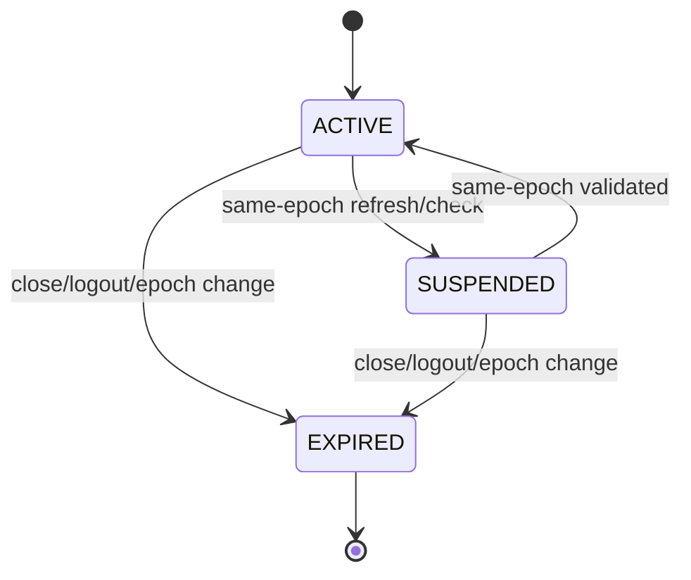
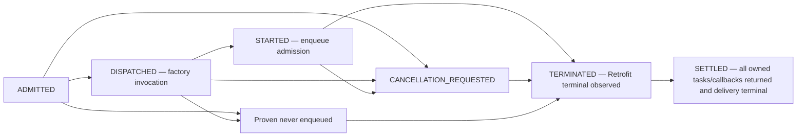

# Phase 2A — Groups lifecycle hardening report

Ngày25/11/2026 (Asia/Saigon). Owner: Hoàng Phúc — TV3.
**Verdict: IMPLEMENTATION PARTIALLY VERIFIED.** Android JVM/backend verified; instrumentation compiled but NOT executed (no online device), real Auth/Home/Chat integration absent. GROUP-01 is NOT production-ready. PR6 stays Draft, never merge.

## 1. Baseline, authorization and initial findings
- Branch: feature/group-01-create-group.
- Starting HEAD/remote PR6 HEAD: `d2141e2560d8d6ba198942c944a69a963c133923`; fetch showed0 ahead/0 behind; PR6 open/Draft.
- Known main: `8b730dccc171c6d55fd8ae127448ed2b6c5f23a4`. No rebase/merge-main/history rewrite.
- D01–D10 directions approved by Hoàng Phúc's Phase2A request; scope limited to TV3. Phase1 documents read and left unchanged as historical decision-preparation records.
- Initial issues: callbacks/session Supplier under Groups state lock; unbounded deferred/pending calls; Call.cancel treated as bookkeeping completion; synchronous cleanup failure escaped close/install; partial dependency preparation could leak adopted resources.
- No TV1/TV2 source, shared interfaces, API DTOs, backend source or migration changed. Backend extraction and periods/history remain separate tasks.

## 2. Files changed
Production Groups-only:
- GroupsAccountScope.java: bounded serial admission/pump, lock-free external execution, logical invalidation, async reserved cleanup and diagnostics.
- GroupsCleanup.java (new): independent bounded cleanup reservation/runtime.
- GroupsDiagnostics.java (new): bounded diagnostic tail with original recoverable cause.
- GroupsIntegration.java: adopted-resource failure cleanup, bind concrete remote repo to scope, revision/preparing guard for concurrent account install/logout.
- data/GroupRequestHandle.java (new): explicit transport/delivery states and task accounting.
- data/GroupRequestRuntime.java (new): independent bounded request runtime/watchdog.
- data/RemoteGroupRepository.java: scope binding, bounded admission, handles, close/quiescence APIs; no shared-client shutdown.
- ui/GroupsActivity.java: navigation through current-scope serial dispatch with Activity validity check.
- viewmodel/GroupsViewModel.java: expired-scope getters/stale state guards; bounded request rejection exits busy with retryable draft retained.

Tests:
- GroupsAccountScopeTest, GroupsIntegrationTest, GroupsViewModelTest, RemoteGroupRepositoryTest updated for authorized behavior.
- GroupsLifecycleHardeningTest (new), data/GroupRequestLifecycleTest (new).
- androidTest GroupsFlowTest waits on background cleanup handoff before UI-idle assertions; assertions retained, no claims runtime passed.

Docs: this report; PHASE2A_MEMBERSHIP_POLICY.md; PHASE2A_BACKEND_MANIFEST.md; appended evidence to PROJECT_14_DAY_CHECKLIST.md. Four untracked Phase1 docs from the previous task are deliberately not staged in this implementation commit.

## 3. Design decisions / compatibility
Keep GroupRepository, PeopleDirectory and GroupsIntegration.ChatNavigator signatures unchanged. No dependency on TV1/TV2 internal classes. New APIs are concrete TV3 implementation/diagnostics, not a new shared lifecycle contract.

A scope is a one-way account resource boundary: ACTIVE↔SUSPENDED for same UUID/epoch; EXPIRED/closed is terminal. Supplier is latest-state projection supplied by TV1, not an authentication source. Factory must provide a prompt, thread-safe projection and main-thread nonblocking UI handoff. Groups never calls Auth logout/refresh or changes session identity.

runIfCurrent retains its signature as **nonwaiting immediate admission**; returns false when another callback is running or queued. Reentrant callers use dispatch instead of recursively bypassing serialization. Chat navigation now uses dispatch; already-running action is not forcibly stopped. getState/diagnostics are not server authorization.

Production RemoteGroupRepository(api) requires binding before dispatch (automatic in GroupsIntegration.Dependencies; also constructor(api,scope)). Missing scope fails before API factory/transport. Scope cannot be rebound to another account; no fabricated User UUID. Package-local injected runtime constructor supports isolated deterministic transport tests only; those handles may have null identity, never establish authentication.

Factories retain responsibility for **unadopted allocations** if ownership reservation is rejected. Adopted resources always close on initialization failure. This is explicit preparation failure, not swallowed cleanup failure; TV1's PR13 factory/partial-allocation recovery policy still required.

## 4. State machine and accounting



Request transport and result settlement are orthogonal:



Delivery: PENDING→CLAIMED→RESULT_DELIVERED, or PENDING→SUPPRESSED. CANCEL/timeout and transport terminal choose one outcome under the request lock before scheduling external work. Duplicate terminal callbacks cannot schedule a second result/release. A result already claimed may finish; scope/VM protects new-account state.

STARTED is an enqueue permission claim, **not invented socket-start telemetry**. TERMINATED means terminal callback observed or proof call never enqueued; it is not proof shared OkHttp thread pool/TCP connection closed. SETTLED additionally charges dispatch/factory/enqueue, cancel invocation, terminal callback and actual result callback completion (including suspended UI handoff). Physical cancellation remains asynchronous. Shared OkHttp resources remain alive by design.

## 5. Locking and callback dispatch
- Groups state lock protects closed flag, FIFO admission, one drain claim, small listener/resource registries. No Supplier, navigation, observer, repository/result callback, executor.execute or arbitrary resource.close runs under that lock.
- Single normal drain on supplied UI executor serializes lifecycle-sensitive callbacks even if an executor has multiple workers; only one normal drain/action admitted at a time. Latest access is checked at execution, not solely when queued.
- close linearizes closed=true and clears pending admission before returning. Already-claimed action may finish; no new claim succeeds afterward. A long action or Supplier cannot hold this state lock and delay logical close.
- sessionChanged coalesces access notification; suspended result FIFO remains bounded, resume drains it without clearing valid draft/retry state.
- Closed notifications use reserved background handoff so an inline executor/observer cannot block the close caller. Production UI notifications still require TV1's main-thread serial executor; background diagnostics wait is NOT UI idle.
- GroupsIntegration invalidates both published and preparing scopes before newer publication. Supplier evaluation is outside integration monitor. Obsolete preparation cannot publish after logout or account B.
- Lifecycle methods do not wait for arbitrary external work. An external callback that itself blocks Android UI still blocks that callback's thread; no claim of forcibly interrupting arbitrary navigation/UI code.

## 6. Capacity limits and rationale
| Resource | Limit | Rationale / exhaustion behavior |
|---|---:|---|
| Normal/deferred scope callbacks |32 total (not32 per executor queue) | VM has one busy operation; repo max16 in-flight, leaving headroom for directory/normal UI work. One pump posted, not one unbounded executor task per result. tryDispatch false+diagnostic; legacy void dispatch overload closes only Groups scope fail-closed so VM cannot remain silently busy. |
| Scope-owned cleanup resources |8 lifetime registrations | Current dependencies use Groups repo, directory and concrete repo scope ownership (idempotent duplicate close), leaving headroom; exceeding throws before adoption. |
| Access/closed listeners |16 each; closed late registrations also bounded | Current Activity+VM need few. Closed notifications reserve cleanup capacity when registered; normal callback saturation cannot discard them. |
| Shared Groups cleanup |2 daemon workers;128 total reserved/running/queued jobs | Slot reserved before ownership; submit never replaces work with an unbounded queue or inline cleanup. Blocked resources remain charged. Overload is explicit exception+diagnostic before ownership transfer. |
| Per-repository requests |16 including retiring/unknown | Far above single busy VM yet bounds multi-surface use; reject synchronously with RejectedExecutionException before factory. VM shows REQUEST_CAPACITY, keeps draft/key. |
| Global Groups requests |64 live/retiring | Bounds repeated account replacement, not only each repo. Old unacknowledged transport consumes capacity until actual terminal+settlement. |
| Request workers |2 independent workers;256 bounded queue | At most dispatch+cancel+result task per handle =192 tasks for64 live requests. No per-request worker and no Messaging worker reuse. |
| Watchdog |1 daemon, one periodic job, bounded64-handle snapshot | No scheduled future per request/unbounded timer queue. |
| Diagnostics |32 retained events +total count per object | Original RuntimeException retained for diagnosis; no token/request payload logging. |

These are implementation safety budgets based on current call sites, not promises of production throughput; tune only with owner review/evidence. No normal-overload path silently drops cleanup. Cleanup ownership admission can reject before transfer; host factory must reclaim its own unadopted objects using its bounded preparation policy.

## 7. Request lifecycle, timeout and shutdown
Concrete execute returns GroupRequestHandle; requests() supplies live handles for diagnostics/cancellation. GroupRepository void methods delegate without signature change. Factory/Retrofit calls execute outside state locks and off UI on Groups workers. Success/failure is handed through bound scope admission; same-epoch suspension defers completion, expiry suppresses it. Explicit cancellation suppresses not-yet-claimed results; callbacks already claimed may finish against old objects.

Request deadline30s starts at admission and also configures Call timeout. Watchdog timeout selects REQUEST_TIMEOUT once, requests cancellation asynchronously and retains unknown physical work. Shutdown deadline5s after cancellation records SHUTDOWN_DEADLINE_TERMINATION_UNKNOWN once. **Deadline does not release/fake termination**; stalled transport remains bounded/quarantined and rejects further admission when budget exhausted. No busy-loop retry, replacement thread explosion or shared-client/dispatcher shutdown.

close marks repository closed, snapshots up to16 handles, requests their cancellation; never joins UI or calls Call.cancel inline. awaitTermination is background/test-only and returns false on deadline with outstanding work still charged. Call.cancel returning or a Future being cancelled is not physical termination evidence and does not roll back server transactions. Terminal callbacks, even cancelled/late/duplicate, settle accounting exactly once. Timeout/response races tested with atomic result selection.

## 8. Cleanup failure isolation
Logical invalidation precedes physical jobs. Each adopted resource is a separately reserved job, so one recoverable exception does not skip others. All RuntimeExceptions are captured with code/cause; repeated close does not repeat jobs. No catch-and-ignore or blanket Throwable suppression; fatal JVM/assertion failures are not silently swallowed.

GroupsAccountScope.close and GroupsIntegration replacement do not propagate recoverable cleanup/notification callback failure into SessionCoordinator. The original TV2-R13-01 remains TV1-owned for factory/obsolete/old/inline hook failure policy; it is NOT fixed by this PR. Factory admission/validation exceptions are distinct and still reported to preparing owner.

awaitCleanup observes registered cleanup completion/UI-handoff only; must not be called from UI/coordinator, is not a transport termination guarantee and cannot force an external job to stop. Production factory must reserve/adopt responsibly; cleanup capacity rejection never pretends adoption succeeded.

## 9. Membership and backend policy boundary
See [membership policy](PHASE2A_MEMBERSHIP_POLICY.md). Existing active-member metadata/OWNER-only invite/atomic accept/idempotent create remains tested. Pending invitation grants no history. Rejoin/period/latest-period history, role/remove/leave/message/attachment revoke are not implemented: require approved shared schema/TV2 contract and separate migration task. Disband/succession/ADMIN escalation/retention/attachment-after-removal remain OPEN, not invented.

See [baseline manifest](PHASE2A_BACKEND_MANIFEST.md). V1 and all backend source unchanged; shared/prod migration state unknown. Only Testcontainers execution verified. No extraction, second backend or global SecurityFilterChain move.

## 10. Tests and evidence

Environment: Windows PowerShell; JDK21 launcher/Maven, Gradle wrapper9.6.0 with project JVM toolchain25, Android Java11 compatibility, SDK37.0/minSdk26; Maven3.9.11; Docker29.4.3; PostgreSQL16-alpine Testcontainers. No online adb device. Commands use JAVA_HOME=C:/Program Files/Java/jdk-21 and ANDROID_HOME=C:/Users/Phuc/AppData/Local/Android/Sdk.

| Check | Exact command / exit | Actual result | Report |
|---|---|---|---|
| Android debug/JVM/test APK | gradlew.bat :app:assembleDebug :app:testDebugUnitTest :app:assembleDebugAndroidTest --rerun-tasks --no-build-cache ; exit0 | Build PASS; **73 JVM /9 XML,73 passed,0 failures/errors/skips**; instrumentation APK compile PASS only | app/build/test-results/testDebugUnitTest/; app/build/reports/tests/testDebugUnitTest/index.html; external D:/Nexa-Chat/test-artifacts/phase2a-android.log |
| Backend | mvn -B verify ; exit0 | **25/25 PASS,0 failures/errors/skips**,12 service +13 PostgreSQL actual | backend/target/surefire-reports/; external D:/Nexa-Chat/test-artifacts/phase2a-backend.log |
| Flyway (within same Maven run) | Boot Flyway validation/migrate on Testcontainers | validate1 migration and apply V1 PASS; not shared DB validation | Same backend log |
| Instrumentation runtime | adb devices ; exit0 | No online device; connectedDebugAndroidTest **NOT RUN**;0 executed, no PASS claimed | adb inventory observed; existing API37 historical review not substituted |
| Ownership/whitespace | git diff --check ; exit0; path review | Only Groups source/tests/docs +explicit checklist update | Complete staged diff reviewed before commit |
| Migration preservation | git hash-object V1 vs HEAD:V1 | Both03e3057ee5c6bbaaf0696ed271767991c205eb8c | No migration/backend diff |

JUnit breakdown: Scope9; Integration7; LifecycleHardening11; RequestLifecycle20; RemoteRepository6; ViewModel13 =**66 Groups**, plus7 baseline (Example1/Phone4/Home2) =73. Starting branch37 total; **36 additional cases**, not the sum of reruns. Existing cases retained; expectations about synchronous close/throw were replaced with stronger async completion/diagnostic/nonblocking assertions according to new authorized behavior. No failing test deleted/assertion bypassed.

Coverage: reentry/parallel dispatch, close-before-queue/stale epoch/account switch, long action and blocked Supplier/cleanup, exceptions/multiple failures, callback saturation/resume, rejected executor, partial dependency validation, candidate initialization/logout races; request capacity/global capacity/concurrent admission, pre/post dispatch cancellation, late/duplicate success/failure, cancellation failure, timeout/deadline, timeout-vs-terminal race, synchronous callback+enqueue throw, suspended handoff and exactly-once accounting. Race iterations remain one JUnit case. SDK-path setup failure and intermediate regression failures were corrected; table records final successful run only, logs point to that final run.

## 11. Remaining blockers / limits
- Instrumentation runtime/rotation/API compatibility remains unverified for this revision. Existing GroupsFlowTest now awaits background handoff off UI before its assertions, but compilation is not execution.
- No real Auth/JWT/credential/directory, authenticated Home mount, ChatNavigator adapter or two-account E2E. No GROUP-01 production-ready claim.
- Retained unknown transport is intentionally bounded, not forcibly killed. A malicious/broken external Call/Supplier/cleanup can consume its budget or worker until it returns; diagnostics expose it and new admission rejects. No guarantee arbitrary external code terminates.
- TV1 factory recovery for unadopted allocation/cleanup admission and PR13 resource-hook policy still needs official review; no TV1 file changed.
- Schema/period/history/GROUP-02/Message/WS/media and shared DB migration evidence not supplied; baseline extraction remains separate.
- This is self-verification, not independent official GitHub approval.

## 12. TV1/TV2 integration requirements and Git delivery
TV1: main-thread prompt executor/latest atomic UUID+epoch projection, invalidate old scope before new access; real credentialed Retrofit/directory; optional module-unavailable/retry policy; factory owns partial unadopted allocations and handles capacity rejection; PR13 TV2-R13-01 fix/re-review. No awaitCleanup/awaitTermination on UI or observer. Physical cleanup errors are diagnostics, not Auth logout.

TV2: existing Groups ChatNavigator(Activity, conversationId) remains unchanged; supply host adapter to current Messaging entry point. No TV2 runtime/workers or wire DTO changed. Conversation UUID/period/history/sequence/read/replay/server ACL contracts still coordinated before GROUP-02/schema work.

Git delivery: normal Conventional Commit `fix(groups): harden account lifecycle and request cancellation` on feature/group-01-create-group; normal non-force push to configured origin; final commit SHA/remote PR6 HEAD verified in final execution report. This file belongs to that implementation commit (resolve via git log -- docs/group-01/PHASE2A_LIFECYCLE_REPORT.md). PR6 remains Draft; no merge/rebase/force push. Initial pre-existing Phase1 untracked docs not included in implementation staging; checklist is included because explicitly updated by this task.

Next milestone: independent review of TV3 hardening +actual device lifecycle suite, in parallel with TV1 recovery/provider and TV2 shared contract work. No automatic backend extraction or new shared interfaces authorized by this report.


## 13. Phase 2A.1 — Independent lifecycle review and instrumentation

**Date:** 25/11/2026, Asia/Saigon. **Latest phase verdict: VERIFIED**, within the requested Groups lifecycle, deterministic concurrency and fixture instrumentation scope. This does not change the historical Phase2A verdict above, approve PR6, freeze cross-team contracts, authorize Phase2B or establish GROUP-01 production readiness.

### 13.1 Baseline, branch and review scope
- Expected and actually reviewed baseline: `45c90a7e5be28332ace723ba9789af01a52fd9c7`.
- Branch: `feature/group-01-create-group`; pre-edit fetch showed0 ahead/0 behind, PR6 open/Draft at that exact SHA. No concurrent changes to the target branch were found at preflight. A separate TV1 documentation branch was discovered and read, never merged.
- Untracked Phase1 documents from earlier work were inspected and left untouched/outside this commit. Existing checklist, backend manifest and membership policy were read; their historical results were not rewritten.
- This is a fresh source/fault-injection review by the implementation agent, not an official independent teammate approval. PR6 had no official reviews at review time. Exact delivery SHA, remote SHA and PR HEAD are verified after the normal commit/push in the final execution response.
- Runtime/source reviewed: GroupsAccountScope, GroupsCleanup, GroupsDiagnostics, GroupsIntegration, GroupRequestHandle, GroupRequestRuntime, RemoteGroupRepository, GroupsActivity, GroupsViewModel and their JVM/instrumentation tests.

### 13.2 Architecture and ownership alignment
Preserve one backend, shared Conversation UUID/Message pipeline, least privilege and explicit period/history boundaries. User UUID, server JWT sid and local sessionEpoch remain distinct; Groups uses only the supplied user UUID/local epoch and does not parse sid, refresh JWT or fabricate a new epoch on credential refresh.

TV1 remains owner of Auth/Session/CredentialProvider/principal/security/shared HTTP/composition root/Home/cross-module navigation. TV2 remains owner of Messaging runtime/router/presentation/wire/sequence/replay/receipts/history. No source or shared interface owned by either was changed; no duplicate GROUP transport was added.

**D08 is not established/frozen by this review packet.** Earlier Phase2A wording above is retained as history. The migration constraint in this run comes directly from the Phase2A.1 instruction: no backend/schema/Flyway edits. Do not infer a complete D08 ADR or approval. V1 Git blob remains `03e3057ee5c6bbaaf0696ed271767991c205eb8c`.

### 13.3 Findings — confirmed versus unconfirmed
Severity below is engineering priority, not a security exploit/CVSS assessment.

| ID / priority | Exact source and baseline behavior | Confirmation and resolution |
|---|---|---|
| G21-R01 P1 | app/src/main/java/com/nexa/chat/feature/groups/data/GroupRequestHandle.java, submitRegistered baseline335–359: only state==ADMITTED was treated as never started | Deterministic dispatch-rejection-after-cancel left CANCELLATION_REQUESTED/inFlight1 with no enqueued call. Fixed with task kind and an execution/rejection ticket; proven rejected DISPATCH terminates even after cancel/timeout changed request state. Exactly-once account/global recovery tested. |
| G21-R02 P2 | Same method: generic rejection suppressed any PENDING delivery, including rejection of CANCEL or DISPATCH after a timeout result was selected | Two baseline regressions lost REQUEST_TIMEOUT. CANCEL rejection now preserves the selected result and unknown physical work; DISPATCH rejection preserves already selected timeout. RESULT rejection is explicitly suppressed with retained Outcome and category diagnostic, never inline callback fallback. |
| G21-R03 P1 | app/src/main/java/com/nexa/chat/feature/groups/GroupsCleanup.java work/reserve; GroupsAccountScope.listen: terminal UI handoff used the physical cleanup queue | Baseline latch test occupied both physical workers; unrelated closed notification could not run. Fixed separate bounded physical and terminal-UI lanes; same test now passes while physical cleanup remains blocked. No arbitrary work under scope lock or UI join. |
| G21-R04 P2 | GroupRequestHandle.requestCancel baseline270: early return when cancellation was already requested by watchdog | Source-confirmed explicit cancel could not withdraw a queued timeout notification. Explicit cancel now suppresses any not-yet-claimed result independently of whether physical cancellation was already requested; timeout outcome remains observable. New deterministic test verifies suppression and continued physical accounting. No separate baseline failed-run claim for this new case. |
| G21-R05 P2 | app/src/main/java/com/nexa/chat/feature/groups/ui/GroupsActivity.java onCreate/onAccessChanged; viewmodel/GroupsViewModel.java load | Opening while SUSPENDED refused the first load, but recovery only rendered an empty view. Added ensureInitialLoad after authorized same-epoch recovery; VM guard prevents refresh reload storms or draft/retry loss. Verified with new JVM and actual UI cases. |
| G21-T01 P2 test defects | app/src/androidTest/java/com/nexa/chat/feature/groups/GroupsFlowTest.java refresh/logout/late response cases | Actual stable-device run exposed an ambiguous dialog-title matcher (same text as a background button) and two premature DESTROYED assertions after UI handoff. Added positive-control dialog ID+text matcher and bounded ON_DESTROY observation. Kept dialog disappearance, hidden private input and exact DESTROYED assertions; no sleep/reduced expectation/skipped case. Final full suite passes. |
| G21-H01 hardening | GroupsIntegration.Dependencies and RemoteGroupRepository.bindScope both registered close for the same repository | Redundant adoption confirmed; Remote.close was already idempotent, so no duplicate harmful side effect was established. Added identity-keyed resource adoption, capped at8 distinct objects, including late registration after closure; repeated same object consumes one reservation/close. |

Baseline fault evidence, before runtime fixes: rejection suite6 cases,3 failed; blocked-cleanup UI test1 case,1 failed. Logs/XML preserved outside Git:
- `D:/Nexa-Chat/test-artifacts/phase2a1-baseline-rejection.log` and `phase2a1-baseline-rejection-xml/`.
- `D:/Nexa-Chat/test-artifacts/phase2a1-baseline-cleanup.log` and `phase2a1-baseline-cleanup-xml/`.

No reproduced cross-account data exposure, fabricated server rollback, shared-client shutdown or newly confirmed backend defect. Actual production transport admission/JWT/directory/WS/history integration remains unverified, not implicitly approved because the fixture suite passes.

### 13.4 Request state machine and executor policy
Transport states remain ADMITTED→DISPATCHED→STARTED, optional CANCELLATION_REQUESTED, TERMINATED, SETTLED. STARTED is enqueue admission, not invented socket-start telemetry. TERMINATED requires Retrofit terminal callback or proof the call was never enqueued. SETTLED additionally requires all owned invocations/results to return or be suppressed. Unknown physical work stays charged through timeout/shutdown deadline.

Every owned submitted task now has:
- **Kind:** DISPATCH, CANCEL or RESULT.
- **Ticket phase:** WAITING→RUNNING→RETURNED, or WAITING→REJECTED, selected with CAS. A rejected ticket cannot execute late even if an unusual executor queued before throwing. An inline execution followed by executor exception cannot decrement accounting a second time.
- **Selected outcome:** NONE/RESPONSE/START_FAILED/DISPATCH_REJECTED/TIMEOUT. RESPONSE represents a transport terminal result, including network failure; this is feature diagnostics, not a new wire DTO.

| Failure category | Policy |
|---|---|
| DISPATCH rejected before execution | Ticket proves never enqueued regardless current request state; transition TERMINATED, preserve selected timeout/explicit suppression; otherwise select REQUEST_DISPATCH_REJECTED through a bounded RESULT task. |
| CANCEL task rejected after start | Record CANCEL_EXECUTOR_REJECTED; do not fabricate termination or discard selected timeout; retain capacity until terminal/settlement. |
| RESULT task rejected | Suppress exactly once; retain selected Outcome and RESULT_EXECUTOR_REJECTED diagnostic; timeout also records TIMEOUT_RESULT_EXECUTOR_REJECTED. No inline external callback fallback. |
| Executor throws after a task claimed execution | Record kind-specific EXECUTOR_FAILURE_AFTER_START; wrapper alone owns return accounting. |
| Queue-then-throw before execution | Rejection wins the ticket; a later wrapper invocation is a no-op, never a second factory/transport call. |
| Explicit caller cancel after timeout selection | Withdraw only unclaimed delivery; keep timeout outcome/unknown transport ownership; already-claimed callback may finish. |

Callbacks are initialized before global publication of the request, avoiding a watchdog publication gap. Account invalidation still rechecks latest scope/result ownership. This does not implement TV1's shared credential/actual-I/O admission gate.

### 13.5 Concurrency regression matrix

| Scenario | Deterministic evidence | Result |
|---|---|---|
| ADMITTED dispatch reject | GroupRequestRejectionTest.admittedDispatchRejectionSettlesAndRecoversAccountCapacity | PASS |
| Dispatch reject vs explicit cancel | dispatchRejectionAfterExplicitCancelDoesNotLeak; cancellation occurs while execute is gated by latches | PASS |
| Dispatch reject vs timeout | dispatchRejectionPreservesAlreadySelectedTimeout; fake clock and controlled executor | PASS |
| Cancel reject with timeout selected | rejectedCancelDoesNotDiscardTimeoutOrFabricateTermination | PASS |
| Explicit cancel reject after start | explicitCancellationTaskRejectionRetainsUnknownTransport | PASS |
| Result reject after terminal | rejectedResultAfterTerminalSuppressesWithoutDuplicateDelivery | PASS |
| Timeout result itself rejected | rejectedTimeoutResultRemainsObservableWithoutInlineFallback | PASS |
| Inline execution then throw | executorRunsInlineThenThrowsCannotDoubleReleaseOrFabricateTermination, inlineResultThenExecutorThrowDoesNotDeliverTwice, inlineCancelThenExecutorThrowStillNeedsTransportTerminal | PASS |
| Queued rejected wrapper runs late | queuedThenRejectedDispatchCannotExecuteLateFactory | PASS |
| Per-account/global leak and recovery | allSubmissionsRejectedNeverLeaksAccountCapacity; cancelledRejectedDispatchesReleaseGlobalCapacityExactlyOnce, then all64 global slots admitted and overflow rejected | PASS |
| Explicit cancel withdraws queued timeout | explicitCancelWithdrawsQueuedTimeoutButRetainsUnknownPhysicalWork | PASS |
| Timeout/terminal race; duplicate callbacks; late success | Existing GroupRequestLifecycleTest cases preserved | PASS |
| Blocked physical cleanup vs terminal UI | GroupsLifecycleHardeningTest.closedNotificationDoesNotWaitBehindBlockedPhysicalCleanup | PASS |
| Identity adoption/late ownership | resourceIdentityIsAdoptedOnceBeforeAndAfterClosure; newResourceAfterClosureIsDisposedAndDeduplicated | PASS |
| Both cleanup lane capacities/recovery | GroupsCleanupCapacityTest reserves128, rejects129th, settles once and recovers on each lane; cancelled unsubmitted job never runs | PASS |
| Initial CHECKING recovery | GroupsViewModelTest.firstLoadWaitsForSameEpochRecoveryAndIsNotRepeatedByRefresh +actual UI equivalent | PASS |

JVM concurrency tests use fake clocks, controlled executors/latches and finite event waits; no new arbitrary sleeps prove concurrency. Loops/reruns are not independent extra test cases.

### 13.6 Account/session/capacity results
- Same-epoch ACTIVE↔SUSPENDED preserves valid draft/retry and defers delivery. Initial opening while SUSPENDED admits zero protected list calls; first ACTIVE loads once, further refresh does not reinitialize it.
- Closed/EXPIRED never reactivates; old UUID/epoch callbacks remain fenced. JVM replacement uses distinct UUIDs; UI new-epoch fixture covers same-user new epoch. These are not real authenticated A/B E2E.
- Account A is invalidated before B publishes; stale preparing candidate cannot publish after logout. Activity recreation/unmount does not close the account-owned repository or independently log out the session.
- Requests:16 per repository,64 global live/retiring,2 request workers, bounded256 work queue, one periodic watchdog. Retired/unknown calls continue to consume capacity; cancel/deadline never manufactures termination.
- Scope:32 normal/deferred callbacks;8 distinct owned resources;16 listeners per kind, bounded late closure registrations.
- **Updated cleanup bound:**2 physical workers +1 independent terminal-UI handoff worker; each lane has128 reserved/queued/running slots,256 combined. This explicitly replaces the historical Phase2A shared128-job lane for this revision. Total dedicated production Groups background workers=6 (2 request+1 watchdog+2 physical cleanup+1 terminal handoff), excluding shared Android UI/HTTP threads.
- Keyed adoption prevents duplicate repo close registrations from consuming resources twice. Late new resource adoption schedules disposal; same object is closed once.
- Host UI executor must hand off promptly onto Android main thread. An inline blocking observer can block its own lane/thread; no claim arbitrary user code can be forcibly stopped. No shared OkHttp dispatcher or Messaging executor is shut down.

### 13.7 Android device and actual execution
**Online device:** emulator-5580; model sdk_gphone64_x86_64; API37; Android17; configured AVD Group01_Scope_API37. Final run used1536MiB RAM,2 cores, software GPU, Vulkan disabled,1080×2400,density420,gesture navigation2. Device /data:6,082,144KiB total,4,089,736KiB available after testing. Variant debug; runner `com.nexa.chat.test/androidx.test.runner.AndroidJUnitRunner`, target `com.nexa.chat`.

Only existing configured AVD was used. All launches read-only/no-snapshot/no-window/no-audio; no wipe, AVD deletion or global SDK configuration change. Guest animation scales set0 in the disposable overlay. The task-owned emulator was shut down after evidence capture; original AVD user data preserved.

Execution history is deliberately retained:
1. Initial1536MiB startup under severe host memory pressure failed allocating guest RAM. Retry1024MiB reached device/boot_completed1.
2. First full run **FAIL:11 tests,1 passed,10 failed,0 errors/skips**, exit1,9m57s. Every failure was RootViewWithoutFocusException; captured window focus identified launcher/SystemUI ANR dialogs covering Groups. XML/logs/screenshot preserved in `phase2a1-instrumentation-first/` and `phase2a1-screen.png`. Not presented as PASS.
3. Stopped the now-idle build daemon/task-owned emulator, used bounded per-command Gradle heap/worker options and restarted the existing AVD read-only at1536MiB after resources recovered. No unrelated host user applications were closed; guest launcher ANR was cleared in the disposable overlay. No test expectations were relaxed. Temporary attempt to stop unused Docker test service did not provide reliable immediate memory recovery; Docker API was later confirmed available29.4.3 and backend verify executed successfully.
4. Second full run on stable device **FAIL:13 tests,10 passed,3 failed,0 errors/skips**, exit1,2m46s. These were G21-T01 dialog matcher/destruction observation issues, not ANR failures. Preserved `phase2a1-instrumentation-second/results.xml`, command.log and raw logs.
5. After correcting those test observations, final full run **PASS:13/13,0 failures/errors/skips**, exit0,1m46s: **10 GroupsFlowTest +2 HomeFragmentTest +1 ExampleInstrumentedTest**. No class/method filter or skipped tests. Final XML and raw logs copied to `phase2a1-instrumentation-passed/`.

The13 are unique cases in the final suite, not the sum of all executions. Existing8 Groups cases retained;2 added (initial suspension recovery and unmount/recreation ownership). Dialog absence now has a positive control and specific alertTitle+text matcher. Logout/late-response tests still require DESTROYED, but observe ON_DESTROY before checking state rather than equating UI idle with lifecycle completion.

Fixture limitation: GroupsFlowTest uses test-only GroupsRepository/PeopleDirectory. PASS proves UI/account-lifecycle behavior under those fixtures. It does **not** prove real TV1 Auth/credential refresh/directory, production Retrofit cancellation/physical termination, TV2 WS or production GROUP messaging. API26–36/alternate hardware/nav configurations remain unverified.

### 13.8 Reproducible commands, exits and reports
PowerShell environment: JAVA_HOME=`C:/Program Files/Java/jdk-21`; ANDROID_HOME=`C:/Users/Phuc/AppData/Local/Android/Sdk`; ANDROID_SERIAL=`emulator-5580`. Gradle9.6.0/project toolchain25, Java11 Android compatibility, SDK37.0; Maven3.9.11/Java21; Docker29.4.3/PostgreSQL16-alpine.

Final commands (heap/worker overrides apply only to those invocations, no project/global config edited):
```powershell
.\gradlew.bat :app:assembleDebug :app:testDebugUnitTest :app:assembleDebugAndroidTest --rerun-tasks --no-build-cache --no-daemon --max-workers=2 "-Dorg.gradle.jvmargs=-Xmx768m -XX:MaxMetaspaceSize=384m -Dfile.encoding=UTF-8"
.\gradlew.bat :app:connectedDebugAndroidTest --no-build-cache --no-daemon --max-workers=2 "-Dorg.gradle.jvmargs=-Xmx512m -XX:MaxMetaspaceSize=384m -Dfile.encoding=UTF-8"
# From backend/, after task emulator shutdown:
mvn -B verify
```

| Check | Exit/status | Counts | Evidence location |
|---|---|---|---|
| Final Android build/JVM/instrumentation APK |0/PASS |93 JVM,93 passed,0 failures/errors/skips;11 XML; test APK compile PASS | app/build/test-results/testDebugUnitTest/; external phase2a1-android-final.log |
| Final connected instrumentation |0/PASS |13 passed,0 failures/errors/skips; Groups10/Home2/Example1 | app/build/outputs/androidTest-results/connected/debug/TEST-Group01_Scope_API37(AVD) - 17.xml; app/build/reports/androidTests/connected/debug/index.html; external phase2a1-instrumentation-final.log and phase2a1-instrumentation-passed/ |
| Backend regression |0/PASS |25 passed,0 failures/errors/skips =12 service +13 actual PostgreSQL tests | backend/target/surefire-reports/; external phase2a1-backend.log; complete13:27:37+07 |
| Flyway test DB validate/migrate |PASS within Maven |1 validated/applied V1; not a shared/prod DB check | Same Maven log |
| Baseline fault reproductions |1/FAIL expected |3/6 rejection regressions failed;1/1 starvation regression failed before fixes | Preserved baseline logs/XML above |
| Device inventory |0/PASS |serial/model/API/version/storage collected; boot_completed1 | adb devices -l /shell getprop /df /wm commands observed |
| Ownership, whitespace and staging checks |PASS before delivery |Only confirmed Groups source/tests and this report; no secrets/generated artifacts | Complete diff/path/secret-pattern review and git diff --check |

External artifact prefix: `D:/Nexa-Chat/test-artifacts/`. No APK/XML/log/AVD artifacts committed. JVM93 =86 Groups +7 branch baseline;20 new JVM cases compared with Phase2A73, not repeated-run inflation.

Tested APK SHA256:
- app-debug.apk: `69E9BB0728D900FB740C789843A4F43DF9F707DD647FDAB68A1C6B8493D24339`.
- app-debug-androidTest.apk: `5359DB5DFD926209397A0500E5025EDEA182A52D0275C5D58E99294A44F0AE43`.

### 13.9 Files and delivery scope
Modified Groups production: GroupsAccountScope.java, GroupsCleanup.java, GroupsIntegration.java, data/GroupRequestHandle.java, data/RemoteGroupRepository.java, ui/GroupsActivity.java, viewmodel/GroupsViewModel.java.
Modified tests: GroupsLifecycleHardeningTest.java, GroupsViewModelTest.java, androidTest/GroupsFlowTest.java.
Added tests: GroupsCleanupCapacityTest.java, data/GroupRequestRejectionTest.java.
Documentation: append this section only. GroupRequestRuntime/GroupsDiagnostics reviewed but unchanged. No shared GroupRepository/PeopleDirectory/GroupApi/model signatures changed; no MainActivity/Home/Auth/Session/Message/backend/migration/build-config edits.

Normal commit/push targets feature/group-01-create-group; suggested message `fix(groups): harden lifecycle rejection and verify Android instrumentation`. Local/remote/PR6 HEAD must match; PR6 stays Draft/unmerged. No reset/clean/rebase/merge-main/force-push. Exact final commit is reported after delivery; resolve this section's implementation commit via git log -- docs/group-01/PHASE2A_LIFECYCLE_REPORT.md.

### 13.10 Cross-team dependencies and production-readiness limits
**TV1**
- PR13 remains `1c459c517cbfea06d1c071554a05c894157e157e`, official CHANGES_REQUESTED for [TV2-R13-01](https://github.com/datcaq/NEXA-Chat/pull/13#pullrequestreview-6050049996) at review time.
- FIX1 is a **proposed design, not implementation/approval**, in [coordinator-fix1-design.md at7d75bf8](https://github.com/datcaq/NEXA-Chat/blob/7d75bf8b919899f6487e6b8ed0b8e27a34772c11/docs/architecture/tv1/coordinator-fix1-design.md). Actual recovery/partial allocation/optional module policy remains pending.
- Final fetch discovered TV1 documentation-only commit `acf30030a549c3bf0cbb501a68e376430710beeb`. Its [Security/Transport Addendum V1](https://github.com/datcaq/NEXA-Chat/blob/acf30030a549c3bf0cbb501a68e376430710beeb/docs/architecture/tv1/security-transport-addendum-v1.md) is PROPOSED/PENDING APPROVAL and still states FIX1 design-only. It separates epoch/credential admission, cancellation/termination and candidate timeout values; no shared production gate or finalized wire contract was delivered. This review does not approve those proposals or automatically adopt their signatures/values.
- Session epoch/invalidations, real CredentialProvider/trusted principal/PeopleDirectory, composition root/Home and shared HTTP operation admission remain TV1-owned. Groups checks its latest supplied scope and suppresses stale result mutation; a snapshot read alone is not proof of atomic protected network dispatch under TV1 authority.

**TV2**
- PR9 at `ea239b9f66a153ac9f848fd089e5d4dd8b8874e4` remains Draft, no official approval record; full production Wire Contract is not frozen.
- ChatNavigator host bridge, shared Conversation UUID/Message pipeline, history vsreplay, membership-period READ/DELIVERED and GROUP authorization/event integration remain pending reviewed contracts. No implementation duplicated here.

**TV3**
- Continue Groups request/account gates/cleanup/isolation/tests within approved contracts. No membershipPeriodId/rejoin/history/cursor/event schema or retention/ADMIN/disband policy implemented or frozen.
- Unknown transport remains bounded, not forcibly terminated. Cleanup ownership rejection before adoption is still factory responsibility. Prompt UI handoff/host invalidation must be validated when real adapters arrive.
- Actual instrumented UI/rotation/suspension/logout/unmount now verified on one API37 AVD with fixtures. No real multi-account Auth/HTTP/WS E2E, shared DB migration state, media revocation, backend extraction or Phase2B authorization established.
- Independent teammate review/merge authority remains Hoàng Phúc and the team, not this agent's test verdict.

**Production assessment:** Phase2A.1 lifecycle/concurrency/instrumentation acceptance is VERIFIED. GROUP-01 production readiness is **not established**; the above integration work is outside this phase and remains explicitly pending.
