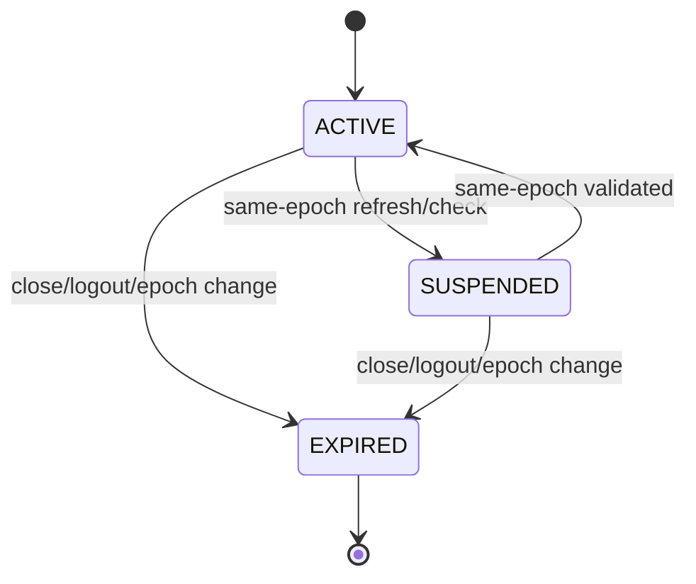
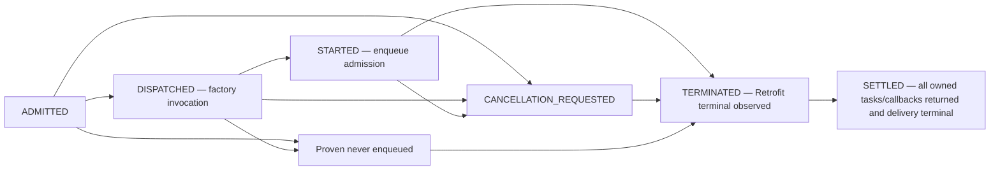

# Phase 2A — Groups lifecycle hardening report

Ngày25/11/2026 (Asia/Saigon). Owner: Hoàng Phúc — TV3.
**Verdict: IMPLEMENTATION PARTIALLY VERIFIED.** Android JVM/backend verified; instrumentation compiled but NOT executed (no online device), real Auth/Home/Chat integration absent. GROUP-01 is NOT production-ready. PR6 stays Draft, never merge.

## 1. Baseline, authorization and initial findings
- Branch: feature/group-01-create-group.
- Starting HEAD/remote PR6 HEAD: `d2141e2560d8d6ba198942c944a69a963c133923`; fetch showed0 ahead/0 behind; PR6 open/Draft.
- Known main: `8b730dccc171c6d55fd8ae127448ed2b6c5f23a4`. No rebase/merge-main/history rewrite.
- D01–D10 directions approved by Hoàng Phúc's Phase2A request; scope limited to TV3. Phase1 documents read and left unchanged as historical decision-preparation records.
- Initial issues: callbacks/session Supplier under Groups state lock; unbounded deferred/pending calls; Call.cancel treated as bookkeeping completion; synchronous cleanup failure escaped close/install; partial dependency preparation could leak adopted resources.
- No TV1/TV2 source, shared interfaces, API DTOs, backend source or migration changed. Backend extraction and periods/history remain separate tasks.

## 2. Files changed
Production Groups-only:
- GroupsAccountScope.java: bounded serial admission/pump, lock-free external execution, logical invalidation, async reserved cleanup and diagnostics.
- GroupsCleanup.java (new): independent bounded cleanup reservation/runtime.
- GroupsDiagnostics.java (new): bounded diagnostic tail with original recoverable cause.
- GroupsIntegration.java: adopted-resource failure cleanup, bind concrete remote repo to scope, revision/preparing guard for concurrent account install/logout.
- data/GroupRequestHandle.java (new): explicit transport/delivery states and task accounting.
- data/GroupRequestRuntime.java (new): independent bounded request runtime/watchdog.
- data/RemoteGroupRepository.java: scope binding, bounded admission, handles, close/quiescence APIs; no shared-client shutdown.
- ui/GroupsActivity.java: navigation through current-scope serial dispatch with Activity validity check.
- viewmodel/GroupsViewModel.java: expired-scope getters/stale state guards; bounded request rejection exits busy with retryable draft retained.

Tests:
- GroupsAccountScopeTest, GroupsIntegrationTest, GroupsViewModelTest, RemoteGroupRepositoryTest updated for authorized behavior.
- GroupsLifecycleHardeningTest (new), data/GroupRequestLifecycleTest (new).
- androidTest GroupsFlowTest waits on background cleanup handoff before UI-idle assertions; assertions retained, no claims runtime passed.

Docs: this report; PHASE2A_MEMBERSHIP_POLICY.md; PHASE2A_BACKEND_MANIFEST.md; appended evidence to PROJECT_14_DAY_CHECKLIST.md. Four untracked Phase1 docs from the previous task are deliberately not staged in this implementation commit.

## 3. Design decisions / compatibility
Keep GroupRepository, PeopleDirectory and GroupsIntegration.ChatNavigator signatures unchanged. No dependency on TV1/TV2 internal classes. New APIs are concrete TV3 implementation/diagnostics, not a new shared lifecycle contract.

A scope is a one-way account resource boundary: ACTIVE↔SUSPENDED for same UUID/epoch; EXPIRED/closed is terminal. Supplier is latest-state projection supplied by TV1, not an authentication source. Factory must provide a prompt, thread-safe projection and main-thread nonblocking UI handoff. Groups never calls Auth logout/refresh or changes session identity.

runIfCurrent retains its signature as **nonwaiting immediate admission**; returns false when another callback is running or queued. Reentrant callers use dispatch instead of recursively bypassing serialization. Chat navigation now uses dispatch; already-running action is not forcibly stopped. getState/diagnostics are not server authorization.

Production RemoteGroupRepository(api) requires binding before dispatch (automatic in GroupsIntegration.Dependencies; also constructor(api,scope)). Missing scope fails before API factory/transport. Scope cannot be rebound to another account; no fabricated User UUID. Package-local injected runtime constructor supports isolated deterministic transport tests only; those handles may have null identity, never establish authentication.

Factories retain responsibility for **unadopted allocations** if ownership reservation is rejected. Adopted resources always close on initialization failure. This is explicit preparation failure, not swallowed cleanup failure; TV1's PR13 factory/partial-allocation recovery policy still required.

## 4. State machine and accounting

Request transport and result settlement are orthogonal:

Delivery: PENDING→CLAIMED→RESULT_DELIVERED, or PENDING→SUPPRESSED. CANCEL/timeout and transport terminal choose one outcome under the request lock before scheduling external work. Duplicate terminal callbacks cannot schedule a second result/release. A result already claimed may finish; scope/VM protects new-account state.

STARTED is an enqueue permission claim, **not invented socket-start telemetry**. TERMINATED means terminal callback observed or proof call never enqueued; it is not proof shared OkHttp thread pool/TCP connection closed. SETTLED additionally charges dispatch/factory/enqueue, cancel invocation, terminal callback and actual result callback completion (including suspended UI handoff). Physical cancellation remains asynchronous. Shared OkHttp resources remain alive by design.

## 5. Locking and callback dispatch
- Groups state lock protects closed flag, FIFO admission, one drain claim, small listener/resource registries. No Supplier, navigation, observer, repository/result callback, executor.execute or arbitrary resource.close runs under that lock.
- Single normal drain on supplied UI executor serializes lifecycle-sensitive callbacks even if an executor has multiple workers; only one normal drain/action admitted at a time. Latest access is checked at execution, not solely when queued.
- close linearizes closed=true and clears pending admission before returning. Already-claimed action may finish; no new claim succeeds afterward. A long action or Supplier cannot hold this state lock and delay logical close.
- sessionChanged coalesces access notification; suspended result FIFO remains bounded, resume drains it without clearing valid draft/retry state.
- Closed notifications use reserved background handoff so an inline executor/observer cannot block the close caller. Production UI notifications still require TV1's main-thread serial executor; background diagnostics wait is NOT UI idle.
- GroupsIntegration invalidates both published and preparing scopes before newer publication. Supplier evaluation is outside integration monitor. Obsolete preparation cannot publish after logout or account B.
- Lifecycle methods do not wait for arbitrary external work. An external callback that itself blocks Android UI still blocks that callback's thread; no claim of forcibly interrupting arbitrary navigation/UI code.

## 6. Capacity limits and rationale
| Resource | Limit | Rationale / exhaustion behavior |
|---|---:|---|
| Normal/deferred scope callbacks |32 total (not32 per executor queue) | VM has one busy operation; repo max16 in-flight, leaving headroom for directory/normal UI work. One pump posted, not one unbounded executor task per result. tryDispatch false+diagnostic; legacy void dispatch overload closes only Groups scope fail-closed so VM cannot remain silently busy. |
| Scope-owned cleanup resources |8 lifetime registrations | Current dependencies use Groups repo, directory and concrete repo scope ownership (idempotent duplicate close), leaving headroom; exceeding throws before adoption. |
| Access/closed listeners |16 each; closed late registrations also bounded | Current Activity+VM need few. Closed notifications reserve cleanup capacity when registered; normal callback saturation cannot discard them. |
| Shared Groups cleanup |2 daemon workers;128 total reserved/running/queued jobs | Slot reserved before ownership; submit never replaces work with an unbounded queue or inline cleanup. Blocked resources remain charged. Overload is explicit exception+diagnostic before ownership transfer. |
| Per-repository requests |16 including retiring/unknown | Far above single busy VM yet bounds multi-surface use; reject synchronously with RejectedExecutionException before factory. VM shows REQUEST_CAPACITY, keeps draft/key. |
| Global Groups requests |64 live/retiring | Bounds repeated account replacement, not only each repo. Old unacknowledged transport consumes capacity until actual terminal+settlement. |
| Request workers |2 independent workers;256 bounded queue | At most dispatch+cancel+result task per handle =192 tasks for64 live requests. No per-request worker and no Messaging worker reuse. |
| Watchdog |1 daemon, one periodic job, bounded64-handle snapshot | No scheduled future per request/unbounded timer queue. |
| Diagnostics |32 retained events +total count per object | Original RuntimeException retained for diagnosis; no token/request payload logging. |

These are implementation safety budgets based on current call sites, not promises of production throughput; tune only with owner review/evidence. No normal-overload path silently drops cleanup. Cleanup ownership admission can reject before transfer; host factory must reclaim its own unadopted objects using its bounded preparation policy.

## 7. Request lifecycle, timeout and shutdown
Concrete execute returns GroupRequestHandle; requests() supplies live handles for diagnostics/cancellation. GroupRepository void methods delegate without signature change. Factory/Retrofit calls execute outside state locks and off UI on Groups workers. Success/failure is handed through bound scope admission; same-epoch suspension defers completion, expiry suppresses it. Explicit cancellation suppresses not-yet-claimed results; callbacks already claimed may finish against old objects.

Request deadline30s starts at admission and also configures Call timeout. Watchdog timeout selects REQUEST_TIMEOUT once, requests cancellation asynchronously and retains unknown physical work. Shutdown deadline5s after cancellation records SHUTDOWN_DEADLINE_TERMINATION_UNKNOWN once. **Deadline does not release/fake termination**; stalled transport remains bounded/quarantined and rejects further admission when budget exhausted. No busy-loop retry, replacement thread explosion or shared-client/dispatcher shutdown.

close marks repository closed, snapshots up to16 handles, requests their cancellation; never joins UI or calls Call.cancel inline. awaitTermination is background/test-only and returns false on deadline with outstanding work still charged. Call.cancel returning or a Future being cancelled is not physical termination evidence and does not roll back server transactions. Terminal callbacks, even cancelled/late/duplicate, settle accounting exactly once. Timeout/response races tested with atomic result selection.

## 8. Cleanup failure isolation
Logical invalidation precedes physical jobs. Each adopted resource is a separately reserved job, so one recoverable exception does not skip others. All RuntimeExceptions are captured with code/cause; repeated close does not repeat jobs. No catch-and-ignore or blanket Throwable suppression; fatal JVM/assertion failures are not silently swallowed.

GroupsAccountScope.close and GroupsIntegration replacement do not propagate recoverable cleanup/notification callback failure into SessionCoordinator. The original TV2-R13-01 remains TV1-owned for factory/obsolete/old/inline hook failure policy; it is NOT fixed by this PR. Factory admission/validation exceptions are distinct and still reported to preparing owner.

awaitCleanup observes registered cleanup completion/UI-handoff only; must not be called from UI/coordinator, is not a transport termination guarantee and cannot force an external job to stop. Production factory must reserve/adopt responsibly; cleanup capacity rejection never pretends adoption succeeded.

## 9. Membership and backend policy boundary
See [membership policy](PHASE2A_MEMBERSHIP_POLICY.md). Existing active-member metadata/OWNER-only invite/atomic accept/idempotent create remains tested. Pending invitation grants no history. Rejoin/period/latest-period history, role/remove/leave/message/attachment revoke are not implemented: require approved shared schema/TV2 contract and separate migration task. Disband/succession/ADMIN escalation/retention/attachment-after-removal remain OPEN, not invented.

See [baseline manifest](PHASE2A_BACKEND_MANIFEST.md). V1 and all backend source unchanged; shared/prod migration state unknown. Only Testcontainers execution verified. No extraction, second backend or global SecurityFilterChain move.

## 10. Tests and evidence

Environment: Windows PowerShell; JDK21 launcher/Maven, Gradle wrapper9.6.0 with project JVM toolchain25, Android Java11 compatibility, SDK37.0/minSdk26; Maven3.9.11; Docker29.4.3; PostgreSQL16-alpine Testcontainers. No online adb device. Commands use JAVA_HOME=C:/Program Files/Java/jdk-21 and ANDROID_HOME=C:/Users/Phuc/AppData/Local/Android/Sdk.

| Check | Exact command / exit | Actual result | Report |
|---|---|---|---|
| Android debug/JVM/test APK | gradlew.bat :app:assembleDebug :app:testDebugUnitTest :app:assembleDebugAndroidTest --rerun-tasks --no-build-cache ; exit0 | Build PASS; **73 JVM /9 XML,73 passed,0 failures/errors/skips**; instrumentation APK compile PASS only | app/build/test-results/testDebugUnitTest/; app/build/reports/tests/testDebugUnitTest/index.html; external D:/Nexa-Chat/test-artifacts/phase2a-android.log |
| Backend | mvn -B verify ; exit0 | **25/25 PASS,0 failures/errors/skips**,12 service +13 PostgreSQL actual | backend/target/surefire-reports/; external D:/Nexa-Chat/test-artifacts/phase2a-backend.log |
| Flyway (within same Maven run) | Boot Flyway validation/migrate on Testcontainers | validate1 migration and apply V1 PASS; not shared DB validation | Same backend log |
| Instrumentation runtime | adb devices ; exit0 | No online device; connectedDebugAndroidTest **NOT RUN**;0 executed, no PASS claimed | adb inventory observed; existing API37 historical review not substituted |
| Ownership/whitespace | git diff --check ; exit0; path review | Only Groups source/tests/docs +explicit checklist update | Complete staged diff reviewed before commit |
| Migration preservation | git hash-object V1 vs HEAD:V1 | Both03e3057ee5c6bbaaf0696ed271767991c205eb8c | No migration/backend diff |

JUnit breakdown: Scope9; Integration7; LifecycleHardening11; RequestLifecycle20; RemoteRepository6; ViewModel13 =**66 Groups**, plus7 baseline (Example1/Phone4/Home2) =73. Starting branch37 total; **36 additional cases**, not the sum of reruns. Existing cases retained; expectations about synchronous close/throw were replaced with stronger async completion/diagnostic/nonblocking assertions according to new authorized behavior. No failing test deleted/assertion bypassed.

Coverage: reentry/parallel dispatch, close-before-queue/stale epoch/account switch, long action and blocked Supplier/cleanup, exceptions/multiple failures, callback saturation/resume, rejected executor, partial dependency validation, candidate initialization/logout races; request capacity/global capacity/concurrent admission, pre/post dispatch cancellation, late/duplicate success/failure, cancellation failure, timeout/deadline, timeout-vs-terminal race, synchronous callback+enqueue throw, suspended handoff and exactly-once accounting. Race iterations remain one JUnit case. SDK-path setup failure and intermediate regression failures were corrected; table records final successful run only, logs point to that final run.

## 11. Remaining blockers / limits
- Instrumentation runtime/rotation/API compatibility remains unverified for this revision. Existing GroupsFlowTest now awaits background handoff off UI before its assertions, but compilation is not execution.
- No real Auth/JWT/credential/directory, authenticated Home mount, ChatNavigator adapter or two-account E2E. No GROUP-01 production-ready claim.
- Retained unknown transport is intentionally bounded, not forcibly killed. A malicious/broken external Call/Supplier/cleanup can consume its budget or worker until it returns; diagnostics expose it and new admission rejects. No guarantee arbitrary external code terminates.
- TV1 factory recovery for unadopted allocation/cleanup admission and PR13 resource-hook policy still needs official review; no TV1 file changed.
- Schema/period/history/GROUP-02/Message/WS/media and shared DB migration evidence not supplied; baseline extraction remains separate.
- This is self-verification, not independent official GitHub approval.

## 12. TV1/TV2 integration requirements and Git delivery
TV1: main-thread prompt executor/latest atomic UUID+epoch projection, invalidate old scope before new access; real credentialed Retrofit/directory; optional module-unavailable/retry policy; factory owns partial unadopted allocations and handles capacity rejection; PR13 TV2-R13-01 fix/re-review. No awaitCleanup/awaitTermination on UI or observer. Physical cleanup errors are diagnostics, not Auth logout.

TV2: existing Groups ChatNavigator(Activity, conversationId) remains unchanged; supply host adapter to current Messaging entry point. No TV2 runtime/workers or wire DTO changed. Conversation UUID/period/history/sequence/read/replay/server ACL contracts still coordinated before GROUP-02/schema work.

Git delivery: normal Conventional Commit `fix(groups): harden account lifecycle and request cancellation` on feature/group-01-create-group; normal non-force push to configured origin; final commit SHA/remote PR6 HEAD verified in final execution report. This file belongs to that implementation commit (resolve via git log -- docs/group-01/PHASE2A_LIFECYCLE_REPORT.md). PR6 remains Draft; no merge/rebase/force push. Initial pre-existing Phase1 untracked docs not included in implementation staging; checklist is included because explicitly updated by this task.

Next milestone: independent review of TV3 hardening +actual device lifecycle suite, in parallel with TV1 recovery/provider and TV2 shared contract work. No automatic backend extraction or new shared interfaces authorized by this report.
